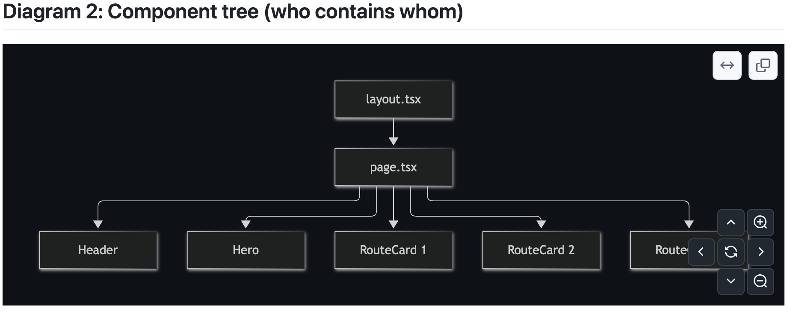

## Day-01 
#### Oct/16/2026

- created intercity app using next js 
- played with the items-center and justify-center
- set up the git -> how to change the remote 
    - first find which remote project u have your project is setupto 
      -  ``` git remote -v   ```
    - change the remote project using 
      - ``` git remote set-url origin https://github.com/pratulsharma/intercitytaxicab.git ```
- Add a CI robot 
    - it will chech the code whenever PR is open 
    - whenever the code is pushed to main or develop branch
- QA
    - what is file based routing 
        > based on the dir structure rather than path defined in some file

## Day - 02
#### Oct/16/2026 

-  create the files to display the homepage 
    - routes.ts --> a placeholder for routes 
    - RoutesCard.tsx --> to display the various different routes
    - Header --> kind of a navbar
    - Hero --> main page 
    - Page.tsx --> page that combines other components 

    
    - anywhere any type of data is defined --> we need to define the type of it
    - it could be an array, object or anything we need to define the type 
    - we need to import the type wherever this data is used. 
    - in the routecard we are going to use the Route type show the popularRoutes --> so we will import the Route type into it


