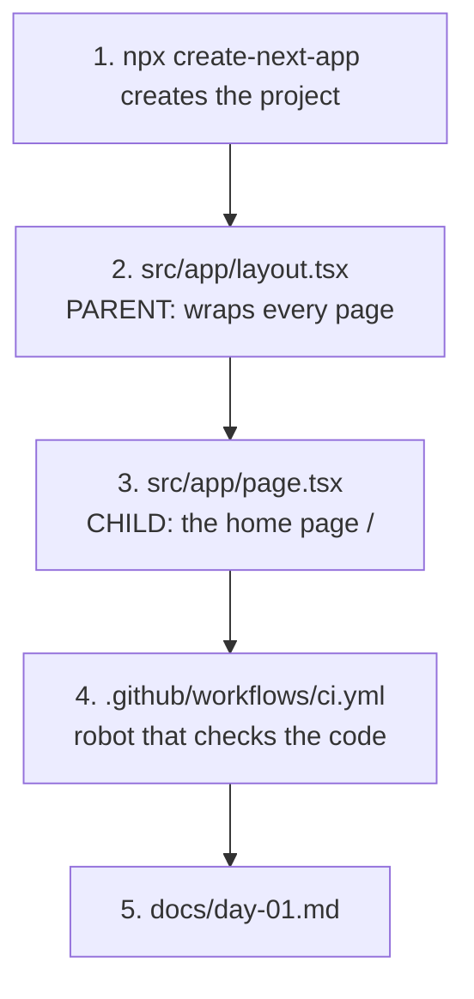
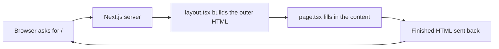
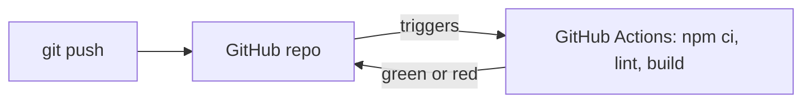
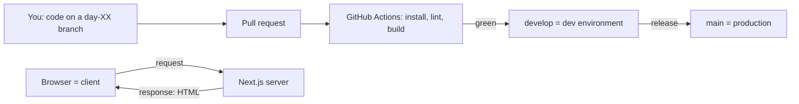

# Day 1: Tools, Git, and your first automatic check (3h)

**Goal:** a Next.js app running on your laptop, stored on GitHub, with a robot (CI) that checks it on every push.
**New today (max 2):** ① Git and GitHub ② CI (automatic checks)
**Reused from before:** nothing. Day 1 is the foundation.
**Time split:** 15 min big picture · 105 min build · 40 min GitHub + CI · 20 min docs + interview questions.
**Branch today:** work directly on `main` (the only day we do this), then create `develop`.

## Diagram 1: Order in which you write files (parent → child)


## Diagram 2: Data flow when someone opens "/"

No database or props yet. Today the page is just static text.

## Diagram 3: Code flow to GitHub (CI)


## Step 1: Understand what you're building (15 min)
- **What:** read the master flow diagram in MASTER.md.
- **Why:** it's easier to learn when you know where each piece fits.
- **How:** read it once. You don't need to understand every box yet.

## Step 2: Install the tools (30 min)
- **What:** VS Code, Node.js (LTS, 20.9 or newer), Git, and a GitHub account.
- **Why:** Node.js runs JavaScript on your computer, Git saves your history, GitHub keeps a safe online copy.
- **How:** install them, then check in a terminal:
  ```bash
  node -v
  git --version
  ```

## Step 3: Create the project (15 min)
- **What:** generate the starter app.
- **Why:** you get a working setup without configuring everything by hand.
- **How:**
  ```bash
  npx create-next-app@latest shubh-yatra-cabs --yes --use-npm
  cd shubh-yatra-cabs
  npm run dev
  ```
  Open http://localhost:3000.

## Step 4: Tour the files (15 min)
- **What:** look at what was generated.
- **Why:** you'll work in these folders every day.
- **How:**
  - `src/app/`: pages; a folder or file here becomes a URL.
  - `package.json`: app name, scripts and dependencies.
  - `node_modules/`: downloaded libraries. Never edit it, never commit it.

## Step 5: Replace the home page (30 min)
- **What:** write your own `src/app/page.tsx`.
- **Why:** it proves you can change what the user sees.
- **How:**
  ```tsx
  // WHAT: The home page. Whatever this file returns is shown at the URL "/".
  // WHY:  In Next.js the folder/file name decides the URL ("file-based routing"),
  //       so we never write a "router" by hand.
  // HOW:  A page is just a function that returns HTML-like code (JSX).
  export default function HomePage() {
    return (
      <main className="flex min-h-screen flex-col items-center justify-center gap-4 p-6 text-center">
        <h1 className="text-4xl font-bold">Shubh Yatra Cabs</h1>
        <p className="text-lg text-slate-600">
          Intercity cab bookings across Uttarakhand. Coming soon.
        </p>
      </main>
    );
  }
  ```
  **CSS: what each class does and why we used it.** (Open [css-lab.html](./css-lab.html) and play with them. Full guide: [css-primer.md](./css-primer.md).)

  | Class | What it does | Why we used it |
  |---|---|---|
  | `flex` | children sit in a row | needed before we can centre things |
  | `flex-col` | children stack top to bottom | heading above paragraph |
  | `min-h-screen` | at least as tall as the window | so "centred vertically" means the middle of the screen |
  | `items-center` | centres across the direction (horizontally, because it's a column) | heading and text in the middle |
  | `justify-center` | centres along the direction (vertically, because it's a column) | middle of the screen |
  | `gap-4` | 16px between children | space between heading and paragraph without margins |
  | `p-6` | 24px padding all round | text doesn't touch the screen edge on phones |
  | `text-center` | centred text | multi-line text stays centred |
  | `text-4xl font-bold` | 36px, bold | makes the heading the main thing |
  | `text-lg text-slate-600` | 18px, grey | the paragraph is secondary |

  ```
  ┌────────────── browser window (min-h-screen) ─────────────┐
  │                                                           │
  │               Shubh Yatra Cabs   ← h1 (text-4xl bold)     │
  │   Intercity cab bookings…        ← p  (text-lg grey)      │
  │                                                           │
  │   main = flex + flex-col + items-center + justify-center  │
  └───────────────────────────────────────────────────────────┘
  ```
  **Try this:** in the lab or your page, remove `justify-center`. The text jumps to the top. Remove `items-center`. It moves to the left. Put them back.

  In `src/app/layout.tsx` change the metadata to:
  ```ts
  title: "Shubh Yatra Cabs | Uttarakhand Intercity Cab Booking",
  description: "Book comfortable intercity cabs for Char Dham, Haridwar, Rishikesh and more.",
  ```

## Step 6: Save your work with Git and push to GitHub (25 min)
- **What:** commit your code and upload it.
- **Why:** if something breaks you can go back, and your work is safe.
- **How:**
  1. On github.com create an empty **private** repo `shubh-yatra-cabs` (no README).
  2. In the terminal:
     ```bash
     git init
     git add .
     git commit -m "Day 1: first page"
     git branch -M main
     git remote add origin https://github.com/YOUR-USERNAME/shubh-yatra-cabs.git
     git push -u origin main
     git switch -c develop
     git push -u origin develop
     ```
  3. `main` is production and `develop` is dev.

## Step 7: Add the CI robot (20 min)
- **What:** a file that tells GitHub to check your code automatically.
- **Why:** it catches broken code before it reaches customers.
- **How:** create `.github/workflows/ci.yml`:
  ```yaml
  # WHAT: A robot (GitHub Actions) that checks our code every time we push.
  # WHY:  Catches broken code in minutes, before it can reach real customers.
  # HOW:  GitHub starts a fresh Linux machine, installs our app, then runs lint + build.

  name: CI                          # The label you will see in GitHub's "Actions" tab.

  on:                               # WHEN should the robot run? (everything under "on:")
    pull_request:                   # Whenever a pull request is opened or updated.
    push:                           # Whenever code is pushed...
      branches: [main, develop]     # ...but only to these two branches (our prod and dev).

  jobs:                             # A "job" = a group of steps that run on one machine.
    check:                          # The name of our job. We chose "check"; any name works.
      runs-on: ubuntu-latest        # The machine: a brand-new, empty Linux computer owned by GitHub.
      steps:                        # Steps run top to bottom. If one fails, the rest are skipped and the run is red.
        - uses: actions/checkout@v6 # "uses" = run someone else's ready-made action. This one downloads
                                    # our repo's code onto the empty machine (it has nothing otherwise).
        - uses: actions/setup-node@v7 # Another ready-made action: installs Node.js on the machine.
          with:                     # "with" = the settings we give to the action just above.
            node-version: 22        # Which Node.js version to install.
            cache: npm              # Remember downloaded libraries between runs so the next run is faster.
        - run: npm ci               # "run" = type this command in the terminal. Installs libraries
                                    # exactly as listed in package-lock.json (repeatable builds).
        - run: npm run lint         # Checks the code for mistakes and messy style.
        - run: npm run build        # Builds the app like production. Catches errors that "npm run dev" hides.
  ```
  **YAML rules to remember** (the format of this file):
  - **Indentation is the structure.** Use 2 spaces, never tabs. Lines indented under another line belong to it (`branches` belongs to `push`, which belongs to `on`).
  - **`- ` (dash)** starts one item in a list. Each step is one item.
  - **`key: value`** is a setting. `#` starts a comment, which the robot ignores.
  - **`uses` vs `run`:** `uses` runs a pre-made action; `run` types a terminal command.

  ```mermaid
  flowchart TD
    T[on: push or pull_request] --> M[runs-on: fresh Linux machine]
    M --> S1[checkout: download code]
    S1 --> S2[setup-node: install Node 22]
    S2 --> S3[npm ci: install libraries]
    S3 --> S4[npm run lint]
    S4 --> S5[npm run build]
    S5 --> OK[All pass = green tick]
    S3 -.any step fails.-> BAD[Red cross: fix before merging]
    S4 -.-> BAD
    S5 -.-> BAD
  ```
  Commit and push, then open the **Actions** tab and wait for a green tick.

## Checklist
- [ ] `npm run dev` shows your page.
- [ ] `npm run lint` and `npm run build` pass locally.
- [ ] GitHub Actions shows a green tick.
- [ ] You can explain in one sentence what `layout.tsx` and `page.tsx` do.

## Step 8: Write today's doc (10 min)
Create `docs/day-01.md` in your project with: *What I built*, *How the data flows*, *What confused me*. Write 5–10 lines under each heading.

## Break it on purpose (10 min)
1. In `page.tsx` delete a closing tag (like `</main>`). Read the error in the terminal and browser, then fix it.
2. On a throwaway branch, add the line `const x = ;` to `page.tsx` and push. Watch CI go **red**, open the log and find the failing step. Then delete the branch.

## Common errors and what they mean
| Message | Meaning | Fix |
|---|---|---|
| `node: command not found` | Node isn't installed or the terminal needs a restart | reinstall Node LTS, reopen the terminal |
| `Port 3000 is in use` | another dev server is already running | stop it, or accept the new port Next.js offers |
| `git push` rejected / permission denied | not logged in to GitHub | sign in with the GitHub CLI or a personal access token |
| CI red at `npm ci` | `package-lock.json` is missing or out of date | commit the lock file |
| CI red at `lint` or `build` | an error in your code | read the log; run the same command locally |

## System design corner (10 min)
**Concept: client–server model, environments, CI/CD.**

- The **browser (client)** asks, the **server** answers. Everything later in the course is a variation of this loop.
- Two environments exist so mistakes happen in `develop`, not in front of customers.
- **Say aloud:** "What would go wrong if I pushed straight to production, and which step in this diagram prevents it?"

## DSA of the day (15–20 min)
**Two Sum (hash map).** Given a list of numbers and a target, return the positions of the two numbers that add up to the target.
- *Brute force:* check every pair, O(n²).
- *Better:* remember each number you have seen in a `Map`; for each number, ask "have I seen `target - n`?" That is O(n) time, O(n) space.
- *Project link:* the same Map idea is how we'll look up a location by its slug instantly.

Put this in `sandbox/dsa/day-01.js` and run `node sandbox/dsa/day-01.js`:
```js
// WHAT: Two Sum with a Map. WHY: a Map lookup is O(1), so one pass is enough.
function twoSum(nums, target) {
  const seen = new Map(); // value -> index where we saw it
  for (let i = 0; i < nums.length; i++) {
    const need = target - nums[i];
    if (seen.has(need)) return [seen.get(need), i];
    seen.set(nums[i], i);
  }
  return []; // no pair found
}
console.log(twoSum([2, 7, 11, 15], 9)); // [0, 1]
console.log(twoSum([3, 3], 6));         // [0, 1]
console.log(twoSum([1], 5));            // []
```
Test yourself with: empty list, one item, duplicates, negative numbers.

More on this track: [system-design-and-dsa.md](./system-design-and-dsa.md).

## Interview Q&A (answer aloud first)
1. **What is Git and why use branches?** Git records every change. Branches let you work without breaking the stable version.
2. **What is CI?** An automatic process that builds and tests code on every change.
3. **`npm ci` vs `npm install`?** `npm ci` installs exactly what's in the lock file, so builds are repeatable.
4. **What is file-based routing?** URLs come from the folder and file structure, not hand-written route lists.
5. **Why separate `main` and `develop`?** `main` is what customers see and `develop` is where new work is tested first.
6. **How does a request travel from browser to page?** The browser sends an HTTP request, the server runs the matching route and returns HTML, and the browser draws it.
7. **(Behavioural) What confused you today and how did you get unstuck?** Name the specific error, what you tried and what finally worked. Interviewers want to hear your debugging process.
