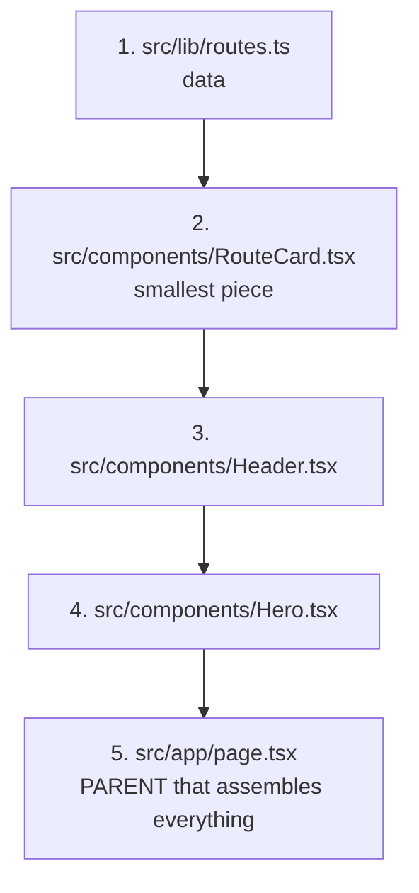
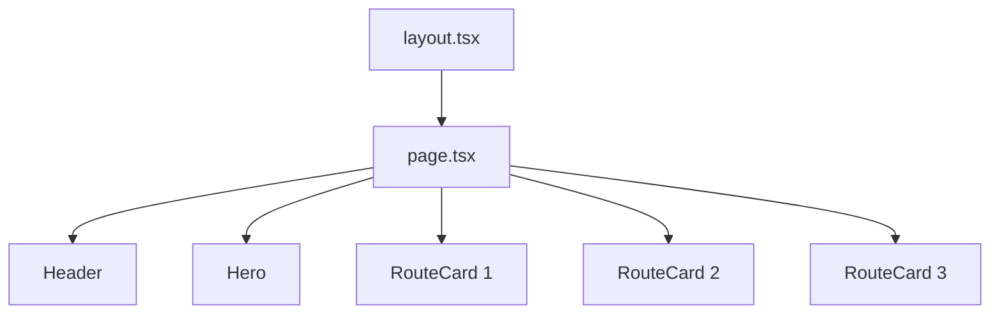
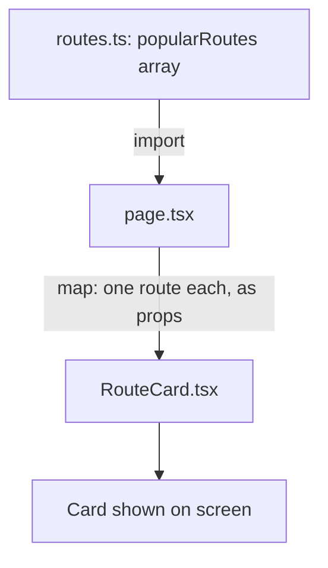
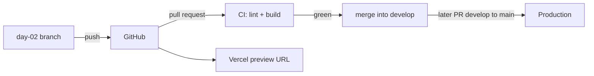
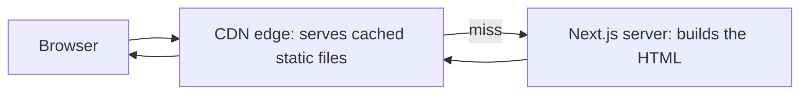

# Day 2: HTML/CSS basics and the landing page in pieces (3h)

**Goal:** a landing page built from small reusable components, and your first branch → PR → live preview.
**New today (max 2):** ① components and props ② Tailwind classes
**Reused from before:** Git, CI (Day 1).
**Time split:** 10 min review · 40 min theory · 85 min build · 25 min PR + preview · 20 min docs + questions.
**Branch today:** `day-02` (from `develop`).

## Recall quiz: yesterday (10 min, answer on paper first)
1. What does CI do when you push a branch?
2. Why do we work on a `day-XX` branch instead of `develop`?
3. A file is at `src/app/about/page.tsx`. What URL shows it?

<details><summary>Answers</summary>

1. Installs, lints and builds your code automatically, and shows a green tick or a red cross.
2. So `develop` stays working; a bad day's branch can be thrown away.
3. `/about`
</details>

Then take 3 spaced cards from [review-and-recall.md](./review-and-recall.md) (from 3+ days ago, once they exist).

## Diagram 1: Order in which you write files (small → big)

We build the small pieces first, then assemble them in the parent.

## Diagram 2: Component tree (who contains whom)


## Diagram 3: Data flow (data only flows DOWN)


## Diagram 4: Branch to live preview


## Step 1: Review and create a branch (10 min)
- **What:** reread your Day 1 doc and start a new branch.
- **Why:** reviewing builds memory, and `develop` stays safe.
- **How:**
  ```bash
  git switch develop
  git switch -c day-02
  ```

## Step 2: Learn HTML and CSS basics (40 min)
- **What:** tags, nesting, and Tailwind classes.
- **Why:** everything on screen is HTML, CSS makes it look good, and Tailwind lets you write CSS as short class names.
- **How:** try each of these in `page.tsx`:
  - Tags: `h1`, `p`, `a`, `section`, `article`.
  - Nesting: tags inside tags form a tree.
  - Layout: `flex` puts items in a row; `grid` makes columns.
  - Spacing: `p-6` padding, `mt-4` margin-top, `gap-4` space between items.
  - Responsive: `sm:` and `lg:` apply only on bigger screens.
- Change one class at a time and watch the page.

## Step 3: Create the data file (10 min)
- **What:** a list of sample routes.
- **Why:** separating data from screens means we can swap in the database later without changing the screens.
- **How:** `src/lib/routes.ts`
  ```ts
  // WHAT: Sample data for the "Popular routes" section.
  // WHY:  Keeping data separate from screens means that on Day 18 we can swap this
  //       file for a real database query without touching the screens.
  // HOW:  An exported array of objects; "Route" describes the shape each object must have.
  // NOTE: PLACEHOLDER content. Replace with the owner's real routes and wording.

  export type Route = {
    slug: string; // URL-friendly id, e.g. "haridwar-to-kedarnath"
    from: string;
    to: string;
    blurb: string;
  };

  export const popularRoutes: Route[] = [
    { slug: "haridwar-to-rishikesh", from: "Haridwar", to: "Rishikesh", blurb: "Ganga aarti and riverside temples." },
    { slug: "haridwar-to-kedarnath", from: "Haridwar", to: "Kedarnath", blurb: "Drive to Sonprayag, trek onward." },
    { slug: "haridwar-to-badrinath", from: "Haridwar", to: "Badrinath", blurb: "Mountain road with experienced drivers." },
  ];
  ```
  `type Route` is TypeScript. Just copy it for now; Day 6 teaches it.

## Step 4: RouteCard (10 min)
- **What:** one card for one route.
- **Why:** write once, reuse for every route.
- **How:** `src/components/RouteCard.tsx`
  ```tsx
  // WHAT: One card showing a single route.
  // WHY:  A small reusable piece: write once, use for every route in the list.
  // HOW:  It receives a "route" through props (inputs) and only displays it.
  import type { Route } from "@/lib/routes";

  export default function RouteCard({ route }: { route: Route }) {
    return (
      <article className="rounded-xl border border-slate-200 bg-white p-5 shadow-sm">
        <h3 className="text-lg font-semibold">
          {route.from} → {route.to}
        </h3>
        <p className="mt-2 text-sm text-slate-600">{route.blurb}</p>
      </article>
    );
  }
  ```

## Step 5: Header and Hero (20 min)
- **What:** the top bar and the first big section.
- **Why:** visitors judge the site in seconds.
- **How:** `src/components/Header.tsx`
  ```tsx
  // WHAT: The top bar with the brand name and a call-to-action link.
  // WHY:  Every page will share it, so it lives in one file.
  // HOW:  Tailwind classes (flex, justify-between...) place the two items on a row.
  export default function Header() {
    return (
      <header className="flex items-center justify-between border-b border-slate-200 px-6 py-4">
        <span className="text-xl font-bold text-amber-700">Shubh Yatra Cabs</span>
        <a href="#routes" className="text-sm font-medium text-slate-700 hover:underline">
          Popular routes
        </a>
      </header>
    );
  }
  ```
  `src/components/Hero.tsx`
  ```tsx
  // WHAT: The big first section visitors see.
  // WHY:  Visitors decide in seconds whether the site is for them.
  // HOW:  Centered text with large font sizes; the button is a link for now.
  export default function Hero() {
    return (
      <section className="bg-amber-50 px-6 py-20 text-center">
        <h1 className="text-4xl font-bold sm:text-5xl">Comfortable cabs across Uttarakhand</h1>
        <p className="mx-auto mt-4 max-w-xl text-lg text-slate-600">
          Experienced hill drivers for Char Dham, Haridwar, Rishikesh and more.
        </p>
        <a
          href="#routes"
          className="mt-8 inline-block rounded-lg bg-amber-700 px-6 py-3 font-semibold text-white hover:bg-amber-800"
        >
          See routes
        </a>
      </section>
    );
  }
  ```

## Step 6: Assemble in the parent page (15 min)
- **What:** replace `src/app/page.tsx`.
- **Why:** the parent decides the order and passes data to children.
- **How:**
  ```tsx
  // WHAT: The home page. It only ASSEMBLES smaller pieces (Header, Hero, RouteCard).
  // WHY:  Small pieces are easier to read, fix and reuse than one giant file.
  // HOW:  Data flows DOWN: routes.ts -> page.tsx -> RouteCard (as props).
  import Header from "@/components/Header";
  import Hero from "@/components/Hero";
  import RouteCard from "@/components/RouteCard";
  import { popularRoutes } from "@/lib/routes";

  export default function HomePage() {
    return (
      <div className="min-h-screen bg-white text-slate-900">
        <Header />
        <main>
          <Hero />
          <section id="routes" className="mx-auto max-w-5xl px-6 py-16">
            <h2 className="mb-6 text-2xl font-bold">Popular routes</h2>
            <div className="grid gap-4 sm:grid-cols-2 lg:grid-cols-3">
              {popularRoutes.map((route) => (
                <RouteCard key={route.slug} route={route} />
              ))}
            </div>
          </section>
        </main>
      </div>
    );
  }
  ```
  Shrink the browser window: the grid goes from 3 columns to 1.

### Step 6b: Why these classes? (new classes only; full guide in [css-primer.md](./css-primer.md))
Open [css-lab.html](./css-lab.html) first, spend 15 minutes changing classes, then come back here.

**Page wireframe: which class makes which part**
```
┌───────────────────────── Header ─────────────────────────┐
│ Shubh Yatra Cabs (text-amber-700)        Popular routes  │  flex justify-between
├───────────────────────────────────────────────────────────┤  border-b
│                  Hero (bg-amber-50, py-20)                │
│       Comfortable cabs across Uttarakhand (text-4xl)      │
│       Experienced hill drivers… (mx-auto max-w-xl)        │
│                    [ See routes ]  ← bg-amber-700         │
├───────────────────────────────────────────────────────────┤
│  Popular routes (text-2xl)       section: mx-auto max-w-5xl│
│  ┌─────────┐   ┌─────────┐   ┌─────────┐                  │  grid gap-4
│  │RouteCard│   │RouteCard│   │RouteCard│                  │  sm:grid-cols-2
│  └─────────┘   └─────────┘   └─────────┘                  │  lg:grid-cols-3
└───────────────────────────────────────────────────────────┘
```

**Header**
| Class | Does | Why |
|---|---|---|
| `flex items-center justify-between` | row; vertically centred; first item left, last item right | brand left, link right |
| `border-b border-slate-200` | 1px light-grey line at the bottom | separates header from content |
| `px-6 py-4` | 24px left/right, 16px top/bottom | wider side space than top/bottom looks balanced |
| `text-xl font-bold text-amber-700` | 20px, bold, amber | brand stands out |
| `text-sm font-medium text-slate-700` | small, medium weight, dark grey | link is secondary to brand |
| `hover:underline` | underline while the mouse is over | shows it is clickable |

**Hero**
| Class | Does | Why |
|---|---|---|
| `bg-amber-50` | very light warm background | separates the hero from the white page |
| `px-6 py-20 text-center` | 24px sides, 80px top/bottom, centred text | big and airy |
| `text-4xl font-bold sm:text-5xl` | 36px on phones, 48px from 640px up | big, but not overflowing on a phone |
| `mx-auto mt-4 max-w-xl` | max 576px wide, centred, 16px above | short lines are easier to read |
| `text-lg text-slate-600` | 18px, grey | supporting text |
| `mt-8 inline-block` | 32px above; behaves like a box | a link can only have padding if it is `inline-block` |
| `rounded-lg bg-amber-700 px-6 py-3 font-semibold text-white` | rounded, dark amber, padded, white bold text | looks like a button; strong contrast |
| `hover:bg-amber-800` | darker on hover | feedback |

**RouteCard**
| Class | Does | Why |
|---|---|---|
| `rounded-xl border border-slate-200 bg-white shadow-sm` | rounded corners, thin line, white, soft shadow | the "card" look |
| `p-5` | 20px inside | text doesn't touch the edge |
| `text-lg font-semibold` | 18px, semi-bold | route name |
| `mt-2 text-sm text-slate-600` | 8px above, small, grey | description is secondary |

**Page wrapper**
| Class | Does | Why |
|---|---|---|
| `min-h-screen bg-white text-slate-900` | at least as tall as the window, white background, dark text | without it, visitors using dark mode would see a black band under a short page |

**Route list section**
| Class | Does | Why |
|---|---|---|
| `mx-auto max-w-5xl px-6 py-16` | centred, max 1024px, side space, 64px top/bottom | content doesn't stretch across a wide monitor |
| `mb-6 text-2xl font-bold` | 24px gap below, 24px bold heading | section title |
| `grid gap-4 sm:grid-cols-2 lg:grid-cols-3` | grid with 16px gaps; 1 column, then 2, then 3 | the same markup works for phone, tablet and laptop |

**Exercises (10 min):** 1) change `bg-amber-50` to `bg-sky-50`; 2) change `lg:grid-cols-3` to `lg:grid-cols-2`; 3) remove `inline-block` from the button and see what changes; 4) remove `mx-auto` from the hero paragraph.

## Step 7: Pull request, CI and live preview (25 min)
- **What:** push the branch, open a PR, let CI run, view a live preview.
- **Why:** this is the loop you'll repeat daily, and it gives you a real URL to open on your phone.
- **How:**
  1. `npm run lint && npm run build`
  2. ```bash
     git add .
     git commit -m "Day 2: landing page components"
     git push -u origin day-02
     ```
  3. On GitHub open a PR from `day-02` into `develop`. Wait for the green tick, then merge.
  4. One-time Vercel setup: sign up with GitHub, import the repo, keep `main` as the Production Branch. Any other branch or PR gets a preview URL (the first deployment of a new project is always production).
  5. Later, when `develop` is stable, open a PR `develop` → `main` to update production.

Cost note: I believe Vercel's free Hobby plan is for non-commercial use. Check current terms before a real launch (Day 35).

## Checklist
- [ ] Header, hero and 3 route cards show.
- [ ] Looks right at phone width.
- [ ] CI is green on the PR.
- [ ] You can say which file passes data to `RouteCard`.

## Step 8: Write today's doc (10 min)
Create `docs/day-02.md` with *What I built*, *Component tree*, *Data flow*, *What confused me*. Draw the tree as text: `layout.tsx → page.tsx → Header, Hero, RouteCard ×3`.

## Break it on purpose (10 min)
1. In `page.tsx` delete `key={route.slug}`. Read the warning in the browser console.
2. In `RouteCard` rename `route.blurb` to `route.blurb2`. Read the TypeScript error.
3. Remove `sm:grid-cols-2` and shrink the window. What changed?

## Common errors and what they mean
| Message | Meaning | Fix |
|---|---|---|
| `Module not found: Can't resolve '@/components/Hero'` | wrong file name or folder | check the spelling and that the file is in `src/components/` |
| `Each child in a list should have a unique "key" prop` | `.map()` without `key` | add `key={...}` |
| A class has no effect | typo in the class name | compare with the [css-primer.md](./css-primer.md) dictionary |

## System design corner (10 min)
**Concept: where a page is rendered, and what a CDN does.**

- **Static** content (images, CSS, a page that doesn't change per user) can be built once and served from a nearby edge. It is fast and cheap.
- **Dynamic** content (search results for today's date) needs the server on each request, or a short cache.
- Our home page is mostly static; `/search` is dynamic. Later, the popular cards get a short cache.
- **Say aloud:** "Which of our pages could be fully static and which must be dynamic, and why?"

## DSA of the day (15–20 min)
**Valid Parentheses (stack).** Given a string of `()[]{}`, say whether every opener has the matching closer in the right order.
- *Idea:* push openers on a stack; on a closer, pop and check it matches. At the end the stack must be empty.
- *Project link:* this is exactly why a missing `</main>` is an error: HTML tags must nest like brackets.

`sandbox/dsa/day-02.js`:
```js
// WHAT: Bracket matching with a stack. WHY: the last opened bracket must be the first closed.
function isValid(s) {
  const pairs = { ")": "(", "]": "[", "}": "{" };
  const stack = [];
  for (const ch of s) {
    if (ch === "(" || ch === "[" || ch === "{") stack.push(ch);
    else if (stack.pop() !== pairs[ch]) return false; // wrong or missing opener
  }
  return stack.length === 0; // anything left over was never closed
}
console.log(isValid("()[]{}")); // true
console.log(isValid("(]"));     // false
console.log(isValid("(("));     // false
console.log(isValid(""));       // true
```
Time O(n), space O(n). Test: empty string, only closers like `)`, deep nesting.

More on this track: [system-design-and-dsa.md](./system-design-and-dsa.md).

## Interview Q&A
1. **What is a component?** A reusable function that returns a piece of UI.
2. **What are props?** Inputs a parent passes to a child; the child can only read them.
3. **Why does data flow one way, parent to child?** It's predictable; you always know where a value came from.
4. **What is `key` in `.map()` for?** It helps React track which item is which when the list changes.
5. **What is a preview deployment?** A temporary live copy of a branch or PR, for testing without affecting production.
6. **What does `sm:` mean in Tailwind?** The style applies from the small breakpoint up (mobile-first design).
7. **What is a CDN?** A network of servers around the world that keep copies of static files close to users, so pages load faster and your server does less work.
8. **(Behavioural) How did you decide how to split the page into components?** One piece per job, small enough to name in a few words, so each can be reused and changed on its own.
