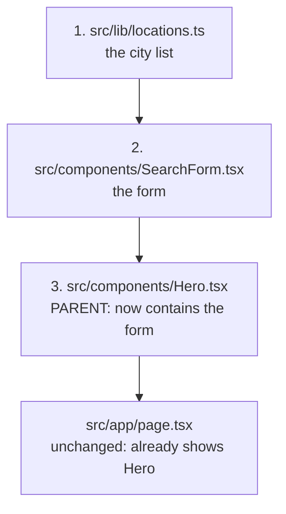
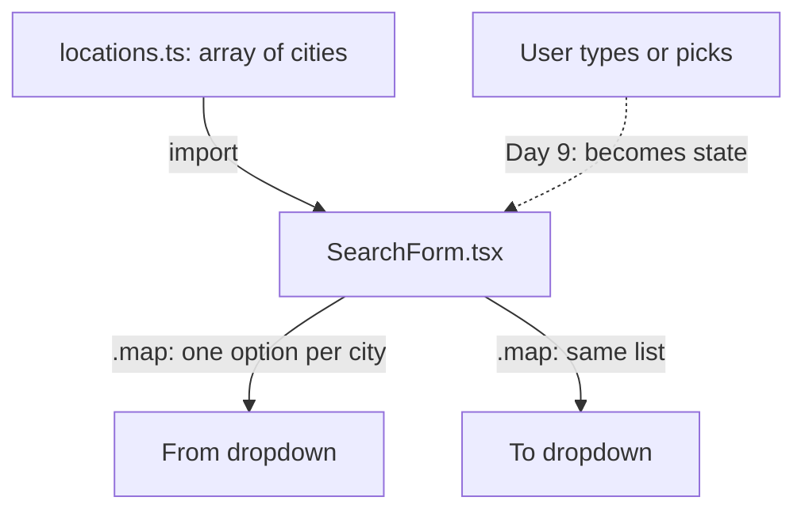
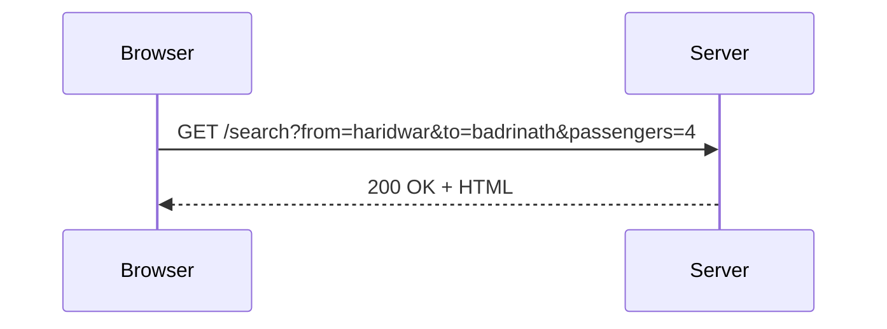

# Day 3: The search form layout (grid, mobile-first, form fields) (3h)

**Goal:** the home page gets the real search form (From, To, Travel date, Passengers) laid out nicely on phone, tablet and laptop. It doesn't *do* anything yet. It only has to look right.
**New today (max 2):** ① CSS **grid** + responsive prefixes (`sm:` `lg:`) ② HTML **form fields** (`label`, `select`, `input`)
**Reused from before:** components, props, `.map()` with `key`, Tailwind classes (Day 2).
**Branch today:** `day-03` (from `develop`).
**Time split:** 10 min recall · 40 min concept + lab · 85 min build · 25 min PR + preview · 20 min docs + Q&A.

## Recall quiz: yesterday (10 min, answer on paper, then open the answers)
1. What does a component receive from its parent?
2. Why does `.map()` need a `key`?
3. What does `sm:grid-cols-2` mean?

<details><summary>Answers</summary>

1. Props (inputs; read-only for the child).
2. So React can tell which item is which when the list changes.
3. From the small breakpoint (640px) upwards, use 2 columns. Below that, the default applies.
</details>

Then take 3 spaced cards from [review-and-recall.md](./review-and-recall.md) (topics from 3+ days ago).

## Diagram 1: Order in which you write files (small → big)


## Diagram 2: Data flow today

Today data flows one way: from `locations.ts` into the two dropdowns. The dotted line (user input) is what Day 9 adds.

## Diagram 3: How the grid changes with screen width
```
Phone (< 640px)      Tablet (≥ 640px, sm:)       Laptop (≥ 1024px, lg:)
┌──────────────┐     ┌───────────┬───────────┐    ┌──────┬──────┬──────┬──────┐
│ From         │     │ From      │ To        │    │ From │ To   │ Date │ Pax  │
├──────────────┤     ├───────────┼───────────┤    └──────┴──────┴──────┴──────┘
│ To           │     │ Date      │ Passengers│    [ Search cabs ]
├──────────────┤     └───────────┴───────────┘
│ Date         │     [ Search cabs ]
├──────────────┤
│ Passengers   │
└──────────────┘
[ Search cabs ] (full width)
```
`grid gap-4 sm:grid-cols-2 lg:grid-cols-4` creates exactly this. No prefix means 1 column (phone). Each prefix means "from this width upward".

## Step 1: Recall and branch (10 min)
- **What:** do the quiz above, then:
  ```bash
  git switch develop
  git pull
  git switch -c day-03
  ```
- **Why:** recalling before looking is the strongest memory technique. A branch keeps `develop` safe.

## Step 2: Learn grid and form fields (40 min)
- **What:** two new ideas, practised in the lab first.
- **Why:** you'll build forms all through the course. A bad form loses customers.
- **How:**
  1. Open [css-lab.html](./css-lab.html) and go to **section 8 (form layout)**. Resize the browser window and watch the columns change.
  2. Read this table of HTML form pieces:

  | Piece | What it is | Why |
  |---|---|---|
  | `<form>` | wraps all the fields | groups them and lets Enter submit |
  | `<label htmlFor="from">` + `<select id="from">` | label linked to its field by matching `htmlFor` and `id` | clicking the label focuses the field, and screen readers announce it |
  | `name="from"` | the key the value is sent under | `?from=haridwar` in the URL, from Day 10 |
  | `<select>` + `<option>` | dropdown | users can only choose valid cities |
  | `type="date"` | date picker | no typing mistakes; phones show a calendar |
  | `type="number" min max` | number field with limits | passengers between 1 and 12 |
  | `defaultValue` | the starting value | the form opens with 2 passengers |

  3. In React (JSX) two words differ from plain HTML: `class` is `className` and `for` is `htmlFor`.
- **Practice (5 min, in the lab):** change `lg:grid-cols-4` to `lg:grid-cols-2` and watch.

## Step 3: The city list (10 min)
- **What:** a list of cities in one file.
- **Why:** both dropdowns use the same list. Later it comes from the database.
- **How:** create `src/lib/locations.ts`:
  ```ts
  // WHAT: The list of cities a customer can pick in the search form.
  // WHY:  A fixed list (not free typing) guarantees the city matches our price table later.
  // HOW:  An array of { slug, name }. "slug" is the safe id; "name" is what people read.
  // NOTE: PLACEHOLDER list. Replace with the owner's real pick-up and drop cities.
  export const locations = [
    { slug: "delhi", name: "Delhi" },
    { slug: "dehradun", name: "Dehradun" },
    { slug: "haridwar", name: "Haridwar" },
    { slug: "rishikesh", name: "Rishikesh" },
    { slug: "kedarnath", name: "Kedarnath (Sonprayag)" },
    { slug: "badrinath", name: "Badrinath" },
  ];
  ```

## Step 4: The SearchForm component (50 min)
- **What:** the 4 fields and the button.
- **Why:** it's the front door of the product, so it must be clear on a phone.
- **How:** create `src/components/SearchForm.tsx`. Type it, don't paste it:
  ```tsx
  // WHAT: The 4-field search form: From, To, Date, Passengers.
  // WHY:  This is the front door of the whole product. Customers start here.
  // HOW:  A <form> with a grid: 1 column on phones, 2 on tablets, 4 on laptops.
  //       Today it is only a LAYOUT. It gets behaviour on Day 9.
  import { locations } from "@/lib/locations";

  // A "variable": a named box that holds text. We reuse these class lists so all
  // fields look identical and we only change the style in one place.
  const labelClass = "block text-sm font-medium text-slate-700";
  const fieldClass =
    "mt-1 w-full rounded-lg border border-slate-300 bg-white px-3 py-2 focus:border-amber-600 focus:outline-none focus:ring-2 focus:ring-amber-200";

  export default function SearchForm() {
    return (
      <form className="mx-auto mt-10 max-w-4xl rounded-2xl bg-white p-5 text-left shadow-lg">
        <div className="grid gap-4 sm:grid-cols-2 lg:grid-cols-4">
          <div>
            <label htmlFor="from" className={labelClass}>
              From
            </label>
            <select id="from" name="from" defaultValue="" className={fieldClass}>
              <option value="" disabled>
                Select city
              </option>
              {locations.map((place) => (
                <option key={place.slug} value={place.slug}>
                  {place.name}
                </option>
              ))}
            </select>
          </div>

          <div>
            <label htmlFor="to" className={labelClass}>
              To
            </label>
            <select id="to" name="to" defaultValue="" className={fieldClass}>
              <option value="" disabled>
                Select city
              </option>
              {locations.map((place) => (
                <option key={place.slug} value={place.slug}>
                  {place.name}
                </option>
              ))}
            </select>
          </div>

          <div>
            <label htmlFor="date" className={labelClass}>
              Travel date
            </label>
            <input id="date" name="date" type="date" className={fieldClass} />
          </div>

          <div>
            <label htmlFor="passengers" className={labelClass}>
              Passengers
            </label>
            <input
              id="passengers"
              name="passengers"
              type="number"
              min={1}
              max={12}
              defaultValue={2}
              className={fieldClass}
            />
          </div>
        </div>

        <button
          type="button"
          className="mt-5 w-full rounded-lg bg-amber-700 px-8 py-3 font-semibold text-white hover:bg-amber-800 sm:w-auto"
        >
          Search cabs
        </button>
      </form>
    );
  }
  ```
  You may notice the two dropdowns are copy-pasted. That's okay for now. On Day 7 you'll turn them into one reusable component.

  **CSS: what each new class does and why**

  | Class | Does | Why |
  |---|---|---|
  | `mx-auto max-w-4xl` | centred, never wider than 56rem | the form doesn't stretch across a big monitor |
  | `mt-10` | 40px space above | breathing room under the subtitle |
  | `rounded-2xl bg-white p-5 shadow-lg` | big rounded corners, white, 20px inside, big shadow | looks like a floating card on the warm hero background |
  | `text-left` | left-align text | the hero centres text; labels read better left-aligned |
  | `grid gap-4` | grid with 16px between cells | the columns |
  | `sm:grid-cols-2 lg:grid-cols-4` | 2 then 4 columns on wider screens | see Diagram 3 |
  | `block` | label takes a whole line | so the field sits under it |
  | `text-sm font-medium text-slate-700` | small, medium weight, dark grey | labels are helpers, not headlines |
  | `mt-1 w-full` | 4px above; fill the cell's width | fields line up in every column |
  | `border border-slate-300` | thin grey line | visible but quiet |
  | `px-3 py-2` | 12px sides, 8px top and bottom | comfortable to tap |
  | `focus:ring-2 focus:ring-amber-200 focus:border-amber-600 focus:outline-none` | when the field is active: amber border + soft glow | shows where the cursor is, and replaces the browser's default outline |
  | `w-full ... sm:w-auto` (button) | full width on phones, natural width from 640px | a big thumb target on phones |

## Step 5: Put the form in the Hero (10 min)
- **What:** replace `src/components/Hero.tsx` so it contains `<SearchForm />`.
- **Why:** visitors came to search, so the form goes right under the headline. We remove the "See routes" button because the header link already goes there.
- **How:**
  ```tsx
  // WHAT: The big first section visitors see, now containing the search form.
  // WHY:  Visitors decide in seconds whether the site is for them, and what they
  //       came to do is search. So the form sits right under the headline.
  // HOW:  Centered text, then <SearchForm /> placed inside (a child component).
  import SearchForm from "@/components/SearchForm";

  export default function Hero() {
    return (
      <section className="bg-amber-50 px-6 py-16 text-center">
        <h1 className="text-4xl font-bold sm:text-5xl">Comfortable cabs across Uttarakhand</h1>
        <p className="mx-auto mt-4 max-w-xl text-lg text-slate-600">
          Experienced hill drivers for Char Dham, Haridwar, Rishikesh and more.
        </p>
        <SearchForm />
      </section>
    );
  }
  ```
  Check in the browser: 4 columns on a wide window, 1 column when you drag it narrow.

## Step 6: Pull request and preview (25 min)
```bash
npm run lint && npm run build
git add .
git commit -m "Day 3: search form layout"
git push -u origin day-03
```
Open a PR into `develop`, wait for green CI, merge, and open the preview URL **on your phone**. Try the dropdowns with your thumb.

## Break it on purpose (10 min)
1. Remove `htmlFor="from"` and click the label "From". Nothing happens. Put it back and it focuses the field.
2. Replace `sm:grid-cols-2 lg:grid-cols-4` with just `grid-cols-4`. The fields get squeezed on a phone. This is why mobile-first matters.
3. Delete `key={place.slug}`. Read the warning in the browser console.

## Common errors and what they mean
| Message | Meaning | Fix |
|---|---|---|
| `Each child in a list should have a unique "key" prop` | `.map()` without a `key` | add `key={...}` on the outer element in the map |
| `Invalid DOM property class. Did you mean className?` | used HTML words in JSX | `class` → `className`, `for` → `htmlFor` |
| `Cannot find module '@/lib/locations'` | wrong file name or folder | check `src/lib/locations.ts` spelling |
| Dropdown shows blank | the default `value=""` option is missing | keep the `Select city` option |

## Checklist
- [ ] Four columns on a laptop-width window, one column on a phone-width window.
- [ ] Clicking each label focuses its field.
- [ ] CI is green and you opened the preview on your phone.
- [ ] You can explain what `name="from"` is for.

**Note:** pressing Enter in a field reloads the page with the values in the URL. That's the browser's default form behaviour. On Day 10 we use it on purpose.

## Write today's doc (10 min)
`docs/day-03.md`: *What I built*, *Data flow*, *Screenshot of the form on phone and laptop*, *What confused me*.

## System design corner (10 min)
**Concept: HTTP request and response; GET and the query string.**

- A form with `method="get"` puts its fields in the URL after `?`, as `name=value` pairs joined by `&`.
- Because it's in the URL, a search can be **bookmarked and shared**. That's why search uses GET, and booking (which changes data) will use POST.
- **Say aloud:** "Why is it fine to put a search in the URL but wrong to put a password there?"

## DSA of the day (15–20 min)
**Contains Duplicate (set).** Return `true` if any value appears twice.
- *Brute force:* compare every pair, O(n²). *Better:* a `Set` remembers what you've seen, O(n).
- *Project link:* a duplicate city in the dropdown list would give two options with the same value.

`sandbox/dsa/day-03.js`:
```js
// WHAT: Detect duplicates with a Set. WHY: Set lookups are O(1).
function containsDuplicate(nums) {
  const seen = new Set();
  for (const n of nums) {
    if (seen.has(n)) return true;
    seen.add(n);
  }
  return false;
}
console.log(containsDuplicate([1, 2, 3, 1])); // true
console.log(containsDuplicate([1, 2, 3]));    // false
console.log(containsDuplicate([]));           // false
```
Follow-up: change it to return *which* value repeats. Then run it on `locations` slugs.

More on this track: [system-design-and-dsa.md](./system-design-and-dsa.md).

## Interview Q&A
1. **Flexbox or grid, which and when?** Flexbox lays items out in one direction (a row or a column). Grid handles rows and columns together. I use flex for a header and grid for a card list or form.
2. **What does mobile-first mean?** You write the phone layout as the default and add rules for bigger screens with prefixes like `sm:` and `lg:`.
3. **Why a `<label>` with `htmlFor`?** It improves accessibility and makes the tap target bigger.
4. **Why a dropdown for cities instead of free text?** It prevents typos and guarantees the value matches the price data.
5. **What is the `name` attribute on an input for?** It's the key under which the value is sent, in the URL or in the request.
6. **Why `className` and `htmlFor` in React?** `class` and `for` are reserved words in JavaScript, and JSX is JavaScript.
7. **GET vs POST?** GET reads data and puts parameters in the URL, so it can be bookmarked. POST sends data in the request body and is used to change things, like creating a booking.
8. **(Behavioural) Tell me about a time a layout didn't work on a small screen.** Describe the symptom, how you found the cause with browser dev tools, and the mobile-first fix.
