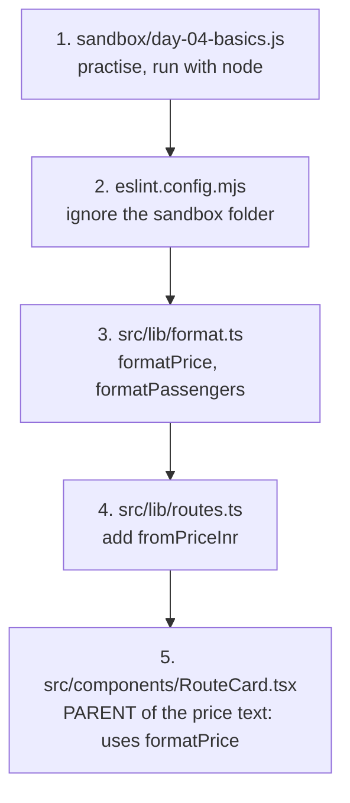
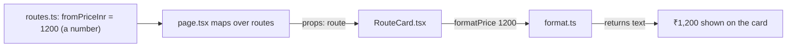
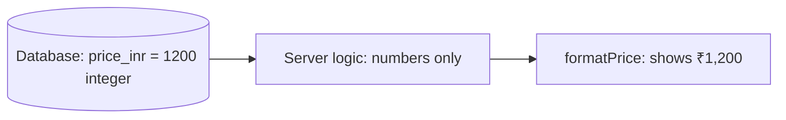

# Day 4: JavaScript basics: variables, functions, arrays, objects (3h)

**Goal:** understand the JavaScript you've been copying so far, practise it in a scratch file, then use it for real: prices on the route cards show as `₹1,200`.
**New today (max 2):** ① variables, values and **functions** ② **arrays and objects**
**Reused from before:** components, props, `.map()`, project folders (`src/lib`).
**Branch today:** `day-04` (from `develop`).
**Time split:** 10 min recall · 70 min sandbox (learn by running) · 55 min project · 25 min PR + preview · 20 min docs + Q&A.

## Recall quiz: yesterday (10 min)
1. Which two attributes connect a `<label>` to its `<input>`?
2. What does `lg:grid-cols-4` do, and what happens below 1024px?
3. Why is the city list a dropdown rather than a text box?

<details><summary>Answers</summary>

1. `htmlFor` on the label and `id` on the field (they must match).
2. 4 columns from 1024px up. Below that, the smaller prefixes or the default apply (`sm:` gives 2, no prefix gives 1).
3. It prevents typos and guarantees the value matches the price data.
</details>

Then take 3 spaced cards from [review-and-recall.md](./review-and-recall.md) (topics from 3+ days ago).

## Diagram 1: Order in which you work (practice first, then project)


## Diagram 2: Data flow for one price

A **function** (`formatPrice`) sits between the data and the screen. Data in, friendly text out.

## Step 1: Recall and branch (10 min)
```bash
git switch develop && git pull
git switch -c day-04
```

## Step 2: Learn JavaScript by running it (70 min)
- **What:** a scratch file with 10 tiny examples.
- **Why:** you read JavaScript in every file already. Running small examples makes it click. The `sandbox/` folder is a safe place to experiment.
- **How:**
  1. Create the folder `sandbox` in the project root and the file `sandbox/day-04-basics.js`.
  2. For **each** numbered block: **predict** the output on paper, **run** it, **compare**, then **change** something.
  3. Run with: `node sandbox/day-04-basics.js`

  ```js
  // WHAT: A scratch file to practise JavaScript. Run it with:  node sandbox/day-04-basics.js
  // WHY:  Trying a small idea alone is faster than finding it inside a big app.
  // HOW:  Read each block, guess what it prints, run it, compare, then change it.

  // 1) VARIABLES: a named box holding a value. const = never reassigned, let = can change.
  const brand = "Shubh Yatra Cabs";
  let passengers = 2;
  passengers = 3; // allowed because we used let
  console.log(brand, passengers);

  // 2) VALUES (types): text, number, true/false.
  const price = 2400; // number
  const isAvailable = true; // boolean
  console.log(typeof brand, typeof price, typeof isAvailable);

  // 3) TEMPLATE STRINGS: put values inside text with backticks and ${ }.
  console.log(`${brand} carries ${passengers} passengers`);

  // 4) CONDITIONS: choose between paths.
  if (passengers > 4) {
    console.log("Too many for a sedan");
  } else {
    console.log("A sedan fits");
  }

  // 5) FUNCTIONS: a reusable recipe. Input -> output.
  function formatPassengers(count) {
    return count === 1 ? "1 passenger" : `${count} passengers`; // ?: is a short if/else
  }
  console.log(formatPassengers(1), "|", formatPassengers(3));

  // 6) ARROW FUNCTION: the same idea in shorter writing. You will see this everywhere in React.
  const double = (n) => n * 2;
  console.log(double(21));

  // 7) ARRAYS: an ordered list. Counting starts at 0.
  const cities = ["Haridwar", "Rishikesh", "Badrinath"];
  console.log(cities[0], cities.length);

  // 8) OBJECTS: a thing with named properties. Our routes are objects.
  const route = { from: "Haridwar", to: "Rishikesh", fromPriceInr: 1200 };
  console.log(route.from, "->", route.to);

  // 9) LOOP: do something for every item.
  for (const city of cities) {
    console.log("City:", city);
  }

  // 10) NUMBER FORMATTING for India (a built-in tool). 1200 -> "₹1,200".
  const inr = new Intl.NumberFormat("en-IN", {
    style: "currency",
    currency: "INR",
    maximumFractionDigits: 0,
  });
  console.log(inr.format(1200), inr.format(245000));

  // TRY THIS: make passengers 6 and rerun. Then change const brand to let and reassign it.
  // BREAK IT: reassign the const `price` on a new line and read the error message.
  ```
  **Expected output:**
  ```
  Shubh Yatra Cabs 3
  string number boolean
  Shubh Yatra Cabs carries 3 passengers
  A sedan fits
  1 passenger | 3 passengers
  42
  Haridwar 3
  Haridwar -> Rishikesh
  City: Haridwar
  City: Rishikesh
  City: Badrinath
  ₹1,200 ₹2,45,000
  ```
  **Mini model to remember:**
  ```
  variable  → a labelled box        const price = 2400
  function  → a recipe              (input) → [steps] → output
  array     → a numbered list       ["a","b","c"]   first item is [0]
  object    → a labelled bundle     { from: "Haridwar", to: "Rishikesh" }
  array of objects → a table        [ {…}, {…}, {…} ]   ← your routes!
  ```

## Step 3: Keep the sandbox out of CI (5 min)
- **What:** tell ESLint to ignore `sandbox/`.
- **Why:** your scratch experiments (and deliberate errors) must never turn the CI red.
- **How:** open `eslint.config.mjs` and add one entry inside `globalIgnores([...])`:
  ```js
  globalIgnores([
    // Default ignores of eslint-config-next:
    ".next/**",
    "out/**",
    "build/**",
    "next-env.d.ts",
    // Our scratch files for learning. They must never fail the build.
    "sandbox/**",
  ]),
  ```

## Step 4: Write the formatting helpers (20 min)
- **What:** two small functions in `src/lib/format.ts`.
- **Why:** one place for formatting means "₹2,400" looks identical everywhere, and you can fix it in one file.
- **How:**
  ```ts
  // WHAT: Small helper functions that turn raw values into friendly text.
  // WHY:  One place for formatting means "₹2,400" looks the same on every screen.
  // HOW:  Plain functions: value in, text out. They don't touch the screen or database.
  //       (The ": number" and ": string" parts are TypeScript labels; Day 6 explains them.)

  // India-style currency: 245000 -> "₹2,45,000". Made once, reused for every call.
  const inr = new Intl.NumberFormat("en-IN", {
    style: "currency",
    currency: "INR",
    maximumFractionDigits: 0,
  });

  export function formatPrice(amountInr: number): string {
    return inr.format(amountInr);
  }

  export function formatPassengers(count: number): string {
    return count === 1 ? "1 passenger" : `${count} passengers`;
  }
  ```
  Notice: it's the **same code** as blocks 5 and 10 of your sandbox, plus `export` (so other files can use it) and the TypeScript labels.

## Step 5: Add a price to each route (10 min)
- **What:** a `fromPriceInr` number on every route.
- **Why:** cards should show what a trip roughly costs.
- **How:** replace `src/lib/routes.ts`:
  ```ts
  // WHAT: Sample data for the "Popular routes" section.
  // WHY:  Keeping data separate from screens means that on Day 18 we can swap this
  //       file for a real database query without touching the screens.
  // HOW:  An exported array of objects; "Route" describes the shape each object must have.
  // NOTE: PLACEHOLDER content. Replace with the owner's real routes, prices and wording.

  export type Route = {
    slug: string; // URL-friendly id, e.g. "haridwar-to-kedarnath"
    from: string;
    to: string;
    blurb: string;
    fromPriceInr: number; // "From ₹X" shown on the card (PLACEHOLDER numbers)
  };

  export const popularRoutes: Route[] = [
    { slug: "haridwar-to-rishikesh", from: "Haridwar", to: "Rishikesh", blurb: "Ganga aarti and riverside temples.", fromPriceInr: 1200 },
    { slug: "haridwar-to-kedarnath", from: "Haridwar", to: "Kedarnath", blurb: "Drive to Sonprayag, trek onward.", fromPriceInr: 5500 },
    { slug: "haridwar-to-badrinath", from: "Haridwar", to: "Badrinath", blurb: "Mountain road with experienced drivers.", fromPriceInr: 7500 },
  ];
  ```
  TypeScript will now **refuse to compile** if any route is missing `fromPriceInr`. That's the point of the `Route` type.

## Step 6: Show the price on the card (10 min)
- **What:** use `formatPrice` in `RouteCard`.
- **How:** replace `src/components/RouteCard.tsx`:
  ```tsx
  // WHAT: One card showing a single route.
  // WHY:  A small reusable piece: write once, use for every route in the list.
  // HOW:  It receives a "route" through props (inputs) and only displays it.
  import { formatPrice } from "@/lib/format";
  import type { Route } from "@/lib/routes";

  export default function RouteCard({ route }: { route: Route }) {
    return (
      <article className="rounded-xl border border-slate-200 bg-white p-5 shadow-sm">
        <h3 className="text-lg font-semibold">
          {route.from} → {route.to}
        </h3>
        <p className="mt-2 text-sm text-slate-600">{route.blurb}</p>
        <p className="mt-3 text-sm font-semibold text-amber-700">
          From {formatPrice(route.fromPriceInr)}
        </p>
      </article>
    );
  }
  ```
  **CSS (only new classes):** `mt-3` = 12px above; `text-sm font-semibold text-amber-700` = small, semi-bold, amber, so the price stands out from the grey description.
  Cards should now say `From ₹1,200`, `From ₹5,500`, `From ₹7,500`.

## Step 7: Pull request and preview (25 min)
```bash
npm run lint && npm run build
git add .
git commit -m "Day 4: JS basics sandbox and price formatting"
git push -u origin day-04
```
PR into `develop`, wait for green CI, merge, check the preview.

## Break it on purpose (10 min)
1. In `routes.ts` delete `fromPriceInr` from one route. Read the TypeScript error in the terminal.
2. In `RouteCard` write `route.fromPrice` (a typo). The editor underlines it. In plain JavaScript this would silently give `undefined`.
3. In the sandbox write `console.log(cities[3])`. What prints? (`undefined`: there's no 4th item.)

## Common errors and what they mean
| Message | Meaning | Fix |
|---|---|---|
| `x is not defined` | used a name that doesn't exist (often a typo) | check spelling and where it was declared |
| `Assignment to constant variable` | changed a `const` | use `let` if it must change |
| prints `undefined` | misspelled property or index out of range | check the object's keys or array length |
| `Cannot read properties of undefined` | used `.something` on a value that doesn't exist | find where it should have been set |
| `Property 'fromPriceInr' is missing` (TypeScript) | an object doesn't match its type | add the property |

## Checklist
- [ ] Sandbox output matches the expected output.
- [ ] Route cards show `From ₹1,200`.
- [ ] `npm run lint` and `npm run build` pass, and CI is green.
- [ ] You can explain the difference between `const` and `let`.
- [ ] You can explain "array of objects" using your routes.

## Write today's doc (10 min)
`docs/day-04.md`: *What I built*, *Data flow of one price* (copy Diagram 2), *3 things I ran in the sandbox and what I learned*, *What confused me*.

## System design corner (10 min)
**Concept: data modelling; money as integers; format at the edge.**

- Store and calculate money as **whole numbers** (rupees or paise), never as formatted text and avoid decimals, because `0.1 + 0.2` is not exactly `0.3` in floating-point.
- Turn it into `₹1,200` only at the very last step, on screen.
- **Say aloud:** "What bug would appear if the database stored `'₹1,200'` as text?"

## DSA of the day (15–20 min)
**Group Anagrams (hash map grouping).** Group words that are made of the same letters.
- *Idea:* give each word a *key* (its letters sorted); words with the same key go in the same group.
- *Project link:* the same "group by a key" pattern groups routes by starting city.

`sandbox/dsa/day-04.js`:
```js
// WHAT: Group words by a shared key. WHY: sorted letters are identical for anagrams.
function groupAnagrams(words) {
  const groups = new Map(); // key -> list of words
  for (const w of words) {
    const key = [...w].sort().join("");
    if (!groups.has(key)) groups.set(key, []);
    groups.get(key).push(w);
  }
  return [...groups.values()];
}
console.log(groupAnagrams(["eat", "tea", "tan", "ate", "nat", "bat"]));
// [["eat","tea","ate"],["tan","nat"],["bat"]]
console.log(groupAnagrams([])); // []
```
Time O(n · k log k) for n words of length k. Now try: group your `popularRoutes` by `from`.

More on this track: [system-design-and-dsa.md](./system-design-and-dsa.md).

## Interview Q&A
1. **`const` vs `let` vs `var`?** `const` can't be reassigned, `let` can, and `var` is the old style with confusing scope, so avoid it.
2. **What is a function?** A reusable block that takes input and returns output.
3. **What's an arrow function?** A shorter way to write a function, `(n) => n * 2`.
4. **Array vs object?** An array is an ordered list accessed by position. An object is a bundle of named properties.
5. **What does `===` do, and why not `==`?** `===` compares value and type without silent conversion, so it avoids surprises like `"2" == 2`.
6. **Why keep formatting in one function?** Consistency, and fixing it once fixes it everywhere.
7. **Why store money as a whole number of rupees (or paise) and not text?** You can calculate with numbers, and you format them only at the edge, on screen.
8. **Why not store prices as floating-point numbers?** Floating-point can't represent some decimals exactly, so totals drift. Whole numbers are exact.
9. **(Behavioural) Describe a bug caused by a data-type mistake.** Use today's `route.fromPrice` typo: TypeScript caught what plain JavaScript would have hidden as `undefined`.
