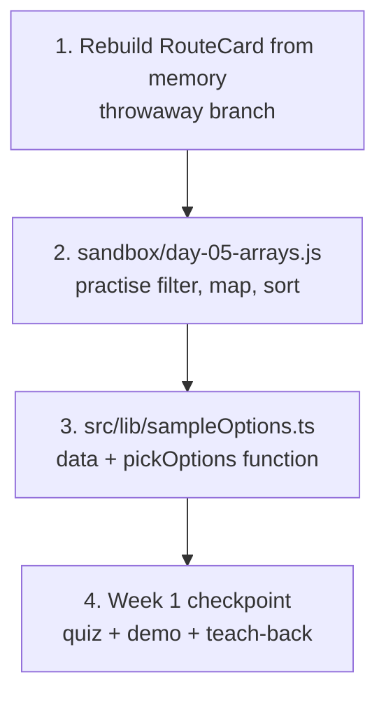
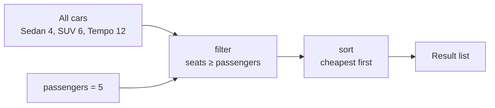
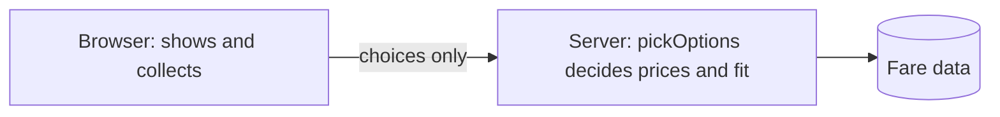

# Day 5: Review day + array tools (`filter`, `map`, `sort`) + Week 1 checkpoint (3h)

**Goal:** prove to yourself that Days 1–4 stuck (by rebuilding from memory), learn the array tools that power search results, and write the first piece of real "backend logic": *which cars fit this many passengers, cheapest first?*
**New today (max 2):** ① array tools `filter` / `map` / `sort` ② **pure functions** (same input → same output)
**Reused from before:** everything. That's the point of a review day.
**Branch today:** `day-05` (from `develop`).
**Time split:** 10 min recall · 45 min rebuild from memory · 40 min array tools · 30 min project logic · 35 min Week 1 checkpoint · 20 min PR + docs.

## Recall quiz: yesterday (10 min)
1. What's the difference between `const` and `let`?
2. What does `cities[0]` give you, and what does `cities[10]` give you for a 3-item array?
3. What does `formatPrice(1200)` return?

<details><summary>Answers</summary>

1. `const` can't be reassigned; `let` can.
2. The first item; `undefined`.
3. `"₹1,200"`
</details>

Then take 3 spaced cards from [review-and-recall.md](./review-and-recall.md) (topics from 3+ days ago).

## Diagram 1: Order in which you work


## Diagram 2: The pipeline you're building (this is the heart of the search)

With 5 passengers: Sedan (4 seats) is dropped, then SUV (₹3,100) and Tempo (₹5,800) are sorted cheapest first. On Day 19 the backend runs this same idea on real database rows.

## Step 1: Recall and branch (10 min)
```bash
git switch develop && git pull
git switch -c day-05
```

## Step 2: Review by rebuilding from memory (45 min)
- **What:** delete one component and rewrite it without looking.
- **Why:** you remember what you *retrieve*, not what you reread.
- **How:**
  1. Open `src/components/RouteCard.tsx`. **Copy the file somewhere safe** (or just rely on Git: your last commit is the answer key).
  2. Delete everything inside it.
  3. Rewrite the whole component from memory: the WHAT/WHY/HOW comments, imports, props, the title, description and price.
  4. Look at the app. Fix anything broken **without** opening the original.
  5. Compare with Git, the professional way to check your work:
     ```bash
     git diff src/components/RouteCard.tsx
     ```
     Red lines (`-`) are what you removed; green (`+`) is what you wrote. Differences in wording don't matter. Differences that change behaviour do.
  6. Decide: keep yours if it works, or restore the original with:
     ```bash
     git restore src/components/RouteCard.tsx
     ```
- **Score yourself (honestly):**
  - Needed no help → great.
  - Needed to peek 1–2 times → normal.
  - Couldn't start → reread Day 2 step 4 and try again tomorrow. This is *information*, not failure.

## Step 3: Learn the array tools by running them (40 min)
- **What:** `filter`, `map`, `find`, `sort`, `reduce` in a scratch file.
- **Why:** "show only the cars that fit, cheapest first" is exactly filter + sort + map.
- **How:** create `sandbox/day-05-arrays.js` and run `node sandbox/day-05-arrays.js`. For each block, predict first.
  ```js
  // WHAT: Practise the array tools we need for search results. Run: node sandbox/day-05-arrays.js
  // WHY:  "Show only cars that fit, cheapest first" is exactly filter + sort + map.
  // HOW:  Each tool takes an array and gives back a NEW array. The original is unchanged.

  const options = [
    { id: "suv", name: "SUV", seats: 6, priceInr: 3100 },
    { id: "sedan", name: "Sedan", seats: 4, priceInr: 2400 },
    { id: "tempo", name: "Tempo Traveller", seats: 12, priceInr: 5800 },
  ];

  // 1) filter: KEEP only items that pass a test.
  const passengers = 5;
  const fits = options.filter((option) => option.seats >= passengers);
  console.log("fits 5 people:", fits.map((o) => o.name)); // [ 'SUV', 'Tempo Traveller' ]

  // 2) map: TRANSFORM every item into something else.
  const names = options.map((option) => option.name);
  console.log("names:", names);

  // 3) find: get the FIRST item that passes (or undefined).
  const cheapestSedan = options.find((option) => option.id === "sedan");
  console.log("sedan costs:", cheapestSedan.priceInr);

  // 4) sort: order items. Subtracting gives low -> high. NOTE: sort changes the array it is
  //    called on, so we copy first with [...options] (the "spread" copy).
  const byPrice = [...options].sort((a, b) => a.priceInr - b.priceInr);
  console.log("cheapest first:", byPrice.map((o) => o.name));

  // 5) reduce: boil a list down to ONE value (here: the total price).
  const total = options.reduce((sum, option) => sum + option.priceInr, 0);
  console.log("total of all prices:", total);

  // 6) CHAIN them: this is the heart of the real search logic.
  const result = options
    .filter((option) => option.seats >= passengers)
    .sort((a, b) => a.priceInr - b.priceInr)
    .map((option) => `${option.name}: ₹${option.priceInr}`);
  console.log(result);

  // TRY THIS: change passengers to 13. What does filter return? (an empty array [] )
  // BREAK IT: delete the [...options] copy in step 4, then print `options` after sorting.
  ```
  **Expected output:**
  ```
  fits 5 people: [ 'SUV', 'Tempo Traveller' ]
  names: [ 'SUV', 'Sedan', 'Tempo Traveller' ]
  sedan costs: 2400
  cheapest first: [ 'Sedan', 'SUV', 'Tempo Traveller' ]
  total of all prices: 11300
  [ 'SUV: ₹3100', 'Tempo Traveller: ₹5800' ]
  ```
  **Cheat sheet:**

  | Tool | Question it answers | Returns |
  |---|---|---|
  | `filter(test)` | "which ones pass?" | a shorter array |
  | `map(change)` | "what does each become?" | an array of the same length |
  | `find(test)` | "give me the first match" | one item or `undefined` |
  | `sort(compare)` | "in what order?" | the array, re-ordered (**changes the original!**) |
  | `reduce(combine, start)` | "boil it down to one value" | one value |

## Step 4: The first real logic: `pickOptions` (30 min)
- **What:** sample cars and a function that picks the ones that fit.
- **Why:** this is the logic the backend will run on Day 19. We write it now with fake data so you understand it before a database exists.
- **How:** create `src/lib/sampleOptions.ts`:
  ```ts
  // WHAT: Sample car options and the rule "which ones fit this many passengers".
  // WHY:  This is the same logic the backend will run for real (Day 19), so we learn it
  //       now with fake data. Pure function = same input, same output, easy to test (Day 14).
  // HOW:  filter keeps cars with enough seats, sort puts the cheapest first.
  // NOTE: PLACEHOLDER cars and prices. The real ones come from the database on Day 17-19.

  export type CarOption = {
    id: string;
    name: string;
    seats: number;
    priceInr: number;
  };

  export const sampleOptions: CarOption[] = [
    { id: "suv", name: "SUV (AC)", seats: 6, priceInr: 3100 },
    { id: "sedan", name: "Sedan (AC)", seats: 4, priceInr: 2400 },
    { id: "tempo", name: "Tempo Traveller", seats: 12, priceInr: 5800 },
  ];

  export function pickOptions(options: CarOption[], passengers: number): CarOption[] {
    return options
      .filter((option) => option.seats >= passengers)
      .sort((a, b) => a.priceInr - b.priceInr);
  }
  ```
  **What's a pure function?** `pickOptions` uses only what you give it and changes nothing outside itself. Same input always gives the same output, so it's easy to test (Day 14) and to move to the backend (Day 19). Notice it doesn't need `[...options]`: `filter` already returns a new array, so `sort` only reorders that copy.

  Nothing shows on screen yet; the results page uses this on Day 10. Check it works: `npm run lint && npm run build` must pass. The same logic already ran in your sandbox.

## Step 5: Week 1 checkpoint (35 min)
**A. Quiz (15 min, no peeking)**
1. What command creates a new branch and switches to it?
2. What does `npm ci` do in CI?
3. Where does a file at `src/app/about/page.tsx` appear in the browser? *(Think: file-based routing)*
4. What does `px-6 py-4` mean?
5. What's the difference between `flex` and `grid`?
6. What do props do?
7. Why does `.map()` need a `key`?
8. What does `sm:grid-cols-2` mean?
9. `filter` vs `map`: what does each return?
10. Why is `pickOptions` a "pure function"?

<details><summary>Answers</summary>

1. `git switch -c branch-name`
2. Installs exactly the versions in `package-lock.json`, so builds are repeatable.
3. `/about`
4. 24px padding left and right, 16px top and bottom.
5. `flex` lays out in one direction; `grid` lays out in rows and columns.
6. Pass data from a parent component into a child.
7. So React can track which item is which when the list changes.
8. From 640px up, use 2 columns.
9. `filter` returns a shorter array of matching items; `map` returns a same-length array of transformed items.
10. Same input always gives the same output, and it changes nothing outside itself.
</details>

Score: 9–10 great · 6–8 fine, reread the topics you missed · under 6 spend your buffer day on them.

**B. Demo to yourself (10 min):** open the preview URL on your phone and say aloud what each part is: header, hero, search form, route cards, and what file each lives in.

**C. Teach it back (10 min):** write 5 sentences, as if to a friend, explaining *how a page appears in the browser* (layout → page → components → data). If you get stuck, that's what to review.

## Step 6: Pull request and doc (20 min)
```bash
npm run lint && npm run build
git add .
git commit -m "Day 5: array tools, pickOptions, week 1 checkpoint"
git push -u origin day-05
```
PR into `develop`, then merge. **It's also a good time to merge `develop` into `main`** (PR `develop` → `main`) so production has the week's work. Check the production URL.

`docs/day-05.md`: *Review score*, *Quiz score and what I missed*, *The pipeline diagram in my own words*, *What confused me*.

## Break it on purpose (5 min)
1. Call `pickOptions(sampleOptions, 13)`. What does it return? (An empty array: no car fits. We'll need a friendly message on Day 12.)
2. In the sandbox, sort without the `[...options]` copy, then print `options`. It changed. This is why we copy.

## Common errors and what they mean
| Message | Meaning | Fix |
|---|---|---|
| `options.filter is not a function` | `options` isn't an array | print it with `console.log(options)` |
| result is `[]` | no item passed the test | check your comparison (`>=` vs `>`) |
| order didn't change | `sort` callback returned wrong sign | `a - b` is low→high, `b - a` is high→low |
| `Cannot read properties of undefined (reading 'priceInr')` | `find` found nothing | check for `undefined` before using it |

## Checklist
- [ ] Sandbox output matches.
- [ ] `src/lib/sampleOptions.ts` passes lint and build.
- [ ] Week 1 quiz scored and gaps noted.
- [ ] `main` has Week 1 deployed.

## System design corner (10 min)
**Concept: where logic lives (server vs browser); pure functions; Big-O.**

- The browser can be edited by the user, so rules that matter (price, which car fits) run on the **server**.
- `pickOptions` is a **pure function**: same input, same output, no side effects. That makes it easy to test and reuse in the real `getOptions`.
- **Big-O check:** `filter` is O(n), `sort` is O(n log n). Filtering first means we sort fewer items.
- **Say aloud:** "If the price were calculated in the browser, what could a user do?"

## DSA of the day (15–20 min)
**Top K Frequent Elements (count, then sort).** Return the `k` values that appear most often.
- *Idea:* count with a `Map`, sort the entries by count, take the first `k`.
- *Project link:* "most-searched routes" for the popular cards.

`sandbox/dsa/day-05.js`:
```js
// WHAT: Most frequent k values. WHY: count in O(n), then sort the distinct values.
function topKFrequent(nums, k) {
  const counts = new Map();
  for (const n of nums) counts.set(n, (counts.get(n) ?? 0) + 1);
  return [...counts.entries()]
    .sort((a, b) => b[1] - a[1]) // highest count first
    .slice(0, k)
    .map(([n]) => n);
}
console.log(topKFrequent([1, 1, 1, 2, 2, 3], 2)); // [1, 2]
console.log(topKFrequent([1], 1));                // [1]
```
Time O(n + m log m) for m distinct values. Follow-up: can you do it in O(n)? (Hint: bucket by count.)

More on this track: [system-design-and-dsa.md](./system-design-and-dsa.md).

## Interview Q&A
1. **`map` vs `filter` vs `reduce`?** `map` transforms each item, `filter` keeps some items, and `reduce` combines everything into one value.
2. **Does `sort` change the original array?** Yes, so copy first with `[...arr]`.
3. **What is a pure function and why do we like them?** Same input gives the same output with no side effects, so they're easy to test and reuse.
4. **What does `git diff` show?** The differences between your working files and the last commit.
5. **What's the difference between `git restore` and `git revert`?** `restore` discards uncommitted changes to a file. `revert` creates a new commit that undoes an earlier commit.
6. **Why filter by seats before sorting by price?** Fewer items to sort, and the cheapest car that can't fit anyone is useless.
7. **Why is server-side logic safer than browser-side for prices?** Users can change anything in the browser. The server is the only place whose result we can trust.
8. **(Behavioural) Tell me about rebuilding something from memory.** Say what you remembered, what you forgot, and how you used Git to compare and learn.
