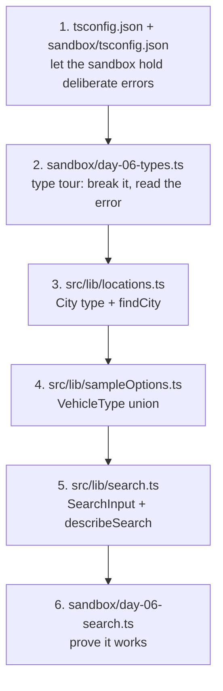
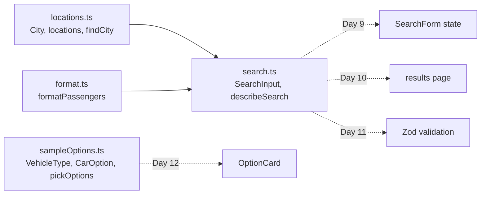
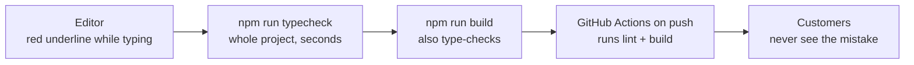
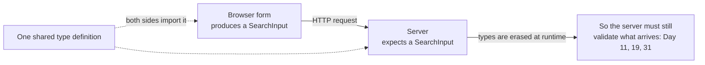

# Day 6: TypeScript basics: the labels that catch your mistakes (3h)

**Goal:** understand the TypeScript you have been copying since Day 2, practise it in a sandbox where you can break things safely, then define the project's first shared types (`City`, `VehicleType`, `SearchInput`).
**New today (max 2):** ① types: basic, object, array, optional (`?`) and union (`|`) ② "maybe missing" values (`string | undefined`, `?.`, `??`, narrowing)
**Reused from before:** `locations.ts` (Day 3), `formatPassengers` and `Route` (Day 4), `CarOption` and `pickOptions` (Day 5), Git and CI (Day 1).
**Branch today:** `day-06` (from `develop`).
**Time split:** 10 min recall · 10 min sandbox setup · 45 min type tour · 50 min project types · 25 min PR + CI · 20 min docs + Q&A · 10 min system design · 15 min DSA.

> **Your code may look different from mine.** You write your own names and styles (for example named exports or a lowercase `location` type), and that is fine. Follow the *idea* of each step, not the exact text. Where today's change touches something you named differently, I point it out.

## Recall quiz: yesterday (10 min, answer on paper first)
1. `filter` vs `map`: what does each return?
2. Does `sort` change the array it is called on?
3. What makes `pickOptions` a pure function?

<details><summary>Answers</summary>

1. `filter` returns a shorter array of the items that pass the test; `map` returns a same-length array of transformed items.
2. Yes, it reorders the original, so copy first (`[...list].sort(...)`) unless a method like `filter` already made a copy for you.
3. Same input always gives the same output, and it changes nothing outside itself.
</details>

Then take 3 spaced cards from [review-and-recall.md](./review-and-recall.md) (topics from 3+ days ago).

## Diagram 1: Order in which you work


## Diagram 2: Which type is used where (no screens change today)

Solid arrows are code that exists after today. Dotted arrows are where these types are used later.

## Diagram 3: Where TypeScript catches mistakes (environments)

Each box is a net further from you. The cheapest place to catch a mistake is the first one.

## Step 1: Recall and branch (10 min)
- **What:** do the quiz above, then start the day's branch.
- **How:**
  ```bash
  git switch develop
  git pull
  git switch -c day-06
  ```
- **Why:** recalling before looking is the strongest memory technique. A branch keeps `develop` safe.

## Step 2: Make the sandbox safe for broken code (10 min)
- **What:** tell the project to ignore `sandbox/` when it type-checks, give the sandbox its own TypeScript settings, and add a quick `typecheck` command.
- **Why:** `npm run build` type-checks every `.ts` file it can see. Today you will write wrong code on purpose, and that must never turn CI red. On Day 4 you did the same for ESLint (`globalIgnores`).
- **How:**
  1. In `tsconfig.json` change the last line of the file from `"exclude": ["node_modules"]` to:
     ```json
     "exclude": ["node_modules", "sandbox"]
     ```
  2. Create `sandbox/tsconfig.json`. The editor uses the nearest `tsconfig.json`, so your sandbox files still get red underlines:
     ```json
     {
       "extends": "../tsconfig.json",
       "include": ["./**/*.ts"],
       "exclude": []
     }
     ```
     `extends` means "same settings as the project's file, but include the sandbox".
  3. In `package.json` add one script next to `"lint"`:
     ```json
     "typecheck": "tsc --noEmit"
     ```
- **Check:** `npm run typecheck` prints nothing and exits normally. (`tsc` is the TypeScript compiler; `--noEmit` means "just check, don't create files".)

## Step 3: The type tour (45 min)
- **What:** nine tiny experiments with types.
- **Why:** you have used `: string`, `type Route = {...}` and `Route[]` for four days. Now you will see *why* they exist.
- **How:** create `sandbox/day-06-types.ts`. Type it, don't paste it. Read each numbered block and *predict* the output before you run it.
  ```ts
  // WHAT: Practice file for TypeScript basics. Not part of the app.
  // WHY:  Types are easiest to learn when you can break them and read the error.
  // HOW:  Read each block, predict the result, then change it and watch the editor.
  //       Check the types:  npx tsc --noEmit -p sandbox
  //       Run the code:     npx tsx sandbox/day-06-types.ts

  // 1) BASIC TYPES: a label that says what kind of value a variable holds.
  const city: string = "Haridwar";
  const seats: number = 4;
  const isAc: boolean = true;
  console.log("1)", city, seats, isAc);

  // 2) INFERENCE: TypeScript often works the label out by itself. Hover over `price`.
  const price = 2400; // TypeScript knows this is a number
  console.log("2)", price + 100);

  // 3) ARRAYS: a list where every item has the same type.
  const cities: string[] = ["Haridwar", "Rishikesh", "Badrinath"];
  const prices: number[] = [1200, 5500, 7500];
  console.log("3)", cities.length, prices[0]);

  // 4) OBJECT TYPES: describe the shape of a bundle. `type` gives the shape a name.
  type Car = {
    name: string;
    seats: number;
    hasCarrier?: boolean; // "?" means optional: it may be missing
  };
  const sedan: Car = { name: "Sedan", seats: 4 };
  const suv: Car = { name: "SUV", seats: 6, hasCarrier: true };
  console.log("4)", sedan.name, suv.hasCarrier, sedan.hasCarrier);

  // 5) UNION TYPES: "one of these exact options". Great for fixed choices.
  type VehicleType = "sedan" | "suv" | "tempo";
  const choice: VehicleType = "suv";
  console.log("5)", choice);

  // 6) FUNCTIONS: label the inputs and the output.
  function seatsLeft(car: Car, booked: number): number {
    return car.seats - booked;
  }
  console.log("6)", seatsLeft(suv, 2));

  // 7) "MAYBE MISSING" VALUES: find() returns the item OR undefined. TypeScript makes you check.
  const found = cities.find((c) => c === "Nainital"); // type: string | undefined
  if (found !== undefined) {
    console.log("7) found", found.toUpperCase()); // safe: inside the check it is a string
  } else {
    console.log("7) not found");
  }
  console.log("7) with ?. and ??:", found?.toUpperCase() ?? "unknown city");

  // 8) `type` vs `interface`: both describe object shapes. We use `type` in this course.
  interface Driver {
    name: string;
    phone: string;
  }
  const driver: Driver = { name: "Ramesh", phone: "9000000000" };
  console.log("8)", driver.name);

  // 9) NARROWING a union of different types.
  function describe(value: string | number): string {
    if (typeof value === "number") return `number ${value.toFixed(1)}`;
    return `text ${value.toUpperCase()}`;
  }
  console.log("9)", describe(7), "|", describe("sedan"));
  ```

  Check the types, then run it (Node 22.18 or newer runs `.ts` directly with `node sandbox/day-06-types.ts`; `npx tsx` works on any version):
  ```bash
  npx tsc --noEmit -p sandbox
  npx tsx sandbox/day-06-types.ts
  ```
  You should see:
  ```
  1) Haridwar 4 true
  2) 2500
  3) 3 1200
  4) Sedan true undefined
  5) suv
  6) 4
  7) not found
  7) with ?. and ??: unknown city
  8) Ramesh
  9) number 7.0 | text SEDAN
  ```

  **Label cheat sheet**

  | You write | It means | Example in this project |
  |---|---|---|
  | `name: string` | text | `slug: string` |
  | `count: number` | any number | `priceInr: number` |
  | `isAc: boolean` | `true` or `false` | |
  | `list: string[]` | a list of text (every item the same type) | `popularRoutes: Route[]` |
  | `type Car = { ... }` | the shape of an object, given a name | `Route`, `CarOption` |
  | `hasCarrier?: boolean` | the property may be missing | |
  | `"sedan" \| "suv"` | a **union**: exactly one of these values | `VehicleType` |
  | `string \| undefined` | text, or nothing | what `find()` returns |
  | `(x: number): string` | a function taking a number and returning text | `formatPrice` |

  **Two ideas to say aloud**
  - **Types are checked before the code runs, and then erased.** The browser never sees them. So TypeScript protects *you* from your own typos, but it cannot protect you from bad data arriving from outside (a form, a URL, an API). We handle that on Day 11 with Zod.
  - **`undefined` is the most common bug in JavaScript.** TypeScript's `string | undefined` makes it impossible to forget the "not found" case: it forces you to check (`if (found !== undefined)`) or to give a fallback (`found?.name ?? "Unknown"`). `?.` means "stop and give `undefined` if the thing before it is missing". `??` means "use this instead if the left side is `undefined` or `null`".

  **`type` vs `interface`:** for object shapes they do almost the same thing. We use `type` everywhere because it also handles unions. You will meet `interface` in other people's code, so you should be able to read it.

## Step 4: Give the project its first shared types (50 min)
- **What:** three small files get proper types.
- **Why:** the form (Day 9), the results page (Day 10), validation (Day 11) and the backend (Day 19) must all agree on what a "city", a "vehicle" and a "search" are. One definition each, written once, is that agreement.

### 4a. `City` and `findCity` in `src/lib/locations.ts`
- **How:** replace the file:
  ```ts
  // WHAT: The list of cities a customer can pick in the search form, plus a lookup helper.
  // WHY:  A fixed list (not free typing) guarantees the city matches our price table later.
  // HOW:  "City" describes one entry. findCity turns a slug (the safe id) back into a City.
  // NOTE: PLACEHOLDER list. Replace with the owner's real pick-up and drop cities.

  export type City = {
    slug: string; // safe id used in URLs and the database, e.g. "haridwar"
    name: string; // what people read, e.g. "Haridwar"
  };

  export const locations: City[] = [
    { slug: "delhi", name: "Delhi" },
    { slug: "dehradun", name: "Dehradun" },
    { slug: "haridwar", name: "Haridwar" },
    { slug: "rishikesh", name: "Rishikesh" },
    { slug: "kedarnath", name: "Kedarnath (Sonprayag)" },
    { slug: "badrinath", name: "Badrinath" },
  ];

  // find() returns the City or undefined, so the return type must say both.
  export function findCity(slug: string): City | undefined {
    return locations.find((city) => city.slug === slug);
  }
  ```

  > **If you named your type `location`:** rename it to `City`. A type called `Location` already exists in the browser (it describes `window.location`), so using that name confuses readers and tools. A lowercase `location` works but breaks the convention that types start with a capital letter. `City` has neither problem. The editor can rename every use for you: right-click the name, **Rename Symbol** (F2).

  Notice the return type of `findCity`: `City | undefined`. That is the "maybe missing" idea from Step 3 applied to real code. Anyone who calls it must handle the missing case.

### 4b. `VehicleType` in `src/lib/sampleOptions.ts`
- **How:** replace the file. Only the union type and the new `vehicle` field are new; `pickOptions` is unchanged:
  ```ts
  // WHAT: Sample car options and the rule "which ones fit this many passengers".
  // WHY:  This is the same logic the backend will run for real (Day 19), so we learn it
  //       now with fake data. Pure function = same input, same output, easy to test (Day 14).
  // HOW:  filter keeps cars with enough seats, sort puts the cheapest first.
  // NOTE: PLACEHOLDER cars and prices. The real ones come from the database on Day 17-19.

  // A union type: a vehicle is exactly one of these three words. Anything else is an error.
  export type VehicleType = "sedan" | "suv" | "tempo";

  export type CarOption = {
    id: string;
    name: string;
    vehicle: VehicleType;
    seats: number;
    priceInr: number;
  };

  export const sampleOptions: CarOption[] = [
    { id: "suv", name: "SUV (AC)", vehicle: "suv", seats: 6, priceInr: 3100 },
    { id: "sedan", name: "Sedan (AC)", vehicle: "sedan", seats: 4, priceInr: 2400 },
    { id: "tempo", name: "Tempo Traveller", vehicle: "tempo", seats: 12, priceInr: 5800 },
  ];

  export function pickOptions(options: CarOption[], passengers: number): CarOption[] {
    return options
      .filter((option) => option.seats >= passengers)
      .sort((a, b) => a.priceInr - b.priceInr);
  }
  ```

  A vehicle can only be `"sedan"`, `"suv"` or `"tempo"`. A typo like `"suvv"` is now a red underline, not a customer who can't book.

### 4c. `SearchInput` and `describeSearch` in a new file `src/lib/search.ts`
- **How:** create it:
  ```ts
  // WHAT: The shape of a search, and a function that describes it in plain words.
  // WHY:  The form (Day 9), the results page (Day 10), validation (Day 11) and the backend
  //       (Day 19) must all agree on what a search is. One type, written once, is that agreement.
  // HOW:  SearchInput lists the 4 fields. describeSearch builds a sentence from them.

  import { formatPassengers } from "@/lib/format";
  import { findCity } from "@/lib/locations";

  export type SearchInput = {
    from: string; // city slug, e.g. "haridwar"
    to: string; // city slug
    date: string; // "YYYY-MM-DD", the format a date input gives us
    passengers: number; // a whole number, 1 or more
  };

  export function describeSearch(input: SearchInput): string {
    // "?." stops if findCity returned undefined. "??" supplies a fallback instead.
    const fromName = findCity(input.from)?.name ?? "Unknown city";
    const toName = findCity(input.to)?.name ?? "Unknown city";
    return `${fromName} → ${toName} on ${input.date}, ${formatPassengers(input.passengers)}`;
  }
  ```

  - `SearchInput` has `date: string` and `passengers: number` because that is what a date input and a stepper give us. Cities are stored as **slugs** (`"haridwar"`), never as display names, so renaming "Kedarnath (Sonprayag)" never breaks a saved search.
  - `describeSearch` shows why `?.` and `??` matter: if someone passes an unknown slug it says "Unknown city" instead of crashing.

### 4d. Prove it works without a screen
- **How:** create `sandbox/day-06-search.ts`:
  ```ts
  // WHAT: Try the real project types from outside the app.
  // WHY:  Proves SearchInput and describeSearch work before any screen uses them.
  // HOW:  Run:  npx tsx sandbox/day-06-search.ts
  import { describeSearch, type SearchInput } from "../src/lib/search";

  const good: SearchInput = { from: "haridwar", to: "badrinath", date: "2026-11-02", passengers: 4 };
  console.log(describeSearch(good));
  console.log(describeSearch({ ...good, from: "atlantis", passengers: 1 }));
  ```

  ```bash
  npx tsx sandbox/day-06-search.ts
  ```
  ```
  Haridwar → Badrinath on 2026-11-02, 4 passengers
  Unknown city → Badrinath on 2026-11-02, 1 passenger
  ```
  Nothing changes on the web page today. That is normal: you laid the foundation the next three days build on.

## Step 5: Check, commit, pull request (25 min)
```bash
npm run lint && npm run typecheck && npm run build
git add .
git commit -m "Day 6: TypeScript basics, City, VehicleType and SearchInput types"
git push -u origin day-06
```
Open a PR into `develop`, wait for the green tick, merge. (CI only runs `lint` and `build`; `build` includes the type-check, so `typecheck` is just the fast way to get the same answer while you work.)

## Break it on purpose (10 min)
Do each one, read the message, then undo it.
1. In `sampleOptions.ts` change `vehicle: "suv"` to `vehicle: "bus"`. → `Type '"bus"' is not assignable to type 'VehicleType'.`
2. In `search.ts` change `input.passengers` to `input.passenger`. → `Property 'passenger' does not exist on type 'SearchInput'. Did you mean 'passengers'?`
3. In `search.ts` replace `findCity(input.from)?.name ?? "Unknown city"` with `findCity(input.from).name`. → `Object is possibly 'undefined'.` TypeScript is saving you from a crash.
4. In the sandbox, change `const found = cities.find(...)` usage so you call `found.toUpperCase()` without the `if`. Read the error and then fix it with `?.`.
5. Add a stray `const x: number = "a";` to a file inside `sandbox/` and run `npm run build`. It should still pass, because the sandbox is excluded. Then run `npx tsc --noEmit -p sandbox` and watch it fail. Delete the line.

## Common errors and what they mean
| Message | Meaning | Fix |
|---|---|---|
| `Type 'string' is not assignable to type 'number'` (TS2322) | you put the wrong kind of value in a labelled box | change the value or fix the label |
| `Type '"bus"' is not assignable to type 'VehicleType'` | not one of the allowed union words | use an allowed value, or add it to the union on purpose |
| `Property 'seats' is missing in type '{ name: string; }' but required in type 'Car'` (TS2741) | an object is missing a required field | add it, or make it optional with `?` if it truly can be absent |
| `Object literal may only specify known properties, and 'color' does not exist in type 'Car'` (TS2353) | you wrote a field the type doesn't know about | remove it, or add it to the type |
| `Property 'seat' does not exist on type 'Car'. Did you mean 'seats'?` (TS2551) | a typo | follow the hint |
| `Argument of type 'string' is not assignable to parameter of type 'number'` (TS2345) | called a function with the wrong kind of input | pass the right type |
| `'found' is possibly 'undefined'` (TS18048) or `Object is possibly 'undefined'` (TS2532) | the value might be missing and you didn't check | `if (x !== undefined)`, `x?.y`, or `x ?? fallback` |
| `tsx: command not found` or an npx prompt | `tsx` isn't installed globally | `npx tsx file.ts` (answer yes), or use Node 22.18+ and `node file.ts` |

## Checklist
- [ ] `npm run lint`, `npm run typecheck` and `npm run build` all pass.
- [ ] `sandbox/day-06-types.ts` and `sandbox/day-06-search.ts` run with the output shown above.
- [ ] You can explain `string | undefined` and `?.` / `??` in your own words.
- [ ] `City`, `VehicleType` and `SearchInput` exist, and no `location` type name is left.
- [ ] PR merged and CI green.

## Write today's doc (10 min)
Create `docs/day-06.md` with: *What I built*, *How the data flows* (use Diagram 2), *Types I can now read* (list five from this project), *What confused me*. 5–10 lines under each.

## System design corner (10 min)
**Concept: types are a contract between the parts of a system.**

- A shared type stops the form and the server from drifting apart: change a field in one place and TypeScript points at every file that must change.
- But types vanish when the code runs. A hacker can send anything to your server. So we use types for *developer safety* and validation (Zod, Day 11) for *runtime safety*.
- **Say aloud:** "Why isn't a TypeScript type enough to protect my API?"

## DSA of the day (15–20 min)
**Best Time to Buy and Sell Stock (one pass).** Given a list of prices by day, return the best profit from buying on one day and selling on a later day (0 if no profit is possible).
- *Brute force:* try every pair of days, O(n²).
- *Better:* walk through once and remember the **cheapest price so far**; at each day the best sale is `price - cheapest`. O(n) time, O(1) space.
- *Project link:* "what's the cheapest day to travel, and how much would waiting save?" is the same shape.

`sandbox/dsa/day-06.ts` (type-checked by the sandbox settings from Step 2):
```ts
// WHAT: Best Time to Buy and Sell Stock (one pass).
// WHY:  Practise a single loop that remembers "the cheapest so far".
// HOW:  Run:  npx tsx sandbox/dsa/day-06.ts
function maxProfit(prices: number[]): number {
  let cheapest = Infinity; // lowest price seen so far
  let best = 0; // best profit seen so far (0 means "don't trade")
  for (const price of prices) {
    if (price < cheapest) cheapest = price;
    else best = Math.max(best, price - cheapest);
  }
  return best;
}
console.log(maxProfit([7, 1, 5, 3, 6, 4])); // 5 (buy at 1, sell at 6)
console.log(maxProfit([7, 6, 4, 3, 1])); // 0 (prices only fall)
console.log(maxProfit([])); // 0
```

```bash
npx tsx sandbox/dsa/day-06.ts
```
```
5
0
0
```
Test yourself with: one price, all equal, prices that only fall, and a very large list. Follow-up: also return the buy day and sell day.

More on this track: [system-design-and-dsa.md](./system-design-and-dsa.md).

## Interview Q&A
1. **What problem does TypeScript solve?** It adds types to JavaScript so many mistakes (typos, wrong kinds of values, forgotten missing cases) are caught in the editor and at build time instead of in front of a user.
2. **`type` vs `interface`?** Both describe object shapes. `type` can also name unions and other shapes, so I use `type` by default.
3. **What is a union type? Give an example.** A value that must be one of several options, like `type VehicleType = "sedan" | "suv" | "tempo"`. It makes invalid values impossible to write.
4. **What does `string | undefined` mean, and how do you handle it?** Text or nothing. I check it (`if (x !== undefined)`), use optional chaining (`x?.length`), or give a fallback (`x ?? "default"`).
5. **What do `?.` and `??` do?** `?.` stops and returns `undefined` if the left side is missing. `??` uses the right side when the left is `undefined` or `null`.
6. **Are TypeScript types checked at runtime?** No. They are erased when the code runs, so data from outside (forms, URLs, APIs) still needs runtime validation.
7. **(System design) Why share one `SearchInput` type between the form and the server?** So both sides agree on the contract and a change in one place shows up as a compile error everywhere else. It is a safety net for developers, not a replacement for server-side validation.
8. **(Behavioural) Tell me about a bug the compiler caught for you.** Use today's example: a `vehicle: "bus"` typo or an unchecked `find()` result. Say what the error said, how long it would have taken to find without it, and what you changed.

