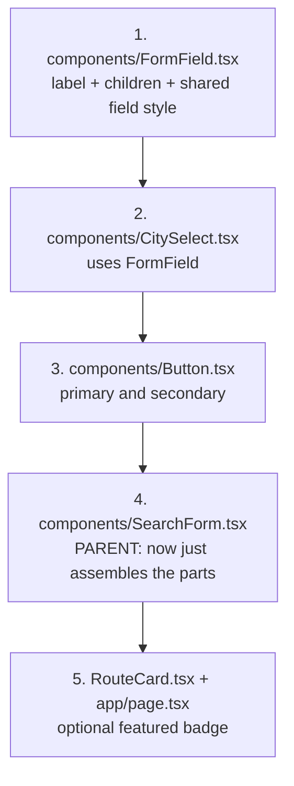
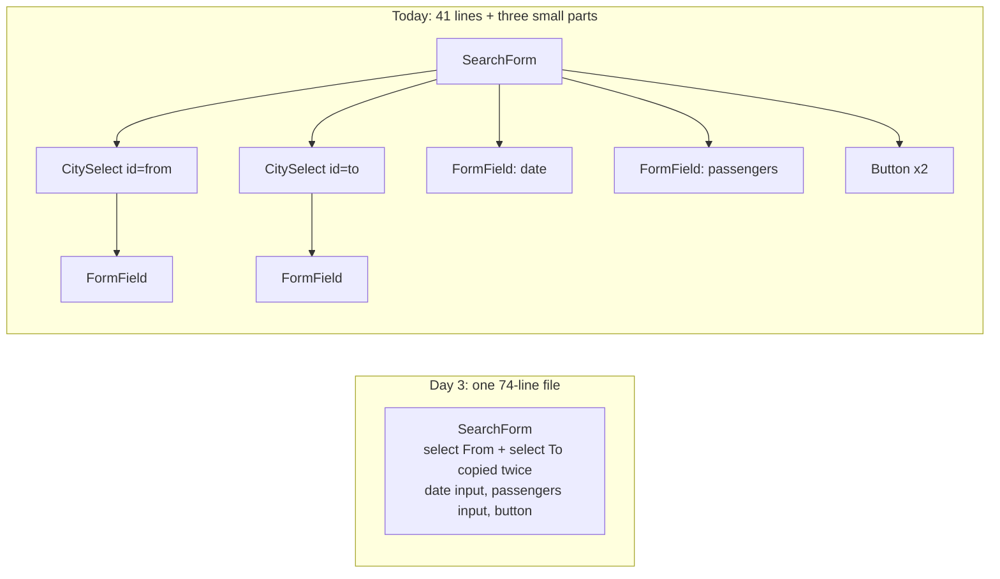
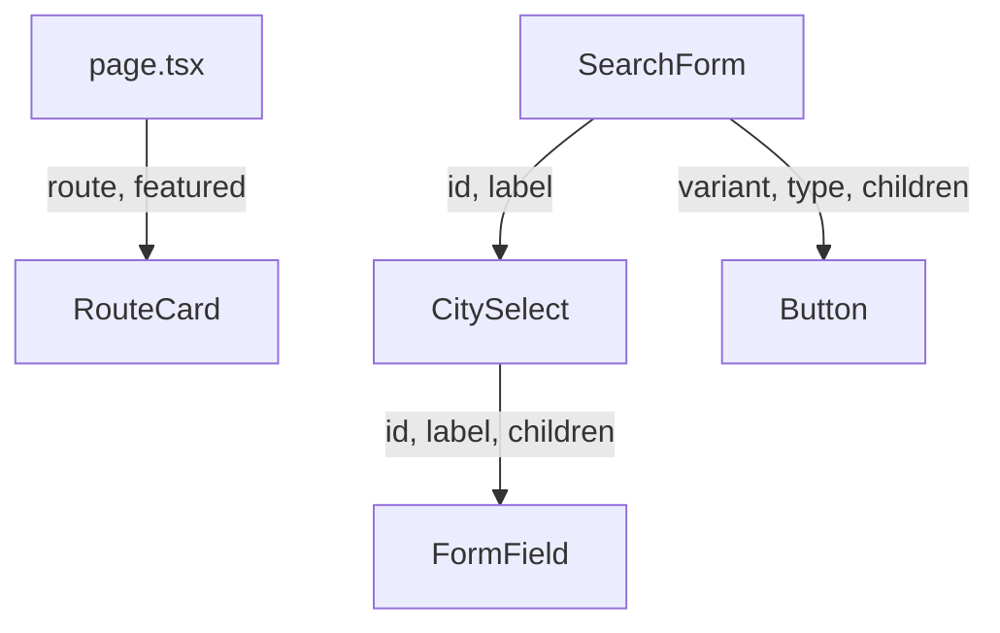
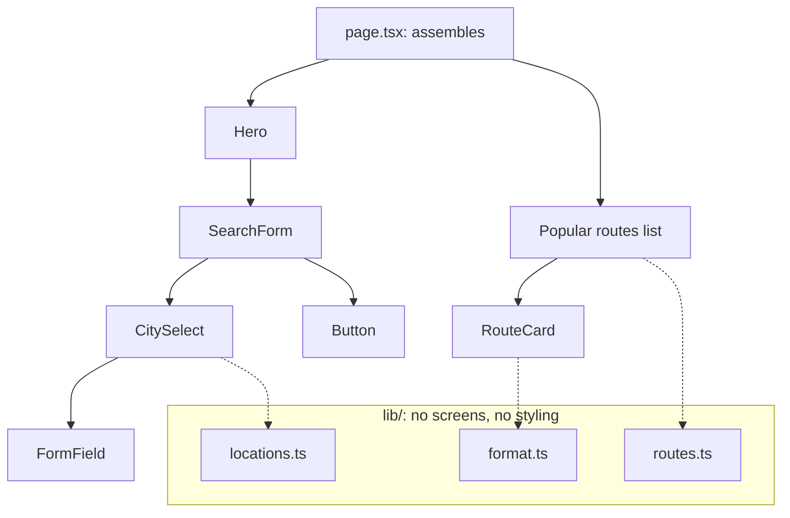

# Day 7: Components and typed props: build reusable pieces (3h)

**Goal:** remove the copy-paste from the search form by building three small reusable components (`FormField`, `CitySelect`, `Button`) with properly typed props, and add a "Popular" badge to the route cards.
**New today (max 2):** ① typed props: required, optional (`?`), default values and `children` ② extracting a component (composition): spot repetition, pull it out, give it inputs
**Reused from before:** props and `.map()` with `key` (Day 2), the form layout (Day 3), union types and `?` (Day 6), `locations` (Day 3).
**Branch today:** `day-07` (from `develop`).
**Time split:** 10 min recall · 30 min props lab · 70 min build · 20 min check and browser test · 25 min PR + CI · 15 min docs · 10 min system design · 15 min DSA = 195 min. If you are over time, drop the DSA first.

> **Your code may look different from mine.** Follow the idea, not the exact text. On Day 3 I said "you'll turn the two dropdowns into one reusable component on Day 7". That is today.

## Recall quiz: yesterday (10 min, answer on paper first)
1. What does `string | undefined` mean?
2. `cities.find(...)` returns what type, and why?
3. Why is `type VehicleType = "sedan" | "suv" | "tempo"` better than `vehicle: string`?

<details><summary>Answers</summary>

1. Text, or nothing (the value might be missing).
2. `string | undefined`, because nothing might match.
3. Only the three allowed words compile, so a typo like `"suvv"` is caught immediately.
</details>

Then take 3 spaced cards from [review-and-recall.md](./review-and-recall.md) (topics from 3+ days ago).

## Diagram 1: Order in which you write files (small → big)


## Diagram 2: The search form before and after

Fewer lines is not the goal. The goal is that fixing the label style or the city list now happens in **one** file.

## Diagram 3: How props flow today

Data flows **down** only, parent to child, exactly like Day 2.

## Step 1: Recall and branch (10 min)
```bash
git switch develop
git pull
git switch -c day-07
```

## Step 2: Props lab (30 min)
- **What:** learn the five prop patterns before using them.
- **Why:** every component you ever write is a function whose *inputs are props*. Once this clicks, React gets much easier.
- **How:** read the table, then predict what each line does.

  | Pattern | Looks like | Means |
  |---|---|---|
  | Required prop | `label: string` | the parent **must** pass it, or TypeScript errors |
  | Optional prop | `featured?: boolean` | the parent **may** pass it |
  | Default value | `{ featured = false }` | what to use when it isn't passed |
  | Union prop | `variant?: "primary" \| "secondary"` | only these words allowed (Day 6 in action) |
  | `children` | `children: ReactNode` | whatever is written **between** the opening and closing tags |

  Three rules to say aloud:
  1. **Props are read-only.** A child never changes what its parent gave it.
  2. **A component is a function.** `<CitySelect id="from" label="From" />` calls `CitySelect({ id: "from", label: "From" })`.
  3. **Name the props type** (`type CitySelectProps = {...}`) right above the component. Without it, TypeScript can't know what the inputs are and complains with `Binding element 'id' implicitly has an 'any' type`.

  **Tiny practice (10 min):** in `RouteCard.tsx` temporarily add a second optional prop `highlight?: boolean` and show a coloured border when it's true. Pass it from `page.tsx` for the second card. Then remove it. You just did the whole prop workflow: define in the child, pass from the parent.

## Step 3: `FormField`, the label wrapper (15 min)
- **What:** a component that draws a label and shows whatever you put inside it.
- **Why:** every field repeats the same label and spacing. And `children` is the most useful prop you will meet.
- **How:** create `src/components/FormField.tsx`:
  ```tsx
  // WHAT: One form field = a label plus whatever input the parent puts inside it.
  // WHY:  Every field in the search form repeats the same label + spacing. Write it once.
  // HOW:  "children" is a special prop: everything written between <FormField> and
  //       </FormField> arrives here as children. ReactNode means "anything React can show".
  import type { ReactNode } from "react";

  // Shared look for inputs and dropdowns, exported so other components reuse it.
  export const fieldClass =
    "mt-1 w-full rounded-lg border border-slate-300 bg-white px-3 py-2 focus:border-amber-600 focus:outline-none focus:ring-2 focus:ring-amber-200";

  type FormFieldProps = {
    id: string; // must match the id of the input inside, so the label points at it
    label: string;
    children: ReactNode;
  };

  export default function FormField({ id, label, children }: FormFieldProps) {
    return (
      <div>
        <label htmlFor={id} className="block text-sm font-medium text-slate-700">
          {label}
        </label>
        {children}
      </div>
    );
  }
  ```

  The `id` appears twice on purpose: once here (`htmlFor`) and once on the input inside. They must match, or clicking the label won't focus the input.

## Step 4: `CitySelect`, the dropdown that serves both fields (15 min)
- **What:** one dropdown component used for From and To.
- **How:** create `src/components/CitySelect.tsx`:
  ```tsx
  // WHAT: A dropdown of cities with its label (used for both "From" and "To").
  // WHY:  On Day 3 we copy-pasted the same dropdown twice. Now one component serves both.
  // HOW:  Two props (id, label) make each use different. The city list comes from locations.ts.
  import FormField, { fieldClass } from "@/components/FormField";
  import { locations } from "@/lib/locations";

  type CitySelectProps = {
    id: string; // also used as the field's name, so "from" arrives as ?from=...
    label: string;
  };

  export default function CitySelect({ id, label }: CitySelectProps) {
    return (
      <FormField id={id} label={label}>
        <select id={id} name={id} defaultValue="" className={fieldClass}>
          <option value="" disabled>
            Select city
          </option>
          {locations.map((place) => (
            <option key={place.slug} value={place.slug}>
              {place.name}
            </option>
          ))}
        </select>
      </FormField>
    );
  }
  ```

  It uses `FormField` inside itself: components can contain components. Both dropdowns now come from this one file.

## Step 5: `Button` with two looks (20 min)
- **What:** a button with a "primary" style (main action) and a "secondary" style (quiet).
- **How:** create `src/components/Button.tsx`:
  ```tsx
  // WHAT: A reusable button with two looks: "primary" (main action) and "secondary" (quiet).
  // WHY:  Buttons appear on every screen. One component keeps them identical and easy to restyle.
  // HOW:  "variant" is a union type from Day 6, so only the allowed words compile.
  //       "variant = 'primary'" is a default: if the parent doesn't pass one, primary is used.
  import type { ReactNode } from "react";

  type ButtonVariant = "primary" | "secondary";

  // Record<ButtonVariant, string> forces an entry for EVERY variant. Add a third variant
  // and forget its style, and TypeScript refuses to compile.
  const variantClass: Record<ButtonVariant, string> = {
    primary: "bg-amber-700 text-white hover:bg-amber-800",
    secondary: "border border-slate-300 bg-white text-slate-700 hover:bg-slate-50",
  };

  type ButtonProps = {
    children: ReactNode;
    variant?: ButtonVariant; // "?" = optional
    type?: "button" | "submit" | "reset";
  };

  export default function Button({ children, variant = "primary", type = "button" }: ButtonProps) {
    return (
      <button
        type={type}
        className={`w-full rounded-lg px-8 py-3 font-semibold sm:w-auto ${variantClass[variant]}`}
      >
        {children}
      </button>
    );
  }
  ```

  Three things to notice:
  - `variant = "primary"` is a **default**. `<Button>Search cabs</Button>` needs no variant.
  - `Record<ButtonVariant, string>` means "an object with exactly one entry for every variant". If you add a third variant later and forget its style, TypeScript refuses to compile (try it in Break it on purpose).
  - `type` defaults to `"button"`. A button inside a form defaults to **submit** in HTML, which can submit the form by accident. Being explicit is safer.

  **CSS: new classes**

  | Class | Does | Why |
  |---|---|---|
  | `w-full ... sm:w-auto` | full width on phones, natural width from 640px | a big thumb target on a phone (same as Day 3) |
  | `px-8 py-3` | 32px sides, 12px top and bottom | comfortable to tap |
  | `border border-slate-300 bg-white text-slate-700 hover:bg-slate-50` | thin grey outline, white fill, very light grey on hover | the "quiet" secondary look |
  | `` `...${variantClass[variant]}` `` | a JavaScript template string that adds the chosen look's classes | one button shape, two colours |

## Step 6: Rebuild `SearchForm` from the parts (15 min)
- **What:** replace `src/components/SearchForm.tsx`. The look on screen stays the same; the file gets shorter and easier to read.
- **How:**
  ```tsx
  // WHAT: The 4-field search form: From, To, Date, Passengers.
  // WHY:  This is the front door of the whole product. Customers start here.
  // HOW:  Built from small parts: CitySelect, FormField and Button. This file only decides
  //       the order and layout. It still has no behaviour; that arrives on Days 8 and 9.
  import Button from "@/components/Button";
  import CitySelect from "@/components/CitySelect";
  import FormField, { fieldClass } from "@/components/FormField";

  export default function SearchForm() {
    return (
      <form className="mx-auto mt-10 max-w-4xl rounded-2xl bg-white p-5 text-left shadow-lg">
        <div className="grid gap-4 sm:grid-cols-2 lg:grid-cols-4">
          <CitySelect id="from" label="From" />
          <CitySelect id="to" label="To" />

          <FormField id="date" label="Travel date">
            <input id="date" name="date" type="date" className={fieldClass} />
          </FormField>

          <FormField id="passengers" label="Passengers">
            <input
              id="passengers"
              name="passengers"
              type="number"
              min={1}
              max={12}
              defaultValue={2}
              className={fieldClass}
            />
          </FormField>
        </div>

        <div className="mt-5 flex flex-col gap-3 sm:flex-row">
          <Button>Search cabs</Button>
          <Button variant="secondary" type="reset">
            Clear
          </Button>
        </div>
      </form>
    );
  }
  ```

  The new "Clear" button is `type="reset"`: the browser itself puts every field back to its starting value. (On Day 9 you'll see why this stops working once React controls the inputs.)

  **CSS: new classes**

  | Class | Does | Why |
  |---|---|---|
  | `mt-5 flex flex-col gap-3 sm:flex-row` | buttons stacked on phones, side by side from 640px, 12px between | two buttons fit small screens |

## Step 7: A "Popular" badge on route cards (10 min)
- **What:** an optional `featured` prop on `RouteCard`, and use it for the first route.
- **Why:** more practice with optional props and **conditional rendering** (`condition && <thing />`). It also previews the `featured_routes` table we planned for the real database.
- **How:** replace `src/components/RouteCard.tsx`:
  ```tsx
  // WHAT: One card showing a single route.
  // WHY:  A small reusable piece: write once, use for every route in the list.
  // HOW:  It receives a "route" through props (inputs) and only displays it.
  //       "featured" is an optional prop: when true, a small "Popular" badge appears.
  import { formatPrice } from "@/lib/format";
  import type { Route } from "@/lib/routes";

  type RouteCardProps = {
    route: Route;
    featured?: boolean;
  };

  export default function RouteCard({ route, featured = false }: RouteCardProps) {
    return (
      <article className="rounded-xl border border-slate-200 bg-white p-5 shadow-sm">
        {featured && (
          <span className="mb-2 inline-block rounded-full bg-amber-100 px-3 py-1 text-xs font-semibold text-amber-800">
            Popular
          </span>
        )}
        <h3 className="text-lg font-semibold">
          {route.from} → {route.to}
        </h3>
        <p className="mt-2 text-sm text-slate-600">{route.blurb}</p>
        <p className="mt-3 text-sm font-semibold text-amber-700">
          From {formatPrice(route.fromPriceInr)}
        </p>
      </article>
    );
  }
  ```

  Then in `src/app/page.tsx` change the list to pass `featured` for the first card:
  ```tsx
  {popularRoutes.map((route, index) => (
    <RouteCard key={route.slug} route={route} featured={index === 0} />
  ))}
  ```
  `index` is the position in the list (0, 1, 2…), so only the first card gets `featured` true.

  **CSS: new classes**

  | Class | Does | Why |
  |---|---|---|
  | `mb-2 inline-block` | 8px below; sizes to its text instead of full width | a small badge above the title |
  | `rounded-full bg-amber-100 px-3 py-1 text-xs font-semibold text-amber-800` | pill shape, light amber, small bold dark-amber text | looks like a tag |

## Step 8: Check it in the browser (20 min)
```bash
npm run lint && npm run typecheck && npm run build
npm run dev
```
Check each point:
- The search form looks the same as Day 3, plus a second "Clear" button.
- Both dropdowns list the six cities; clicking the "To" label focuses the To dropdown.
- Pick cities, a date and a passenger number, then click **Clear**: everything goes back to the starting values.
- The first route card has a **Popular** badge; the others don't.
- Right-click → View page source: the form and cards are in the HTML. None of these files needs `"use client"` because they have no state yet. They are rendered on the server.

## Step 9: Commit and pull request (25 min)
```bash
git add .
git commit -m "Day 7: FormField, CitySelect, Button, typed props, featured badge"
git push -u origin day-07
```
PR into `develop`, wait for green CI, merge, check the preview URL.

## Break it on purpose (10 min)
1. In `SearchForm.tsx` write `<CitySelect id="to" />` (no label). → `Property 'label' is missing in type '{ id: string; }' but required in type 'CitySelectProps'.`
2. Write `<Button variant="danger">`. → `Type '"danger"' is not assignable to type 'ButtonVariant | undefined'.`
3. In `Button.tsx` change the type to `"primary" | "secondary" | "danger"` and don't add a style. → `Property 'danger' is missing in type '{ primary: string; secondary: string; }' but required in type 'Record<ButtonVariant, string>'.` (This is the safety net `Record` gives you. Undo it.)
4. Write `<Button></Button>` with nothing inside. → `Property 'children' is missing in type '{}' but required in type 'ButtonProps'.`
5. In `CitySelect.tsx` delete the `type CitySelectProps` and write `({ id, label })` only. → `Binding element 'id' implicitly has an 'any' type.`

## Common errors and what they mean
| Message | Meaning | Fix |
|---|---|---|
| `Property 'label' is missing in type '{ id: string; }' but required in type 'CitySelectProps'` | the parent forgot a required prop | pass it, or make it optional with `?` if it truly is optional |
| `Type '"danger"' is not assignable to type 'ButtonVariant \| undefined'` | not an allowed union word | use an allowed variant |
| `Binding element 'id' implicitly has an 'any' type` | you destructured props without a props type | add `type XProps = {...}` and annotate the parameter |
| `Cannot find module '@/components/Button' or its corresponding type declarations` | a typo in the import path or file name | the path is case-sensitive; match the file name |
| Clicking a label doesn't focus the input | `htmlFor` and the input's `id` don't match | make them identical |
| A form submits and reloads the page when you click a button | the button's `type` is `submit` (the HTML default) | set `type="button"` on buttons that shouldn't submit |

## Checklist
- [ ] `lint`, `typecheck` and `build` pass.
- [ ] The form looks the same as before, with a working **Clear** button.
- [ ] Only the first route card shows **Popular**.
- [ ] You can name the five prop patterns from Step 2 and give an example of each from today's code.
- [ ] PR merged and CI green.

## Write today's doc (10 min)
`docs/day-07.md`: *What I built*, *How props flow* (Diagram 3 in your own words), *When I should turn repeated code into a component*, *What confused me*.

## System design corner (10 min)
**Concept: separation of concerns and the component tree.**

- Each piece has **one job**: `FormField` lays out a label, `CitySelect` knows about cities, `lib/` knows data and rules but nothing about screens.
- Why it matters beyond React: this is how you keep any system changeable. On Day 18 `locations.ts` becomes a database query and `CitySelect` doesn't change at all.
- The tree is also a map for debugging: a bug in the label style lives in `FormField`, a wrong city list lives in `locations.ts`.
- **Say aloud:** "If the owner wants to rename a city, which single file changes? If they want rounder buttons, which one?"

## DSA of the day (15–20 min)
**Maximum Depth of Binary Tree (recursion).** Given a tree, return how many levels deep it is.
- *Idea:* the depth of a node is 1 plus the deeper of its two children; an empty node has depth 0. The function calls itself on smaller pieces, just like a page is made of components that contain components.
- *Project link:* the component tree in the diagram above is a tree. "How deep is it?" is the same question.

`sandbox/dsa/day-07.ts`:
```ts
// WHAT: Maximum Depth of Binary Tree (recursion).
// WHY:  A page is a tree of components, and "how deep is it?" is the same question.
// HOW:  Run:  npx tsx sandbox/dsa/day-07.ts
type TreeNode = {
  value: number;
  left: TreeNode | null;
  right: TreeNode | null;
};

function maxDepth(node: TreeNode | null): number {
  if (node === null) return 0; // base case: an empty tree has depth 0
  return 1 + Math.max(maxDepth(node.left), maxDepth(node.right));
}

const leaf = (value: number): TreeNode => ({ value, left: null, right: null });
const tree: TreeNode = {
  value: 3,
  left: leaf(9),
  right: { value: 20, left: leaf(15), right: leaf(7) },
};
console.log(maxDepth(tree)); // 3
console.log(maxDepth(leaf(1))); // 1
console.log(maxDepth(null)); // 0
```

```bash
npx tsx sandbox/dsa/day-07.ts
```
```
3
1
0
```
Time O(n) (each node visited once), space O(h) for the call stack, where h is the depth. Test: empty tree, one node, a long chain on one side. Follow-up: write it without recursion using a loop and a list of nodes at each level.

More on this track: [system-design-and-dsa.md](./system-design-and-dsa.md).

## Interview Q&A
1. **What are props?** Inputs a parent passes to a child component. The child reads them but must not change them.
2. **What is the `children` prop?** Whatever is written between a component's opening and closing tags, so a wrapper like `FormField` can show anything inside it.
3. **How do you make a prop optional and give it a default?** Mark it with `?` in the type and give it a default value when destructuring, like `{ variant = "primary" }`.
4. **When would you extract a component?** When the same markup appears more than once, or when one piece has a clear single job and the file is getting hard to read.
5. **Why use `Record<Variant, string>` for styles?** It forces an entry for every variant, so adding a variant and forgetting its style is a compile error.
6. **Why set `type="button"` on a button in a form?** The HTML default is `submit`, which can submit the form unexpectedly.
7. **(System design) What does "separation of concerns" mean and why does it help?** Each module has one job, so changes stay local and parts can be replaced (like swapping a file for a database query) without touching the others.
8. **(Behavioural) Tell me about refactoring code without changing how it behaves.** Describe how you checked the screen looked identical before and after, and what got easier.

