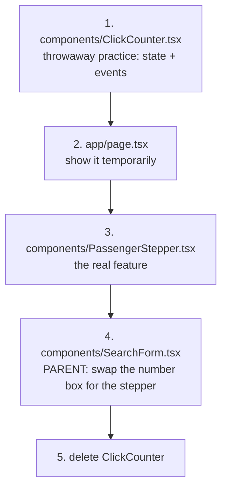
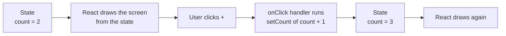
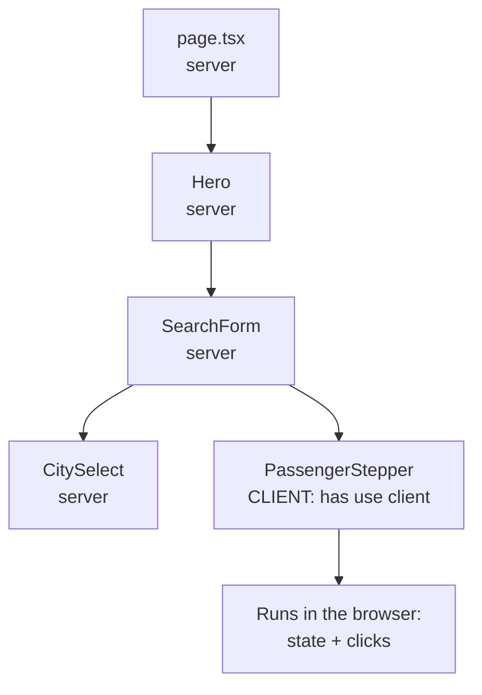
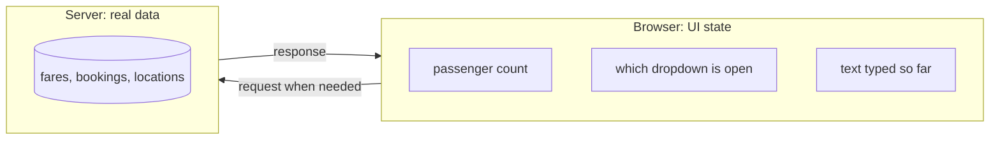

# Day 8: State and events: the page starts reacting (3h)

**Goal:** make your first interactive component, a passenger stepper (– 2 passengers +) that updates on screen and shows which car types fit, and learn why a "Clear" button can fail to clear it.
**New today (max 2):** ① `useState`: a component's memory ② events: `onClick`, and what `"use client"` means
**Reused from before:** typed props (Day 7), `formatPassengers` (Day 4), `pickOptions` and `sampleOptions` (Day 5), union types (Day 6).
**Branch today:** `day-08` (from `develop`).
**Time split:** 10 min recall · 40 min learn state (practice component) · 55 min build the stepper · 20 min test + clean up · 25 min PR + CI · 15 min docs · 10 min system design · 15 min DSA = 190 min. If you are over time, drop the DSA first.

> **Your code may look different from mine.** If you already used `useState` in `SearchForm` back on Day 3, great, you are ahead. Today we do it step by step so you know *why* it works.

## Recall quiz: yesterday (10 min, answer on paper first)
1. What is the `children` prop?
2. How do you make a prop optional, and how do you give it a default?
3. Why write `type="button"` on a button inside a form?

<details><summary>Answers</summary>

1. Whatever is written between a component's opening and closing tags.
2. Add `?` in the props type, and a default when destructuring: `{ variant = "primary" }`.
3. The HTML default is `submit`, which can submit the form by accident.
</details>

Then take 3 spaced cards from [review-and-recall.md](./review-and-recall.md) (topics from 3+ days ago).

## Diagram 1: Order in which you work


## Diagram 2: The state loop (the one picture to remember)

You never edit the screen. You change the state, and React redraws the screen from it.

## Diagram 3: Server and client parts of the page

By default every component runs on the **server** and sends finished HTML. A component that needs memory (`useState`) or reacts to clicks must also run in the **browser**, so its file starts with `"use client"`. Only that file and what it imports become browser code, so the rest of the page stays light.

## Step 1: Recall and branch (10 min)
```bash
git switch develop
git pull
git switch -c day-08
```

## Step 2: Learn state with a throwaway component (40 min)
- **What:** a click counter and a show/hide toggle.
- **Why:** state and events are easiest to learn on the smallest example. We delete it afterwards.
- **How:** create `src/components/ClickCounter.tsx`:
  ```tsx
  // WHAT: A throwaway practice component: a click counter and a show/hide toggle.
  // WHY:  Learn useState and events on the smallest possible example before using them for real.
  // HOW:  "use client" says this file runs in the browser (hooks and clicks need that).
  //       DELETE THIS FILE at Step 5, once you understand it.
  "use client";

  import { useState } from "react";

  export default function ClickCounter() {
    // useState(0) returns a pair: [current value, function that changes it].
    const [count, setCount] = useState(0);
    const [showHint, setShowHint] = useState(false);

    return (
      <div className="mx-auto my-6 max-w-sm rounded-lg border border-dashed border-slate-400 p-4 text-center">
        <p className="text-lg">Clicked {count} times</p>
        <button
          type="button"
          onClick={() => setCount(count + 1)}
          className="mt-2 rounded bg-slate-800 px-3 py-1 text-white"
        >
          Add one
        </button>
        <button
          type="button"
          onClick={() => setShowHint(!showHint)}
          className="mt-2 ml-2 rounded border border-slate-400 px-3 py-1"
        >
          {showHint ? "Hide hint" : "Show hint"}
        </button>
        {showHint && <p className="mt-2 text-sm text-slate-600">Changing state re-draws this component.</p>}
      </div>
    );
  }
  ```

  Temporarily show it: in `src/app/page.tsx` add `import ClickCounter from "@/components/ClickCounter";` at the top and put `<ClickCounter />` right under `<Hero />`.

  **Read it line by line**

  | Code | Meaning |
  |---|---|
  | `"use client"` | this file runs in the browser (needed for hooks and clicks) |
  | `const [count, setCount] = useState(0)` | `count` is the current value (starts at 0). `setCount` is the **only** way to change it |
  | `onClick={() => setCount(count + 1)}` | when clicked, ask React to set the count to the old one plus one |
  | `{showHint && <p>…</p>}` | show the paragraph only while `showHint` is true |
  | `showHint ? "Hide hint" : "Show hint"` | pick one of two texts |

  **Four rules to say aloud**
  1. **Change state only with its setter** (`setCount`). Writing `count++` or `count = 5` does nothing on screen (and TypeScript says "Cannot assign to 'count' because it is a constant").
  2. **Pass a function to `onClick`, don't call one.** `onClick={() => setCount(count + 1)}` is right. `onClick={setCount(count + 1)}` runs immediately while drawing, and TypeScript rejects it: `Type 'void' is not assignable to type 'MouseEventHandler<HTMLButtonElement>'`.
  3. **State updates are requests, not instant.** Inside one click, `count` still holds the old number. See the experiment below.
  4. **A component's state is private to that copy.** Two `<ClickCounter />` on the page count separately.

  **Experiment (10 min): the "stale" count.** Change the button's handler to:
  ```tsx
  onClick={() => {
    setCount(count + 1);
    setCount(count + 1);
  }}
  ```
  Click once. It goes up by **1**, not 2, because both lines read the same old `count`. Now fix it by giving the setter a function (it receives the latest value):
  ```tsx
  onClick={() => {
    setCount((current) => current + 1);
    setCount((current) => current + 1);
  }}
  ```
  Now one click adds 2. Rule of thumb: **when the new value depends on the old one, use the function form.** We use it in the stepper.

  > **React Compiler is on in this project** (`reactCompiler: true` in `next.config.ts`). It automatically avoids needless redraws, so you will not need `useMemo` or `useCallback` in this course.

## Step 3: Build the `PassengerStepper` (55 min)
- **What:** a "– 2 passengers +" control that never goes below 1 or above 12, and shows how many car types fit.
- **Why:** on a phone, tapping + and – is easier and safer than typing. The limits mean the user can't enter nonsense.
- **How:** create `src/components/PassengerStepper.tsx`:
  ```tsx
  // WHAT: A "– 2 passengers +" control with a live hint about which cars fit.
  // WHY:  A stepper is friendlier than typing a number on a phone, and it can never go below 1
  //       or above 12, so the user can't type nonsense.
  // HOW:  The count lives in state. Clicking – or + changes the state, and React re-draws.
  //       The number of fitting cars is DERIVED from the count each time: never stored separately.
  "use client";

  import { useState } from "react";
  import { formatPassengers } from "@/lib/format";
  import { pickOptions, sampleOptions } from "@/lib/sampleOptions";

  const MIN_PASSENGERS = 1;
  const MAX_PASSENGERS = 12;

  const stepButtonClass =
    "flex h-10 w-10 items-center justify-center rounded-lg border border-slate-300 bg-white text-xl font-semibold text-slate-700 hover:bg-slate-50 disabled:cursor-not-allowed disabled:opacity-40";

  export default function PassengerStepper() {
    const [count, setCount] = useState(2);

    // Derived value: recalculated on every draw from `count`. No second useState needed.
    const carsThatFit = pickOptions(sampleOptions, count).length;

    return (
      <div role="group" aria-labelledby="passengers-label">
        <span id="passengers-label" className="block text-sm font-medium text-slate-700">
          Passengers
        </span>
        <div className="mt-1 flex items-center gap-3">
          <button
            type="button"
            aria-label="Fewer passengers"
            disabled={count <= MIN_PASSENGERS}
            onClick={() => setCount((current) => current - 1)}
            className={stepButtonClass}
          >
            −
          </button>
          <span className="min-w-28 text-center font-medium" aria-live="polite">
            {formatPassengers(count)}
          </span>
          <button
            type="button"
            aria-label="More passengers"
            disabled={count >= MAX_PASSENGERS}
            onClick={() => setCount((current) => current + 1)}
            className={stepButtonClass}
          >
            +
          </button>
        </div>
        <p className="mt-1 text-xs text-slate-500">
          {carsThatFit === 1 ? "1 car type fits" : `${carsThatFit} car types fit`}
        </p>
      </div>
    );
  }
  ```

  **Notice**
  - `carsThatFit` is **not** state. It is calculated from `count` on every draw using `pickOptions` from Day 5. This is called **derived state**: if you can calculate something from existing state, don't store it separately, or the two can drift apart.
  - `disabled={count <= MIN_PASSENGERS}` greys out the – button at 1, so the number can never go to 0.
  - `aria-label="Fewer passengers"` gives screen readers a name for a button that only shows "−". `aria-live="polite"` makes them read out the new number after a click.
  - The "N car types fit" text is the Day 5 pure function doing real work in the UI.

  **CSS: new classes**

  | Class | Does | Why |
  |---|---|---|
  | `flex h-10 w-10 items-center justify-center` | a 40px square that centres its symbol | a finger-sized button |
  | `text-xl font-semibold` | bigger, bolder symbol | easy to see |
  | `disabled:cursor-not-allowed disabled:opacity-40` | when the button is disabled: "no" cursor and faded | it looks unavailable |
  | `min-w-28 text-center` | at least 7rem wide, centred text | the number doesn't make the buttons jump as its length changes ("1 passenger" vs "12 passengers") |
  | `mt-1 text-xs text-slate-500` | tiny grey helper text just below | secondary info |

## Step 4: Use it in the form (10 min)
- **What:** in `src/components/SearchForm.tsx`, replace the passengers `FormField` + `<input>` with `<PassengerStepper />`.
- **How:** add the import and swap the block. The whole file becomes:
  ```tsx
  // WHAT: The 4-field search form: From, To, Date, Passengers.
  // WHY:  This is the front door of the whole product. Customers start here.
  // HOW:  Built from small parts: CitySelect, FormField and Button. This file only decides
  //       the order and layout. Only PassengerStepper has state so far.
  //       The form as a whole gets behaviour on Day 9.
  import Button from "@/components/Button";
  import CitySelect from "@/components/CitySelect";
  import FormField, { fieldClass } from "@/components/FormField";
  import PassengerStepper from "@/components/PassengerStepper";

  export default function SearchForm() {
    return (
      <form className="mx-auto mt-10 max-w-4xl rounded-2xl bg-white p-5 text-left shadow-lg">
        <div className="grid gap-4 sm:grid-cols-2 lg:grid-cols-4">
          <CitySelect id="from" label="From" />
          <CitySelect id="to" label="To" />

          <FormField id="date" label="Travel date">
            <input id="date" name="date" type="date" className={fieldClass} />
          </FormField>

          <PassengerStepper />
        </div>

        <div className="mt-5 flex flex-col gap-3 sm:flex-row">
          <Button>Search cabs</Button>
          <Button variant="secondary" type="reset">
            Clear
          </Button>
        </div>
      </form>
    );
  }
  ```

  `SearchForm` is **still a server component**. Only `PassengerStepper` is a client component, and a server component is allowed to include one.

## Step 5: Test, then clean up (20 min)
```bash
npm run lint && npm run typecheck && npm run build
npm run dev
```
Check each point:
- It starts at **2 passengers** and "3 car types fit".
- Click + up to **12 passengers**: the + button greys out and the hint says "1 car type fits".
- Click – down to **1 passenger**: the – button greys out.
- At 5 or more passengers the hint drops to 2 car types, because the sedan only seats 4.
- Select cities and a date, change the passengers, then click **Clear**. The cities and date reset, **but the passenger count does not**.

That last result is not a mistake in your code, it is a lesson. The browser's reset button only knows about the browser's own form fields. Our stepper's number lives in **React state**, which the browser knows nothing about. Tomorrow you will fix this properly by making React the single owner of every field.

Now delete the practice component: remove `ClickCounter.tsx`, and remove its import and `<ClickCounter />` line from `page.tsx`.

## Step 6: Commit and pull request (25 min)
```bash
npm run lint && npm run typecheck && npm run build
git add .
git commit -m "Day 8: PassengerStepper with useState"
git push -u origin day-08
```
PR into `develop`, wait for green CI, merge, check the preview on your phone.

## Break it on purpose (10 min)
1. Delete the line `"use client";` from `PassengerStepper.tsx` and run `npm run build`. → `You're importing a module that depends on useState into a React Server Component module. This API is only available in Client Components. To fix, mark the file (or its parent) with the "use client" directive.` Put it back.
2. In `ClickCounter` write `onClick={() => count++}`. → `Cannot assign to 'count' because it is a constant.`
3. Write `onClick={setCount(count + 1)}`. → `Type 'void' is not assignable to type 'MouseEventHandler<HTMLButtonElement> | undefined'.`
4. Do the "stale count" experiment from Step 2 if you skipped it.
5. In the stepper, change the starting value `useState(2)` to `useState(20)`. The + button is disabled but the number is out of range. The limits only stop the buttons, not the starting value. Keep this in mind for tomorrow's validation.

## Common errors and what they mean
| Message | Meaning | Fix |
|---|---|---|
| `You're importing a module that depends on useState into a React Server Component module` | a hook is used in a file without `"use client"` | add `"use client";` as the first statement of the file |
| `Cannot assign to 'count' because it is a constant` | you tried to change state directly | call the setter: `setCount(...)` |
| `Type 'void' is not assignable to type 'MouseEventHandler<HTMLButtonElement>'` | you called the handler instead of passing it | `onClick={() => doThing()}` |
| The count goes up by 1 when you expected 2 | stale value: both lines read the same old state | `setCount((current) => current + 1)` |
| The number changes in the code but not on screen | you changed a normal variable, not state | use `useState` and its setter |
| You added `"use client"` but still get the Server Component error | the directive is below the imports, so it is ignored | it must come before the imports (only comments may sit above it) |

## Checklist
- [ ] The stepper works, stops at 1 and 12, and the hint text changes.
- [ ] `ClickCounter.tsx` is deleted and `page.tsx` no longer mentions it.
- [ ] You can explain in your own words why "Clear" didn't reset the stepper.
- [ ] `lint`, `typecheck` and `build` pass; PR merged; CI green.

## Write today's doc (10 min)
`docs/day-08.md`: *What I built*, *The state loop in my own words* (Diagram 2), *Why `carsThatFit` isn't state*, *What confused me*.

## System design corner (10 min)
**Concept: client state vs server state.**

- **UI state** (how many passengers I've tapped so far) is temporary, private to one browser tab, and cheap to lose. It belongs in `useState`.
- **Server data** (fares, bookings) is shared, must survive a refresh and must be correct. It belongs in the database, and the browser only asks for a copy.
- Mixing them up causes classic bugs: trusting a price kept in browser state, or storing a half-typed form in the database.
- **Say aloud:** "Which of these are UI state and which are server data: the selected city, the fare for a route, a booking reference, whether the menu is open?"

## DSA of the day (15–20 min)
**Min Stack.** Design a stack with `push`, `pop`, `top` and `getMin`, where `getMin` returns the smallest value in O(1).
- *Idea:* keep a second stack that remembers the minimum **at each level**. When you pop, both stacks pop together, so the minimum is always right.
- *Project link:* "undo" in a form works the same way: you keep a history that stays in step with the current value.

`sandbox/dsa/day-08.ts`:
```ts
// WHAT: Min Stack: a stack that can also tell you its smallest value instantly.
// WHY:  Practise keeping "extra memory" in step with state, like undo history in a form.
// HOW:  Run:  npx tsx sandbox/dsa/day-08.ts
class MinStack {
  private items: number[] = [];
  private mins: number[] = []; // mins[i] = smallest value among items[0..i]

  push(value: number): void {
    const currentMin = this.mins.length === 0 ? value : Math.min(value, this.mins[this.mins.length - 1]);
    this.items.push(value);
    this.mins.push(currentMin);
  }

  pop(): number | undefined {
    this.mins.pop();
    return this.items.pop();
  }

  top(): number | undefined {
    return this.items[this.items.length - 1];
  }

  getMin(): number | undefined {
    return this.mins[this.mins.length - 1];
  }
}

const stack = new MinStack();
stack.push(5);
stack.push(2);
stack.push(8);
console.log(stack.getMin()); // 2
stack.pop(); // removes 8
stack.pop(); // removes 2
console.log(stack.getMin(), stack.top()); // 5 5
console.log(new MinStack().getMin()); // undefined
```

```bash
npx tsx sandbox/dsa/day-08.ts
```
```
2
5 5
undefined
```
All four operations are O(1); space is O(n). Test: pop from an empty stack, push equal values, push values in descending order. Follow-up: how would you do it with one stack by storing pairs?

More on this track: [system-design-and-dsa.md](./system-design-and-dsa.md).

## Interview Q&A
1. **What is state in React?** Data a component remembers between draws. Changing it with the setter makes React redraw the component.
2. **Why can't you just write `count++`?** React only redraws when you use the setter. Changing the variable directly changes nothing on screen (and a `const` can't be reassigned anyway).
3. **When do you use the function form `setCount(c => c + 1)`?** When the new value depends on the old one, so repeated updates in one event don't read a stale value.
4. **What does `"use client"` do?** It marks a file (and what it imports) as code that runs in the browser, which is needed for state, effects and click handlers. Without it, components run on the server.
5. **What is derived state and why avoid storing it?** A value you can calculate from existing state, like `carsThatFit` from `count`. Storing it separately lets the two drift out of sync.
6. **Props vs state?** Props are inputs from the parent and are read-only. State is the component's own memory, changed with its setter.
7. **(System design) What is the difference between client state and server state?** Client state is temporary UI memory in one browser. Server state is shared, persistent data that must be correct. Prices and bookings belong on the server.
8. **(Behavioural) Tell me about a time something worked in one place and not another, and how you found out why.** Use the "Clear" button example: the browser reset the fields it knew about, but not React's state.

