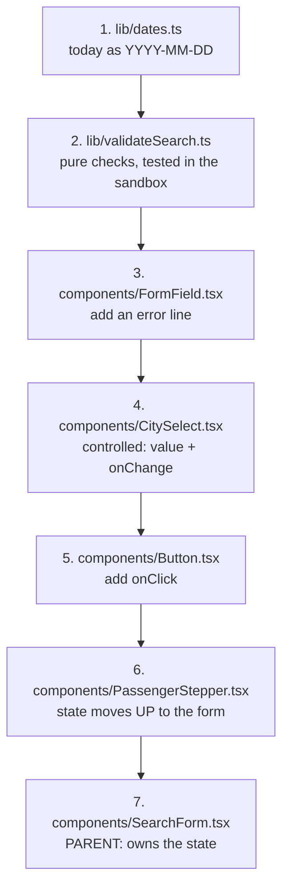
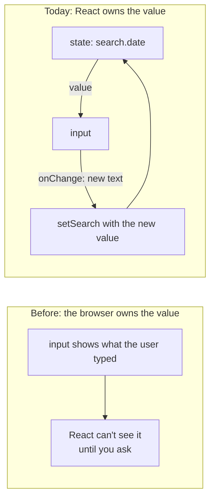
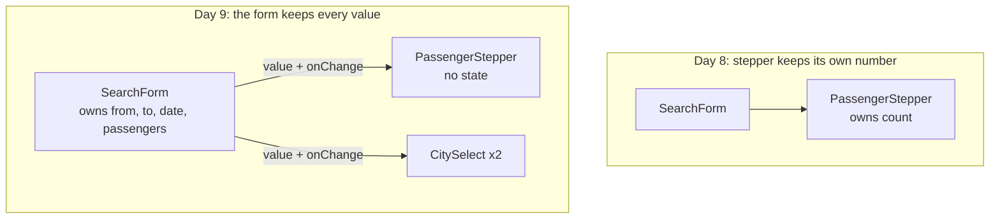
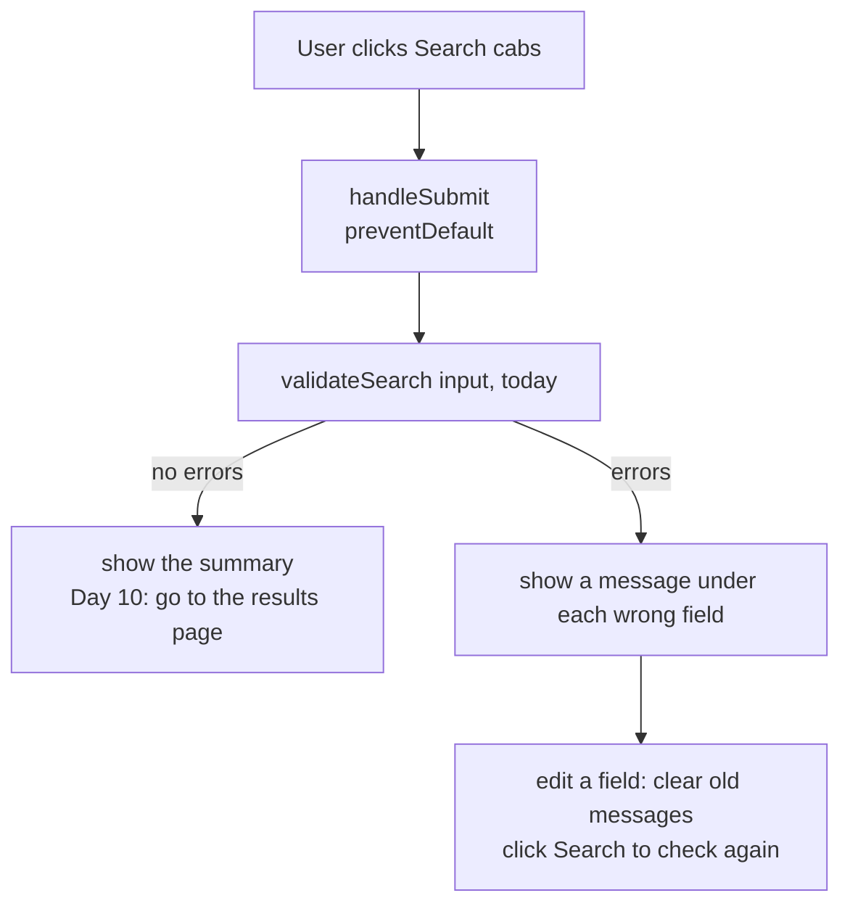
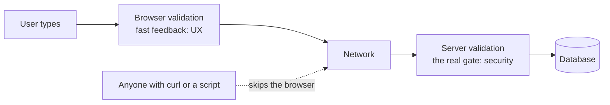

# Day 9: The working search form: controlled inputs, lifting state up, validation (3h)

**Goal:** make the search form really work. Every field is owned by React, the passenger stepper and "Clear" button behave, and a bad search shows clear messages next to the fields. A good search shows a summary (Day 10 will turn that into a real results page).
**New today (max 2):** ① controlled inputs: the input shows a value from state and reports every change ② lifting state up: the form owns all four values and passes them down to its children
**Reused from before:** `useState` and events (Day 8), typed props and `children` (Day 7), `SearchInput` and `describeSearch` (Day 6), pure functions (Day 5), `PassengerStepper` (Day 8).
**Branch today:** `day-09` (from `develop`).
**Time split:** 10 min recall · 30 min concept + sandbox · 75 min build · 20 min browser test · 25 min PR + CI · 15 min docs · 10 min system design · 15 min DSA = 200 min. This is the longest day of the week. If you run over, drop the DSA, and finish the browser test tomorrow morning.

> **Your code may look different from mine.** Follow the idea. If your inputs already use `value` and `onChange`, compare your version with mine and note the differences in today's doc.

## Recall quiz: yesterday (10 min, answer on paper first)
1. What does `useState(2)` return?
2. Why is `carsThatFit` not stored in state?
3. Why did the "Clear" button not reset the passenger count?

<details><summary>Answers</summary>

1. A pair: the current value (starting at 2) and a function to change it.
2. It can be calculated from `count` on every draw (derived state). Storing it separately lets the two drift apart.
3. The browser's reset only knows about its own form fields. The count lives in React state.
</details>

Then take 3 spaced cards from [review-and-recall.md](./review-and-recall.md) (topics from 3+ days ago).

## Diagram 1: Order in which you write files


## Diagram 2: Uncontrolled vs controlled

In a controlled input **the screen always shows the state**. If you change the state (for example Clear), the screen follows. That is why Clear will now work.

## Diagram 3: Lifting state up

Rule of thumb: when two components need the same value (here, the form needs the passenger count to validate and to search), move the state to their **closest common parent** and pass it down.

## Diagram 4: What happens on Search


## Step 1: Recall and branch (10 min)
```bash
git switch develop
git pull
git switch -c day-09
```

## Step 2: Today's date helper (5 min)
- **What:** a function that returns today's date as text like `"2026-11-02"`.
- **Why:** a date input gives text in that format, so to check "not in the past" we compare it with today in the same format.
- **How:** create `src/lib/dates.ts`:
  ```ts
  // WHAT: Date helpers for the search form.
  // WHY:  A date input gives text like "2026-11-02". We need today's date in that same format
  //       to check that the traveller didn't pick a day in the past.
  // HOW:  Uses the browser's local clock. Call it from an event handler (a click or submit),
  //       never while a component is drawing, because "now" changes between draws.

  export function todayAsIsoDate(): string {
    const now = new Date();
    const month = String(now.getMonth() + 1).padStart(2, "0"); // months start at 0
    const day = String(now.getDate()).padStart(2, "0");
    return `${now.getFullYear()}-${month}-${day}`;
  }
  ```

  **Important:** call this only inside an event handler (a click or submit), never while a component is drawing. "Now" changes every moment, and the server and browser would disagree. Next.js enforces this: calling it during a draw fails the build with `Next.js encountered the unstable value new Date() in a Client Component`.

## Step 3: The validation rules as a pure function (25 min)
- **What:** one function that takes a search and today's date and returns a message for each wrong field.
- **Why:** validation rules are business rules. As a pure function they are easy to test without a browser, and on Day 11 and Day 19 we reuse the same rules (the server must check again, because the browser can't be trusted).
- **How:** create `src/lib/validateSearch.ts`:
  ```ts
  // WHAT: Checks a search and returns a message for every field that is wrong.
  // WHY:  The form shows these messages (Day 9). On Day 11 this becomes a Zod schema and on
  //       Day 19 the server runs the same checks again, because the browser can't be trusted.
  // HOW:  A pure function: same input gives the same output. "today" is passed in instead of
  //       read inside, which keeps it predictable and easy to test.
  import type { SearchInput } from "@/lib/search";

  export const MIN_PASSENGERS = 1;
  export const MAX_PASSENGERS = 12;

  // Partial<...> means "any of these fields may be present". No key = no problem with that field.
  export type SearchErrors = Partial<Record<keyof SearchInput, string>>;

  export function validateSearch(input: SearchInput, today: string): SearchErrors {
    const errors: SearchErrors = {};

    if (input.from === "") errors.from = "Please choose where you are travelling from.";
    if (input.to === "") errors.to = "Please choose where you are going.";
    if (input.from !== "" && input.from === input.to) {
      errors.to = "Pick-up and drop must be different cities.";
    }

    if (input.date === "") {
      errors.date = "Please choose a travel date.";
    } else if (input.date < today) {
      // "YYYY-MM-DD" text sorts in date order, so < works on it.
      errors.date = "Travel date can't be in the past.";
    }

    const validCount =
      Number.isInteger(input.passengers) &&
      input.passengers >= MIN_PASSENGERS &&
      input.passengers <= MAX_PASSENGERS;
    if (!validCount) {
      errors.passengers = `Passengers must be a whole number from ${MIN_PASSENGERS} to ${MAX_PASSENGERS}.`;
    }

    return errors;
  }
  ```

  **Notice**
  - `today` is **passed in**, not read from the clock inside. Same input, same output: a pure function. That is why we can test it with any date we like.
  - `Partial<Record<keyof SearchInput, string>>` reads as: an object whose possible keys are `from`, `to`, `date`, `passengers`, each optional, with a text message as the value. A field without a key has no error.
  - `"2026-11-01" < "2026-11-02"` works on text because the format is year-month-day. This is why we use that format.
  - The limits (1 and 12) are exported so the stepper uses the same numbers. One rule, one place.

  Check it in the sandbox. Create `sandbox/day-09-validate.ts`:
  ```ts
  // WHAT: Try validateSearch on good and bad searches without opening the browser.
  // WHY:  A pure function is easy to check: give it input, read the output.
  // HOW:  Run:  npx tsx sandbox/day-09-validate.ts
  import type { SearchInput } from "../src/lib/search";
  import { validateSearch } from "../src/lib/validateSearch";

  const today = "2026-11-02";
  const good: SearchInput = { from: "haridwar", to: "badrinath", date: "2026-11-05", passengers: 4 };

  console.log("good:", validateSearch(good, today)); // {}
  console.log("empty:", validateSearch({ from: "", to: "", date: "", passengers: 2 }, today));
  console.log("same city:", validateSearch({ ...good, to: "haridwar" }, today));
  console.log("past date:", validateSearch({ ...good, date: "2026-11-01" }, today));
  console.log("today is fine:", validateSearch({ ...good, date: today }, today));
  console.log("0 passengers:", validateSearch({ ...good, passengers: 0 }, today));
  console.log("2.5 passengers:", validateSearch({ ...good, passengers: 2.5 }, today));
  console.log("13 passengers:", validateSearch({ ...good, passengers: 13 }, today));
  ```

  ```bash
  npx tsx sandbox/day-09-validate.ts
  ```
  You should see:
  ```
  good: {}
  empty: {
    from: 'Please choose where you are travelling from.',
    to: 'Please choose where you are going.',
    date: 'Please choose a travel date.'
  }
  same city: { to: 'Pick-up and drop must be different cities.' }
  past date: { date: "Travel date can't be in the past." }
  today is fine: {}
  0 passengers: { passengers: 'Passengers must be a whole number from 1 to 12.' }
  2.5 passengers: { passengers: 'Passengers must be a whole number from 1 to 12.' }
  13 passengers: { passengers: 'Passengers must be a whole number from 1 to 12.' }
  ```
  On Day 14 you will turn these lines into real automatic tests.

## Step 4: Teach `FormField` to show an error (5 min)
- **How:** replace `src/components/FormField.tsx`:
  ```tsx
  // WHAT: One form field = a label, whatever input the parent puts inside it, and an error line.
  // WHY:  Every field in the search form repeats the same label + spacing + error message.
  // HOW:  "children" is a special prop: everything written between <FormField> and
  //       </FormField> arrives here as children. ReactNode means "anything React can show".
  //       "error" is optional: no error, nothing is drawn.
  import type { ReactNode } from "react";

  // Shared look for inputs and dropdowns, exported so other components reuse it.
  export const fieldClass =
    "mt-1 w-full rounded-lg border border-slate-300 bg-white px-3 py-2 focus:border-amber-600 focus:outline-none focus:ring-2 focus:ring-amber-200";

  // The id of the error paragraph. Inputs point at it with aria-describedby.
  export const errorIdFor = (id: string) => `${id}-error`;

  type FormFieldProps = {
    id: string; // must match the id of the input inside, so the label points at it
    label: string;
    error?: string;
    children: ReactNode;
  };

  export default function FormField({ id, label, error, children }: FormFieldProps) {
    return (
      <div>
        <label htmlFor={id} className="block text-sm font-medium text-slate-700">
          {label}
        </label>
        {children}
        {error && (
          <p id={errorIdFor(id)} className="mt-1 text-sm text-red-600">
            {error}
          </p>
        )}
      </div>
    );
  }
  ```

  `errorIdFor` builds the id of the error line. The input will point at it with `aria-describedby`, so a screen reader reads the message when the field gets focus.

  **CSS: new classes**

  | Class | Does | Why |
  |---|---|---|
  | `mt-1 text-sm text-red-600` | 4px above, small, red | an error that is clearly an error but not shouting |

## Step 5: Make `CitySelect` controlled (10 min)
- **How:** replace `src/components/CitySelect.tsx`:
  ```tsx
  // WHAT: A dropdown of cities with its label (used for both "From" and "To").
  // WHY:  One component serves both dropdowns. It is now CONTROLLED: the parent owns the
  //       chosen city and this component just shows it and reports changes.
  // HOW:  value = what to show. onChange = a function we call with the new city slug.
  import FormField, { errorIdFor, fieldClass } from "@/components/FormField";
  import { locations } from "@/lib/locations";

  type CitySelectProps = {
    id: string;
    label: string;
    value: string; // the chosen city slug, or "" for "nothing chosen yet"
    onChange: (slug: string) => void; // a function the parent gives us
    error?: string;
  };

  export default function CitySelect({ id, label, value, onChange, error }: CitySelectProps) {
    return (
      <FormField id={id} label={label} error={error}>
        <select
          id={id}
          name={id}
          value={value}
          onChange={(event) => onChange(event.target.value)}
          aria-invalid={error ? true : undefined}
          aria-describedby={error ? errorIdFor(id) : undefined}
          className={fieldClass}
        >
          <option value="" disabled>
            Select city
          </option>
          {locations.map((place) => (
            <option key={place.slug} value={place.slug}>
              {place.name}
            </option>
          ))}
        </select>
      </FormField>
    );
  }
  ```

  - `value` tells the dropdown what to show. `onChange` is a **function the parent gives us** (a function is just another prop). We call it with the new city slug.
  - `event.target.value` is the chosen option's `value`: the slug.
  - `aria-invalid` marks the field as wrong for screen readers. We pass `undefined` instead of `false` so the attribute disappears when there is no error.

## Step 6: Let `Button` accept a click handler (5 min)
- **How:** replace `src/components/Button.tsx`:
  ```tsx
  // WHAT: A reusable button with two looks: "primary" (main action) and "secondary" (quiet).
  // WHY:  Buttons appear on every screen. One component keeps them identical and easy to restyle.
  // HOW:  "variant" is a union type from Day 6, so only the allowed words compile.
  //       "variant = 'primary'" is a default: if the parent doesn't pass one, primary is used.
  //       "onClick" (added Day 9) is a function the parent can hand in to run on click.
  import type { ReactNode } from "react";

  type ButtonVariant = "primary" | "secondary";

  // Record<ButtonVariant, string> forces an entry for EVERY variant. Add a third variant
  // and forget its style, and TypeScript refuses to compile.
  const variantClass: Record<ButtonVariant, string> = {
    primary: "bg-amber-700 text-white hover:bg-amber-800",
    secondary: "border border-slate-300 bg-white text-slate-700 hover:bg-slate-50",
  };

  type ButtonProps = {
    children: ReactNode;
    variant?: ButtonVariant; // "?" = optional
    type?: "button" | "submit" | "reset";
    onClick?: () => void;
  };

  export default function Button({
    children,
    variant = "primary",
    type = "button",
    onClick,
  }: ButtonProps) {
    return (
      <button
        type={type}
        onClick={onClick}
        className={`w-full rounded-lg px-8 py-3 font-semibold sm:w-auto ${variantClass[variant]}`}
      >
        {children}
      </button>
    );
  }
  ```

  One new optional prop: `onClick?: () => void`. This is how you grow a component: add one prop at a time, only when a parent needs it.

## Step 7: Lift the stepper's state up (10 min)
- **What:** `PassengerStepper` loses its `useState`. It now receives `value` and `onChange`.
- **How:** replace `src/components/PassengerStepper.tsx`:
  ```tsx
  // WHAT: A "– 2 passengers +" control with a live hint about which cars fit.
  // WHY:  A stepper is friendlier than typing a number on a phone, and it can never go below 1
  //       or above 12, so the user can't type nonsense.
  // HOW:  Since Day 9 it holds NO state of its own. The form owns the count ("lifting state up")
  //       and passes it in as `value`; we call `onChange` to ask for a new number.
  //       The number of fitting cars is still DERIVED from the value on every draw.
  import { formatPassengers } from "@/lib/format";
  import { pickOptions, sampleOptions } from "@/lib/sampleOptions";
  import { MAX_PASSENGERS, MIN_PASSENGERS } from "@/lib/validateSearch";

  const stepButtonClass =
    "flex h-10 w-10 items-center justify-center rounded-lg border border-slate-300 bg-white text-xl font-semibold text-slate-700 hover:bg-slate-50 disabled:cursor-not-allowed disabled:opacity-40";

  type PassengerStepperProps = {
    value: number;
    onChange: (next: number) => void;
    error?: string;
  };

  export default function PassengerStepper({ value, onChange, error }: PassengerStepperProps) {
    const carsThatFit = pickOptions(sampleOptions, value).length;

    return (
      <div role="group" aria-labelledby="passengers-label">
        <span id="passengers-label" className="block text-sm font-medium text-slate-700">
          Passengers
        </span>
        <div className="mt-1 flex items-center gap-3">
          <button
            type="button"
            aria-label="Fewer passengers"
            disabled={value <= MIN_PASSENGERS}
            onClick={() => onChange(value - 1)}
            className={stepButtonClass}
          >
            −
          </button>
          <span className="min-w-28 text-center font-medium" aria-live="polite">
            {formatPassengers(value)}
          </span>
          <button
            type="button"
            aria-label="More passengers"
            disabled={value >= MAX_PASSENGERS}
            onClick={() => onChange(value + 1)}
            className={stepButtonClass}
          >
            +
          </button>
        </div>
        <p className="mt-1 text-xs text-slate-500">
          {carsThatFit === 1 ? "1 car type fits" : `${carsThatFit} car types fit`}
        </p>
        {error && <p className="mt-1 text-sm text-red-600">{error}</p>}
      </div>
    );
  }
  ```

  There is no `"use client"` and no `useState` here any more. It is a plain function of its props, which makes it simpler and easier to reuse. The client boundary moves to the form, its parent.

## Step 8: The form owns everything (30 min)
- **What:** `SearchForm` holds the four values in **one** state object and passes them down.
- **Why:** the form needs all four values to check the search and reset every field together.
- **Beginner version:** check only when Search is clicked. Editing a field clears all old errors and the old summary; it does not re-check immediately. We use explicit field names instead of spread syntax first.
- **How:** replace `src/components/SearchForm.tsx`:
  ```tsx
  // WHAT: The working search form: From, To, Date, Passengers, with validation.
  // WHY:  This is the front door of the whole product. Customers start here.
  // HOW:  Store the values, check them on Search, and show errors or a summary.
  "use client";

  import { useState, type SubmitEvent } from "react";
  import Button from "@/components/Button";
  import CitySelect from "@/components/CitySelect";
  import FormField, { errorIdFor, fieldClass } from "@/components/FormField";
  import PassengerStepper from "@/components/PassengerStepper";
  import { todayAsIsoDate } from "@/lib/dates";
  import { describeSearch, type SearchInput } from "@/lib/search";
  import { validateSearch, type SearchErrors } from "@/lib/validateSearch";

  const emptySearch: SearchInput = { from: "", to: "", date: "", passengers: 2 };

  export default function SearchForm() {
    const [search, setSearch] = useState<SearchInput>(emptySearch);
    const [errors, setErrors] = useState<SearchErrors>({});
    const [submitted, setSubmitted] = useState<SearchInput | null>(null);

    function change(nextSearch: SearchInput) {
      setSearch(nextSearch);
      setErrors({});
      setSubmitted(null);
    }

    function handleSubmit(event: SubmitEvent<HTMLFormElement>) {
      event.preventDefault(); // stop the browser's own page reload
      const today = todayAsIsoDate();
      const validationErrors = validateSearch(search, today);
      setErrors(validationErrors);

      const hasErrors = Object.keys(validationErrors).length > 0;
      if (hasErrors) {
        setSubmitted(null);
      } else {
        setSubmitted(search);
      }
    }

    function handleClear() {
      setSearch(emptySearch);
      setErrors({});
      setSubmitted(null);
    }

    return (
      <form
        onSubmit={handleSubmit}
        noValidate
        className="mx-auto mt-10 max-w-4xl rounded-2xl bg-white p-5 text-left shadow-lg"
      >
        <div className="grid gap-4 sm:grid-cols-2 lg:grid-cols-4">
          <CitySelect
            id="from"
            label="From"
            value={search.from}
            onChange={(newCity) => {
              change({
                from: newCity,
                to: search.to,
                date: search.date,
                passengers: search.passengers,
              });
            }}
            error={errors.from}
          />
          <CitySelect
            id="to"
            label="To"
            value={search.to}
            onChange={(newCity) => {
              change({
                from: search.from,
                to: newCity,
                date: search.date,
                passengers: search.passengers,
              });
            }}
            error={errors.to}
          />

          <FormField id="date" label="Travel date" error={errors.date}>
            <input
              id="date"
              name="date"
              type="date"
              value={search.date}
              onChange={(event) => {
                change({
                  from: search.from,
                  to: search.to,
                  date: event.target.value,
                  passengers: search.passengers,
                });
              }}
              aria-invalid={errors.date ? true : undefined}
              aria-describedby={errors.date ? errorIdFor("date") : undefined}
              className={fieldClass}
            />
          </FormField>

          <PassengerStepper
            value={search.passengers}
            onChange={(newCount) => {
              change({
                from: search.from,
                to: search.to,
                date: search.date,
                passengers: newCount,
              });
            }}
            error={errors.passengers}
          />
        </div>

        <div className="mt-5 flex flex-col gap-3 sm:flex-row">
          <Button type="submit">Search cabs</Button>
          <Button variant="secondary" onClick={handleClear}>
            Clear
          </Button>
        </div>

        {submitted && (
          <p role="status" className="mt-4 rounded-lg bg-green-50 p-3 text-sm text-green-800">
            Searching: {describeSearch(submitted)}
          </p>
        )}
      </form>
    );
  }
  ```

  **Walk through it**

  | Code | Meaning |
  |---|---|
  | `useState<SearchInput>(emptySearch)` | one object with all four fields. `<SearchInput>` is the Day 6 type, so a typo in a field name is a compile error |
  | `search` | what the user is currently entering: From, To, date and passengers |
  | `errors` | field messages from the most recent Search click; `{}` means no messages |
  | `submitted` | the search that passed validation, or `null` when no summary should appear |
  | `change(nextSearch)` | replace the search with a new object and clear old feedback |
  | `Object.keys(validationErrors).length > 0` | count the fields with errors; more than zero means the search is invalid |
  | `event.preventDefault()` | stops the browser from reloading the page when the form is submitted |
  | `noValidate` on `<form>` | turns off the browser's own pop-up messages so ours are the only ones |
  | `type SubmitEvent` | the type of the submit event. Imported from React; `FormEvent` is deprecated |
  | `setSubmitted(null)` inside `change` | an old summary would no longer match what's on screen, so we hide it when anything changes |
  | `handleClear` | puts the state back to `emptySearch`. The inputs follow because they show the state |

  ### Why pass `onChange` to a child?

  The parent stores the value, but the child displays the control the user edits. The child cannot directly change the parent's state, so the parent supplies a function for the child to call.

  ```text
  SearchForm sends value -> CitySelect displays it
                                   |
                           user picks a city
                                   |
  CitySelect calls onChange(newCity)
                                   |
  SearchForm makes a new search object -> React redraws the dropdown
  ```

  Inside `CitySelect`, the native dropdown reports its selected value like this:

  ```tsx
  <select
    value={value}
    onChange={(event) => onChange(event.target.value)}
  >
    {/* Keep your existing city options here. */}
  </select>
  ```

  The left `onChange` belongs to the HTML dropdown; the function called on the right is the prop supplied by `SearchForm`. Not every child needs an `onChange` prop: it is needed here to report an edit.

  ### Why keep `submitted` as well as `search`?

  `search` changes as you type. `submitted` is set only after a valid Search click, so typing alone does not show a success summary. The JSX `{submitted && (...)}` means "show this summary only when submitted contains a search." Setting it to `null` hides the summary.

  This is temporary learning feedback, not a saved booking. In Day 10, navigation to the results page replaces it, so we remove this state.

  ### Object updates without spread first

  When From changes, we write a new object:

  ```tsx
  change({
    from: newCity,
    to: search.to,
    date: search.date,
    passengers: search.passengers,
  });
  ```

  Read it as: "Use the new From city and keep the other three values." React's `setSearch` replaces the whole object; it does not automatically merge fields.

  **Optional shorthand for later:** this does the same thing:

  ```tsx
  change({ ...search, from: newCity });
  ```

  `...search` copies the existing fields into a new object. The later `from: newCity` replaces the copied From value. Order matters: put the replacement after the spread.

  **Why not mutate?** Writing `search.from = "haridwar"` edits the existing state object without calling its setter. It does not request a redraw and can corrupt earlier state snapshots. Always pass a new object to the setter, either by listing the fields explicitly or by using spread.

  **CSS: new classes**

  | Class | Does | Why |
  |---|---|---|
  | `bg-green-50 text-green-800` with `rounded-lg p-3 text-sm` | pale green box with dark green text | a friendly "success" message |

## Step 9: Test it in the browser (20 min)
```bash
npm run lint && npm run typecheck && npm run build
npm run dev
```
Check each point:
1. Click **Search cabs** with nothing filled in. Three red messages appear (From, To, date).
2. Choose a From city. All old messages disappear; this only clears feedback, it does not mean the search is valid.
3. Choose the same city for To and a future date. Click **Search cabs**. You get "Pick-up and drop must be different cities."
4. Choose a different To city and pick a date in the past. Click **Search cabs**. You get "Travel date can't be in the past."
5. Pick a date in the future, then click **Search cabs**. A green line appears: *Searching: Haridwar → Badrinath on your chosen date, 2 passengers*.
6. Change any field. The green line disappears.
7. Click **Clear**. **Every** field is back to the start, including the passengers (this fails on Day 8, now it works).
8. Click into the date field and press Enter: the form submits (free, because it's a real `<form>`).
9. Tab through the form with the keyboard only. Every control is reachable.

## Step 10: Commit and pull request (25 min)
```bash
git add .
git commit -m "Day 9: working search form with controlled inputs and validation"
git push -u origin day-09
```
PR into `develop`, wait for green CI, merge, test the preview on your phone.

## Break it on purpose (10 min)
1. On the date input, delete the `onChange` line. The date becomes unchangeable and the console says: `You provided a value prop to a form field without an onChange handler. This will render a read-only field. If the field should be mutable use defaultValue. Otherwise, set either onChange or readOnly.` Put it back.
2. Inside `SearchForm`, add `search.from = "haridwar";` just after the `useState` line. → the linter reports `This value cannot be modified`. This is the "never edit state directly" rule. Remove it.
3. Add `const today = todayAsIsoDate();` at the top of `SearchForm` (while drawing). → `npm run build` fails with `Route "/": Next.js encountered the unstable value new Date() in a Client Component`. Remove it.
4. In `validateSearch.ts` change `input.date < today` to `input.date > today`. Run the sandbox file: "past date" now passes and a future date fails. This is why we test rules.
5. Remove `event.preventDefault()`. Click Search. The page reloads and your input vanishes.

## Common errors and what they mean
| Message | Meaning | Fix |
|---|---|---|
| `You provided a value prop to a form field without an onChange handler` | the input is controlled (has `value`) but nothing updates the state | add `onChange`, or use `defaultValue` for an uncontrolled input |
| `A component is changing an uncontrolled input to be controlled` | the `value` started as `undefined` and later became text | start with a real value such as `""`, not `undefined` |
| `This value cannot be modified` (lint) | you edited a state object directly | pass a new object with all four fields to `change`, as shown in Step 8 |
| `Next.js encountered the unstable value new Date() in a Client Component` | you read the clock while drawing | read it inside an event handler (like `handleSubmit`) |
| `Property 'passengers' is missing in type ... but required in type 'SearchInput'` | you built a `SearchInput` without all four fields | include every field, or spread an existing object |
| The page reloads when you click Search | `preventDefault()` is missing | call `event.preventDefault()` first in `handleSubmit` |
| The typed text jumps or a field can't be edited | its `onChange` doesn't update the state it displays | make `value` and `onChange` use the same state |

## Checklist
- [ ] `lint`, `typecheck` and `build` pass.
- [ ] All nine browser checks in Step 9 behave as described.
- [ ] `sandbox/day-09-validate.ts` prints the expected results.
- [ ] You can draw Diagram 3 (lifting state up) from memory and explain why the stepper lost its state.
- [ ] PR merged and CI green.

## Write today's doc (10 min)
`docs/day-09.md`: *What I built*, *Controlled vs uncontrolled in my own words*, *How `change` and `validateSearch` work together*, *What confused me*, *What I'll ask the owner* (for example: are there pick-ups outside the six placeholder cities?).

## System design corner (10 min)
**Concept: validate at the boundary, in two places.**

- **Browser validation is for the user's convenience.** It saves a round trip and gives instant messages. It can be bypassed in seconds (dev tools, curl, a script).
- **Server validation is the real gate.** Everything that crosses from outside into your system is checked again, where nobody can tamper with it. On Day 11 the same rules become a Zod schema, and on Day 19 the API runs them again.
- One shared rule file (`validateSearch.ts`, later the Zod schema) means the two checks can't disagree.
- **Say aloud:** "If browser validation is easy to bypass, why do we still write it?"

## DSA of the day (15–20 min)
**Implement Trie (prefix tree).** Build a structure with `insert`, `search` and `startsWith`, plus a `suggest(prefix)` that lists matching words.
- *Idea:* each letter is a step down a tree; all words sharing a prefix share the path. Finding every word that starts with "ha" means walking two letters and collecting what is below.
- *Project link:* autocomplete for the city list. Typing "Ha" finds Haridwar and Haldwani without checking every city.

`sandbox/dsa/day-09.ts`:
```ts
// WHAT: Implement Trie (prefix tree), plus a suggest() method for autocomplete.
// WHY:  Typing "Ha" should find Haridwar and Haldwani without scanning every city.
// HOW:  Run:  npx tsx sandbox/dsa/day-09.ts
class TrieNode {
  children = new Map<string, TrieNode>();
  isWord = false;
}

class Trie {
  private root = new TrieNode();

  insert(word: string): void {
    let node = this.root;
    for (const ch of word.toLowerCase()) {
      if (!node.children.has(ch)) node.children.set(ch, new TrieNode());
      node = node.children.get(ch)!;
    }
    node.isWord = true;
  }

  private find(prefix: string): TrieNode | undefined {
    let node: TrieNode | undefined = this.root;
    for (const ch of prefix.toLowerCase()) {
      node = node.children.get(ch);
      if (node === undefined) return undefined;
    }
    return node;
  }

  search(word: string): boolean {
    return this.find(word)?.isWord === true;
  }

  startsWith(prefix: string): boolean {
    return this.find(prefix) !== undefined;
  }

  suggest(prefix: string, limit = 5): string[] {
    const start = this.find(prefix);
    if (start === undefined) return [];
    const results: string[] = [];
    const walk = (node: TrieNode, path: string): void => {
      if (results.length >= limit) return;
      if (node.isWord) results.push(path);
      for (const [ch, child] of node.children) walk(child, path + ch);
    };
    walk(start, prefix.toLowerCase());
    return results;
  }
}

const trie = new Trie();
["Haridwar", "Haldwani", "Rishikesh", "Badrinath"].forEach((c) => trie.insert(c));
console.log(trie.search("haridwar"), trie.search("hari")); // true false
console.log(trie.startsWith("hal"), trie.startsWith("x")); // true false
console.log(trie.suggest("ha")); // [ 'haridwar', 'haldwani' ]
console.log(trie.suggest("zz")); // []
```

```bash
npx tsx sandbox/dsa/day-09.ts
```
```
true false
true false
[ 'haridwar', 'haldwani' ]
[]
```
`insert`, `search` and `startsWith` take O(L) time for a word of length L, independent of how many words are stored. Test: empty prefix, a prefix that is also a whole word, words with different capitals. Follow-up: make `suggest` return the original capitalised names.

More on this track: [system-design-and-dsa.md](./system-design-and-dsa.md).

## Interview Q&A
1. **What is a controlled input?** An input whose value comes from React state (`value`) and whose changes are reported back with `onChange`, so React is the single source of truth.
2. **Controlled vs uncontrolled?** Uncontrolled inputs keep their own value in the browser and you read it when needed. Controlled inputs always show state, which makes validation, resetting and conditional logic simple.
3. **What does "lifting state up" mean?** Moving shared state to the closest common parent and passing the value and a change function down as props.
4. **Why do we copy state objects (`{ ...search, from }`) instead of changing them?** React decides to redraw by noticing a new value. Editing in place gives it nothing new to notice, so the screen goes stale.
5. **What does `event.preventDefault()` do on a form submit?** It stops the browser's default behaviour (reloading the page with the form data) so our code can handle it.
6. **Why validate on both the client and the server?** Client checks give fast feedback. Server checks are the real protection, because anything sent from a browser can be forged.
7. **(System design) Why is it fine to repeat the same validation rules in two places, and how do you keep them in sync?** Each place has a different purpose (UX vs security). Keep one shared rule definition (later a Zod schema) that both import.
8. **(Behavioural) Tell me about a feature you made more robust by thinking about bad input.** Use the validation list: empty fields, same city, past date, 0 or 13 passengers. Say how you found the cases and tested them in the sandbox.
