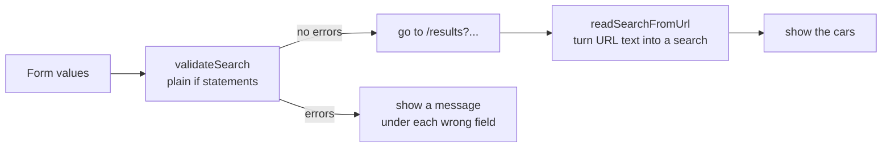

# Day 11: Simpler code: a short URL reader and tidy form rules (3h)

**Goal:** make the code shorter and easier to read. The results page reads the URL with a short function, and the form's rules sit in one plain `if` list.
**New today (max 2):** reading the URL the simple way; writing rules as plain `if / else if`.
**Reused:** functions, `if / else if`, objects, `SearchErrors`, the form from Day 9, the results page from Day 10.
**Branch:** `day-11`, from `develop`.
**Time:** recall 10 min; practice 20; build 60; browser checks 25; PR and notes 25; design 10; optional DSA 20 = 170 min.

**Prerequisite:** [Day 10](./day-10.md). Run commands inside `shubh-yatra-cabs`. No new library is needed today.

> **Why this lesson is simple.** Earlier versions used a validation library and checked the search again on the results page. For a beginner that is a lot. Today the form checks the search (Day 9), and the results page just reads the URL and shows cars.

## Recall (10 min)
1. Why is a value in a URL always text, even if it looks like a number?
2. What does `validateSearch` return when everything is fine?
3. Which page checks the search before the user is sent to `/results`?

<details><summary>Answers</summary>

1. A URL is only text. `passengers=4` arrives as `"4"`.
2. An empty object, `{}`.
3. The form on the home page (Day 9).
</details>

## Picture: who does what



- The **form** checks the rules (`validateSearch`).
- The **results page** only reads the URL (`readSearchFromUrl`) and shows the cars.

## Step 1: Branch (5 min)

```bash
git switch develop
git pull --ff-only
git switch -c day-11
```

## Step 2: Tiny practice: check a value with plain `if` (20 min)

**What:** write a small checking function with no React, no files from the app.
**Why:** every rule today is this same pattern, just repeated.
**How:** create `sandbox/day-11-practice.ts`:

```ts
// WHAT: Check a person's age and return an error message, or "" if it is fine.
// WHY: This is the whole idea of validation: look at a value, return a message if it is wrong.
// HOW: Plain if / else if, checked from the most basic problem to the least.
function checkAge(age: number): string {
  if (!Number.isInteger(age)) return "Age must be a whole number.";
  if (age < 0) return "Age cannot be negative.";
  if (age > 120) return "That age looks wrong.";
  return "";   // "" means: no problem
}

console.log(checkAge(30));    // ""
console.log(checkAge(-5));    // "Age cannot be negative."
console.log(checkAge(2.5));   // "Age must be a whole number."
console.log(checkAge(NaN));   // "Age must be a whole number."
```

Run it with `npx tsx sandbox/day-11-practice.ts` (the sandbox you set up earlier).

Things to notice:
- A function can `return` early. The first problem found wins, and the rest of the function does not run.
- `NaN` ("not a number") is what you get from `Number("abc")`. `Number.isInteger(NaN)` is `false`, so one check catches it.
- Order matters: check "is it a number at all" before "is it too big".

Now change the function to return an **object** of messages, one key per field. That is what `validateSearch` does:

```ts
function checkPerson(name: string, age: number) {
  const errors: { name?: string; age?: string } = {};
  if (name === "") errors.name = "Please enter a name.";
  if (!Number.isInteger(age) || age < 0) errors.age = "Please enter a valid age.";
  return errors;   // {} means everything is fine
}
console.log(checkPerson("", 30));      // { name: "Please enter a name." }
console.log(checkPerson("Asha", 30));  // {}
```

## Step 3: Read the URL the simple way (20 min)

**What:** replace the body of `src/lib/searchQuery.ts` with a shorter version.
**Why:** a URL gives us text. We turn that text into a `SearchInput` object, the same shape the form builds. Keeping this job small and separate makes it easy to read.
**How:** first a tiny example of the problem:

```ts
// What a results page receives for /results?from=haridwar&passengers=4
const query = { from: "haridwar", passengers: "4" };

query.from;       // "haridwar"  (text)
query.passengers; // "4"         (text, not the number 4)
query.to;         // undefined   (not in the URL)
```

Our job is to turn that into the same object the form builds: `{ from, to, date, passengers }`, with `passengers` as a number. If something is missing we use an empty value. The page then simply finds no matching cars.

Replace the file:

```ts
// WHAT: Turn URL text into a search object, and a search object back into URL text.
// WHY: The results page and the form must read the same search.
// HOW: Missing or odd values become "" (or 0 / NaN). The page then finds no matching cars.
import type { SearchInput } from "@/lib/search";

// The query part of a URL: each key has text, a list of text (repeated key), or nothing.
export type SearchQuery = Record<string, string | string[] | undefined>;

// Return the text, or "" when the value is missing or repeated.
function getText(value: string | string[] | undefined): string {
  if (typeof value === "string") return value;
  return "";
}

export function readSearchFromUrl(query: SearchQuery): SearchInput {
  const passengersText = getText(query.passengers);
  return {
    from: getText(query.from),
    to: getText(query.to),
    date: getText(query.date),
    // Number("") is 0, so we handle "" ourselves. Number("abc") is NaN, and no car fits NaN passengers.
    passengers: passengersText === "" ? 0 : Number(passengersText),
  };
}

export function searchToQuery(input: SearchInput): URLSearchParams {
  return new URLSearchParams({
    from: input.from,
    to: input.to,
    date: input.date,
    passengers: String(input.passengers),
  });
}
```

What disappeared compared with Day 10: the success/failure result type, the text-pattern checks and the "too large" check. The results page does not need them. A bad value just means no car fits.

`searchToQuery` is unchanged.

## Step 4: Tidy the form's rules (20 min)

**What:** rewrite `src/lib/validateSearch.ts` as one plain list.
**Why:** all the form's rules in one place, in a straight list you can read top to bottom.
**How:**

```ts
// WHAT: The rules for a cab search, as plain if statements.
// WHY: The form calls this before sending the user to the results page.
// HOW: Check one field at a time. Put a message in `errors` for each problem.
import type { SearchInput } from "@/lib/search";

export type SearchErrors = Partial<Record<keyof SearchInput, string>>;

export const MIN_PASSENGERS = 1;
export const MAX_PASSENGERS = 30;

export function validateSearch(input: SearchInput, today: string): SearchErrors {
  const errors: SearchErrors = {};

  if (input.from === "") errors.from = "Please choose where you start.";

  if (input.to === "") errors.to = "Please choose where you are going.";
  else if (input.to === input.from) errors.to = "Pick-up and drop must be different.";

  // YYYY-MM-DD text sorts in date order, so < works on it
  if (input.date === "") errors.date = "Please choose a travel date.";
  else if (input.date < today) errors.date = "Travel date can't be in the past.";

  if (
    !Number.isInteger(input.passengers) ||
    input.passengers < MIN_PASSENGERS ||
    input.passengers > MAX_PASSENGERS
  ) {
    errors.passengers = `Choose between ${MIN_PASSENGERS} and ${MAX_PASSENGERS} passengers.`;
  }

  return errors;
}
```

Read it slowly, once per field:
- **`if … else if`** means "stop at the first problem for this field". A field can only show one message.
- **`input.date < today`** compares two `YYYY-MM-DD` texts. Because the year comes first, the text order is the date order. That is why Day 9 built `today` in this exact format.
- **`!Number.isInteger(...) || < MIN || > MAX`** reads as "not a whole number, or too small, or too big".
- We do not check that a city exists or that a date is real. The form only offers real cities in the dropdown and real dates in the date picker.

The function takes `today` as an input instead of reading the clock itself. That keeps it easy to test (Day 14).

The form still works unchanged, because the function name, inputs and the `SearchErrors` type are the same as before. Keep your own error wording if you prefer it.

## Step 5: Use the short reader on the results page (15 min)

**What:** shorten the top of the `Results` function in `src/app/results/page.tsx`.
**Why:** the page only needs the search and the cars. The Day 10 version had a result type and a message for each problem.
**How:** change the import, then the first lines of `Results`:

```tsx
// Replace this import:
//   import { readSearchQuery, type SearchQuery } from "@/lib/searchQuery";
// with:
import { readSearchFromUrl, type SearchQuery } from "@/lib/searchQuery";
```

```tsx
async function Results({ searchParams }: Props) {
  const input = readSearchFromUrl(await searchParams);       // text -> search object
  const options = pickOptions(sampleOptions, input.passengers);
  // ...the rest of the page stays the same
}
```

Delete the old `if (!parsed.success)` block. There is no `parsed.success` any more, because `readSearchFromUrl` always gives back a search object. If someone edits the URL to something odd, they see "No sample vehicles fit this group" and can use **Change search**.

**Fix a bug you may still have:** in `sampleOptions.ts`, `pickOptions` must use `r.seats >= passengers`. A 4-seat car fits 4 people. If yours says `>`, change it.

## Step 6: Check it in the browser (25 min)

```bash
npm run lint
npm run typecheck
npm run build
npm run dev
```

Part 1, the form (Day 9's checks):
1. Submit an empty form: a message under each field.
2. Pick the same city twice: "Pick-up and drop must be different."
3. Pick a past date: "Travel date can't be in the past." (The picker also greys past dates out.)
4. Set passengers outside 1 to 30: the passengers message.
5. Fill the form correctly: you land on `/results?...` with cars.

Part 2, the results page. Use a future date:

| Address | Expected |
|---|---|
| `/results?from=haridwar&to=badrinath&date=2027-01-20&passengers=2` | Cars shown |
| same, but `passengers=abc` | "No sample vehicles fit this group", no crash |
| same, but `passengers=` (empty) | The same, no crash |
| `/results` (nothing) | The same, no crash |

If a row does not match, read the first lines of `Results` and `readSearchFromUrl`.

## Break it on purpose (5 min)
- Change `<` to `>` in the date check: past dates are now accepted. Restore it.
- Remove `else` from `else if` in the `to` block: a same-city search may show a different message. Notice why `else if` matters.
- Return `errors` before the passengers block: the passengers rule stops working. Restore it.

## Common errors
- `Cannot find name 'validateSearch'`: check the import and that you export the function.
- Every date is an error: check that `today` is `YYYY-MM-DD`. Run `console.log(todayAsIsoDate())`.
- `Property 'success' does not exist`: you still have the old `parsed.success` code on the results page. Remove it.

## Finish (25 min)
- [ ] The form checks still work, and a valid search goes to `/results`.
- [ ] Every row in the results table behaves as expected.
- [ ] Lint, typecheck and build pass.

```bash
git add src sandbox/day-11-practice.ts
git commit -m "Day 11: short URL reader and tidy form rules"
git push -u origin day-11
```

Open a PR into `develop`, wait for CI, merge. Write `docs/day-11.md`: what `readSearchFromUrl` does, what `validateSearch` does and why they are separate, one URL you tried and what the page showed.

## System design corner (10 min): The browser is not the boss
A browser can send anything: a hand-edited URL, a changed form, a script. For a demo with sample data, that is harmless, so today the form checks the search for the user's comfort. When we build a real server API (Day 19), the **server** must check every request again, because that is the part that cannot be bypassed. Keep the rules in one function so the form and the server can use the same ones.

## DSA (optional, 20 min): Valid Palindrome
Write `isPalindrome(text: string): boolean` in `sandbox/dsa/day-11.ts`.
- For this exercise, keep only letters and digits, in lowercase.
- Compare the first and last characters, then move inward (left and right pointers).
- `"A man, a plan, a canal: Panama"` is true; `"race a car"` is false; `""` is true.
- O(n) time.

## Interview Q&A
1. **Why check input in a form?** It gives the user quick, friendly messages.
2. **Why must a real server check again?** Anything from a browser can be changed or bypassed.
3. **Why does `validateSearch` take `today` as an input?** It makes the function predictable and easy to test.
4. **Behavioral:** Tell me about a time you made code simpler. What did you remove, and how did you know it still worked?

Next: [Day 12](./day-12.md).
