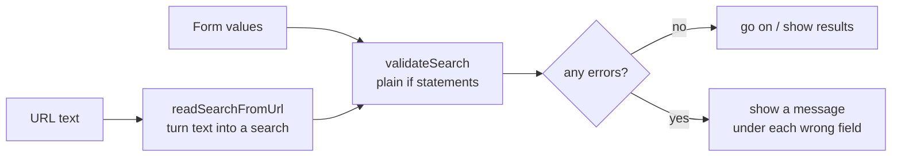

# Day 11: One simple validation function, used everywhere (3h)

**Goal:** check a search in **one place**, with plain `if` statements, so the form and the results page follow the same rules.
**New today (max 2):** reading the URL the simple way; one shared rule function.
**Reused:** functions, `if / else if`, objects, `SearchErrors`, the form from Day 9, the results page from Day 10.
**Branch:** `day-11`, from `develop`.
**Time:** recall 10 min; practice 20; build 65; browser checks 30; PR and notes 25; design 10; optional DSA 20 = 180 min.

**Prerequisite:** [Day 10](./day-10.md). Run commands inside `shubh-yatra-cabs`. No new library is needed today.

> **Why this lesson changed.** Earlier versions used a validation library. For a beginner it adds a new tool, new words and a lot of indirection. Plain `if` statements do the same job and you can read every line. Libraries make sense later, when you already know what they replace.

## Recall (10 min)
1. Why is a value in a URL always text, even if it looks like a number?
2. What does `validateSearch` return when everything is fine?
3. Why do we check the search again on the results page, when the form already checked it?

<details><summary>Answers</summary>

1. A URL is only text. `passengers=4` arrives as `"4"`.
2. An empty object, `{}`.
3. Anyone can edit a URL by hand, so the page cannot trust what arrives.
</details>

## Picture: one set of rules, two entrances



Both entrances end in the **same** `validateSearch` function. That is how the form and the results page can never disagree.

## Step 1: Branch (5 min)

```bash
git switch develop
git pull --ff-only
git switch -c day-11
```

## Step 2: Tiny practice: check a value with plain `if` (20 min)

**What:** write a small checking function with no React, no files from the app.
**Why:** every rule today is this same pattern, just repeated.
**How:** create `sandbox/day-11-practice.ts`:

```ts
// WHAT: Check a person's age and return an error message, or "" if it is fine.
// WHY: This is the whole idea of validation: look at a value, return a message if it is wrong.
// HOW: Plain if / else if, checked from the most basic problem to the least.
function checkAge(age: number): string {
  if (!Number.isInteger(age)) return "Age must be a whole number.";
  if (age < 0) return "Age cannot be negative.";
  if (age > 120) return "That age looks wrong.";
  return "";   // "" means: no problem
}

console.log(checkAge(30));    // ""
console.log(checkAge(-5));    // "Age cannot be negative."
console.log(checkAge(2.5));   // "Age must be a whole number."
console.log(checkAge(NaN));   // "Age must be a whole number."
```

Run it with `npx tsx sandbox/day-11-practice.ts` (the sandbox you set up earlier).

Things to notice:
- A function can `return` early. The first problem found wins, and the rest of the function does not run.
- `NaN` ("not a number") is what you get from `Number("abc")`. `Number.isInteger(NaN)` is `false`, so one check catches it.
- Order matters: check "is it a number at all" before "is it too big".

Now change the function to return an **object** of messages, one key per field. That is what `validateSearch` does:

```ts
function checkPerson(name: string, age: number) {
  const errors: { name?: string; age?: string } = {};
  if (name === "") errors.name = "Please enter a name.";
  if (!Number.isInteger(age) || age < 0) errors.age = "Please enter a valid age.";
  return errors;   // {} means everything is fine
}
console.log(checkPerson("", 30));      // { name: "Please enter a name." }
console.log(checkPerson("Asha", 30));  // {}
```

## Step 3: Read the URL the simple way (20 min)

**What:** replace the body of `src/lib/searchQuery.ts` with a shorter version.
**Why:** a URL gives us text. We turn that text into a `SearchInput` object **without judging it yet**. Judging is the job of `validateSearch` (Step 4). Splitting the jobs keeps each one small.
**How:** first a tiny example of the problem:

```ts
// What a results page receives for /results?from=haridwar&passengers=4
const query = { from: "haridwar", passengers: "4" };

query.from;       // "haridwar"  (text)
query.passengers; // "4"         (text, not the number 4)
query.to;         // undefined   (not in the URL)
```

Our job is to turn that into the same object the form builds: `{ from, to, date, passengers }`, with `passengers` as a number. If something is missing we use an empty value, and `validateSearch` will complain about it later.

Replace the file:

```ts
// WHAT: Turn URL text into a search object, and a search object back into URL text.
// WHY: The results page and the form must read the same search.
// HOW: Missing or odd values become "" (or 0). validateSearch reports the problem later.
import type { SearchInput } from "@/lib/search";

// The query part of a URL: each key has text, a list of text (repeated key), or nothing.
export type SearchQuery = Record<string, string | string[] | undefined>;

// Return the text, or "" when the value is missing or repeated.
function getText(value: string | string[] | undefined): string {
  if (typeof value === "string") return value;
  return "";
}

export function readSearchFromUrl(query: SearchQuery): SearchInput {
  const passengersText = getText(query.passengers);
  return {
    from: getText(query.from),
    to: getText(query.to),
    date: getText(query.date),
    // Number("") is 0, so we handle "" ourselves. Number("abc") is NaN, which validateSearch rejects.
    passengers: passengersText === "" ? 0 : Number(passengersText),
  };
}

export function searchToQuery(input: SearchInput): URLSearchParams {
  return new URLSearchParams({
    from: input.from,
    to: input.to,
    date: input.date,
    passengers: String(input.passengers),
  });
}
```

What disappeared compared with Day 10: the success/failure result type, the text-pattern checks and the "too large" check. They are not needed, because `validateSearch` now catches all of those problems with ordinary `if`s.

`searchToQuery` is unchanged.

## Step 4: One validation function (30 min)

**What:** rewrite `src/lib/validateSearch.ts`.
**Why:** all rules in one place, in a straight list you can read top to bottom.
**How:**

```ts
// WHAT: The rules for a cab search, as plain if statements.
// WHY: The form and the results page both call this, so they always agree.
// HOW: Check one field at a time. Put a message in `errors` for each problem.
import { findCity } from "@/lib/locations";
import type { SearchInput } from "@/lib/search";

export type SearchErrors = Partial<Record<keyof SearchInput, string>>;

export const MIN_PASSENGERS = 1;
export const MAX_PASSENGERS = 30;

export function validateSearch(input: SearchInput, today: string): SearchErrors {
  const errors: SearchErrors = {};

  // From
  if (input.from === "") errors.from = "Please choose where you start.";
  else if (!findCity(input.from)) errors.from = "We don't serve that city yet.";

  // To
  if (input.to === "") errors.to = "Please choose where you are going.";
  else if (!findCity(input.to)) errors.to = "We don't serve that city yet.";
  else if (input.to === input.from) errors.to = "Pick-up and drop must be different.";

  // Date (YYYY-MM-DD text sorts in date order, so < and >= work on it)
  if (input.date === "") errors.date = "Please choose a travel date.";
  else if (Number.isNaN(new Date(input.date).getTime())) errors.date = "That date doesn't look right.";
  else if (input.date < today) errors.date = "Travel date can't be in the past.";

  // Passengers
  if (
    !Number.isInteger(input.passengers) ||
    input.passengers < MIN_PASSENGERS ||
    input.passengers > MAX_PASSENGERS
  ) {
    errors.passengers = `Choose between ${MIN_PASSENGERS} and ${MAX_PASSENGERS} passengers.`;
  }

  return errors;
}
```

Read it slowly, once per field:
- **`if … else if … else if`** means "stop at the first problem for this field". A field can only show one message.
- **`findCity`** is the helper you already wrote in `locations.ts`. If it finds nothing, the city is not one we serve.
- **`new Date("abc")`** gives an "Invalid Date". Its `getTime()` is `NaN`, so `Number.isNaN(...)` catches text that is not a date. (A date like `2027-02-30` rolls over to March in JavaScript. The date picker in the form only offers real dates, and we accept that for the prototype.)
- **`input.date < today`** compares two `YYYY-MM-DD` texts. Because year comes first, the text order is the date order. That is why Day 9 built `today` in this exact format.
- **`!Number.isInteger(...) || < MIN || > MAX`** reads as "not a whole number, or too small, or too big".

The function takes `today` as an input instead of reading the clock itself. That keeps it easy to test (Day 14).

The form still works unchanged, because the function name, inputs and the `SearchErrors` type are the same as before. Keep your own error wording if you prefer it.

## Step 5: Use it on the results page (15 min)

**What:** shorten the top of the `Results` function in `src/app/results/page.tsx`.
**Why:** the page used to do its own city checks. Now one function does everything.
**How:** change the imports, then the first lines of `Results`:

```tsx
// Remove these two imports:
//   import { findCity } from "@/lib/locations";
//   import { readSearchQuery, type SearchQuery } from "@/lib/searchQuery";
// Use these instead:
import { readSearchFromUrl, type SearchQuery } from "@/lib/searchQuery";
```

```tsx
async function Results({ searchParams }: Props) {
  await connection();
  const input = readSearchFromUrl(await searchParams);       // text -> search object
  const errors = validateSearch(input, todayAsIsoDate());    // check it

  if (Object.keys(errors).length > 0) {
    return (
      <section>
        <h1 className="text-2xl font-bold">Check your search</h1>
        <ul>
          {Object.entries(errors).map(([field, message]) => (
            <li key={field}>{message}</li>
          ))}
        </ul>
        <Link href="/">Edit search</Link>
      </section>
    );
  }

  const options = pickOptions(sampleOptions, input.passengers);
  // ...the rest of the page stays the same
}
```

Delete the old `if (!parsed.success)` block and the two manual `findCity` lines. There is no `parsed.success` any more. `readSearchFromUrl` always gives back a search object.

**Fix a bug you may still have:** in `sampleOptions.ts`, `pickOptions` must use `r.seats >= passengers`. A 4-seat car fits 4 people. If yours says `>`, change it.

## Step 6: Check it in the browser (30 min)

```bash
npm run lint
npm run typecheck
npm run build
npm run dev
```

Open each URL. Replace dates with a future date in `YYYY-MM-DD` form:

| Address | Expected |
|---|---|
| `/results?from=haridwar&to=badrinath&date=2027-01-20&passengers=2` | Cars shown |
| same, but `passengers=0` | "Choose between 1 and 30 passengers." |
| same, but `passengers=abc` | The same passengers message |
| same, but `passengers=` (empty) | The same passengers message |
| same, but `from=nowhere` | "We don't serve that city yet." |
| same, but `to=haridwar` (same as from) | "Pick-up and drop must be different." |
| same, but `date=2020-01-01` | "Travel date can't be in the past." |
| same, but `date=hello` | "That date doesn't look right." |
| `/results` (nothing) | Several messages, one for each field |

Then repeat Day 9's form checks. The form must show the same kinds of messages.

If a row does not match, read your `if` for that field and check the **order**: a message from an earlier `if` can hide a later one.

## Break it on purpose (5 min)
- Change `<` to `>` in the date check: past dates are now accepted. Restore it.
- Remove `else` from `else if` in the `to` block: a same-city search may show a different message. Notice why `else if` matters.
- Return `errors` before the passengers block: the passengers rule stops working. Restore it.

## Common errors
- `Cannot find name 'validateSearch'`: check the import and that you export the function.
- Everything is an error: check that `today` is `YYYY-MM-DD`. Run `console.log(todayAsIsoDate())`.
- Messages show for fields you did not touch on the results page: that is correct for a bare `/results`. The page has no values, so every field is empty.

## Finish (25 min)
- [ ] Every row in the browser table behaves as expected.
- [ ] The form, Clear button and field messages still work.
- [ ] Lint, typecheck and build pass.

```bash
git add src sandbox/day-11-practice.ts
git commit -m "Day 11: one simple validation function"
git push -u origin day-11
```

Open a PR into `develop`, wait for CI, merge. Write `docs/day-11.md`: what `readSearchFromUrl` does, what `validateSearch` does and why they are separate, one URL you tried and the message it showed.

## System design corner (10 min): Never trust the client
A browser can send anything: a hand-edited URL, a changed form, a script. The form's checks are for the user's comfort. The server's checks are for safety. Keeping the rules in one function means you write them once and use them in both places. Checking is not the same as logging in: a valid request still has to be allowed to do what it asks, and prices must always be looked up on the server.

## DSA (optional, 20 min): Valid Palindrome
Write `isPalindrome(text: string): boolean` in `sandbox/dsa/day-11.ts`.
- For this exercise, keep only letters and digits, in lowercase.
- Compare the first and last characters, then move inward (left and right pointers).
- `"A man, a plan, a canal: Panama"` is true; `"race a car"` is false; `""` is true.
- O(n) time.

## Interview Q&A
1. **Why check in two places?** The form check is quick feedback for the user. The server check protects the app, because anything from a browser can be changed.
2. **Why keep the rules in one function?** The two places can never disagree, and a change is made once.
3. **Why does `validateSearch` take `today` as an input?** It makes the function predictable and easy to test.
4. **Behavioral:** Tell me about a time you made code simpler. What did you remove, and how did you know it still worked?

Next: [Day 12](./day-12.md).
