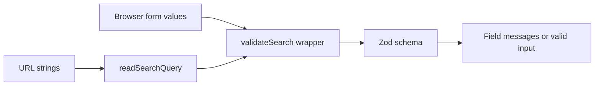

# Day 11: Validation with Zod - one shared set of rules (3h)

**Goal:** replace handwritten search checks with a schema while preserving field errors in the form and rejecting bad URLs on the server.
**New today (max 2):** schemas; `safeParse` and validation issues.
**Reused:** pure functions, `SearchErrors`, URL parsing, controlled inputs.
**Branch:** `day-11`, from `develop`.
**Time:** recall 10 min; practice 25; build 60; verification 30; PR and notes 25; design 10; optional DSA 20 = 180 min.

**Prerequisite:** [Day 10](./day-10.md). Run commands inside `shubh-yatra-cabs`. This lesson uses Zod 4; the examples are not Zod 3 syntax.

## Recall (10 min)
1. Why is a query parameter not automatically a number?
2. What happens if someone types the same query key twice?
3. Why isn't a TypeScript type enough to validate a request?

<details><summary>Answers</summary>

1. URLs transport text. 2. Next.js can supply an array; Day 10 rejects it for required scalar fields.
3. Types are erased at runtime; outside input may not match them.
</details>

## Picture: one rule, two entry points



## Step 1: Branch and install (10 min)

**What:** add a validation dependency.
**Why:** a schema gives consistent checks and useful structured errors.
**How:**

```bash
git switch develop
git pull --ff-only
git switch -c day-11
npm install zod@^4
```

Commit both `package.json` and `package-lock.json` later. Use `npm install` to add dependencies; CI uses `npm ci` to reproduce them.

## Step 2: Tiny practice (25 min)

In `sandbox/day-11-zod.ts`:

```ts
// WHAT: Try runtime validation without React.
// WHY: TypeScript cannot check data arriving from outside the program.
// HOW: safeParse returns a result; inspect success before accessing data.
import { z } from "zod";

const passengerSchema = z.number().int().min(1).max(12);
for (const value of [2, 0, 2.5, "2"]) {
  const result = passengerSchema.safeParse(value);
  console.log(value, result.success);
}
```

Run `npx tsx sandbox/day-11-zod.ts` using the sandbox setup from earlier days.
Expected success flags: `true`, `false`, `false`, `false`.

**Why not automatically coerce every value?** `Number("")` is `0`, and broad coercion can disguise missing input. Day 10 parses URL text explicitly. Today's schema checks the parsed values.

## Step 3: Define the schema (35 min)

**What:** create `src/lib/searchSchema.ts`.
**Why:** validate known cities, real calendar dates and passenger limits in one place.
**How:**

```ts
// WHAT: The runtime rules for a cab search.
// WHY: Browser and server must agree about allowed inputs.
// HOW: Build a schema using an explicit "today", keeping tests deterministic.
import { z } from "zod";
import { findCity } from "@/lib/locations";
import type { SearchInput } from "@/lib/search";

export const MIN_PASSENGERS = 1;
export const MAX_PASSENGERS = 12;

const citySchema = z.string().min(1, "Please choose a city.").refine(
  (slug) => findCity(slug) !== undefined,
  { message: "Please choose a supported city." },
);

export function makeSearchSchema(today: string) {
  return z.object({
    from: citySchema,
    to: citySchema,
    date: z.iso.date({ error: "Please choose a valid calendar date." }).refine(
      (date) => date >= today,
      { message: "Travel date can't be in the past." },
    ),
    passengers: z.number()
      .int("Passengers must be a whole number.")
      .min(MIN_PASSENGERS, "At least 1 passenger is required.")
      .max(MAX_PASSENGERS, "At most 12 passengers are supported."),
  }).refine(
    (input) => input.from !== input.to,
    { message: "Pick-up and drop must be different cities.", path: ["to"] },
  );
}

export function parseSearch(value: unknown, today: string) {
  return makeSearchSchema(today).safeParse(value);
}

// A compile-time check that the parsed shape still matches the existing contract.
export type ValidSearch = z.infer<ReturnType<typeof makeSearchSchema>>;
export function toSearchInput(value: ValidSearch): SearchInput {
  return value;
}
```

`unknown` means "we must check before using it". A successful `safeParse` gives validated `data`. A failure gives `error.issues`. `path: ["to"]` associates the identical-city error with the To field.

`z.iso.date()` rejects dates such as February 30, not just malformed text. The schema deliberately takes `today`; it does not read a clock itself.

## Step 4: Preserve the form's existing interface (25 min)

**What:** replace the implementation of `src/lib/validateSearch.ts`.
**Why:** the form and stepper should not need a rewrite just because validation changed.
**How:**

```ts
// WHAT: Convert schema issues into the field-error object used by the form.
// WHY: Keep the UI interface stable while sharing runtime rules.
// HOW: Keep the first message per known field.
import type { SearchInput } from "@/lib/search";
import { parseSearch } from "@/lib/searchSchema";

export { MIN_PASSENGERS, MAX_PASSENGERS } from "@/lib/searchSchema";
export type SearchErrors = Partial<Record<keyof SearchInput, string>>;

export function validateSearch(input: SearchInput, today: string): SearchErrors {
  const result = parseSearch(input, today);
  if (result.success) return {};

  const errors: SearchErrors = {};
  for (const issue of result.error.issues) {
    const field = issue.path[0];
    if (field === "from" || field === "to" || field === "date" || field === "passengers") {
      errors[field] ??= issue.message;
    }
  }
  return errors;
}
```

This adapter is for this known four-field schema: each possible rule above has a field path. If you later introduce form-wide errors, extend the interface to show them instead of discarding them.

In the results page, remove the two manual `findCity` checks and its now-unused import. Keep `readSearchQuery` followed by `validateSearch`; that wrapper now checks supported cities too.

The form's imports and the stepper's exported limits still work. Check the UI wording if your old errors were more specific.

## Step 5: Verify the boundary (30 min)

Create `sandbox/day-11-checks.ts`:

```ts
// WHAT: Exercise real search rules with a fixed date.
// WHY: Clock-independent examples remain useful next year.
// HOW: Compare success flags to the expected values.
import { parseSearch } from "../src/lib/searchSchema";

const today = "2027-01-10";
const good = {
  from: "haridwar", to: "badrinath", date: "2027-01-20", passengers: 2,
};
const cases = [
  good,
  { ...good, date: today },
  { ...good, date: "2027-01-09" },
  { ...good, date: "2027-02-30" },
  { ...good, from: "unknown-city" },
  { ...good, to: good.from },
  { ...good, passengers: 2.5 },
  { ...good, passengers: "2" },
  { ...good, passengers: 13 },
];
console.log(cases.map((input) => parseSearch(input, today).success));
// [true, true, false, false, false, false, false, false, false]
```

```bash
npx tsx sandbox/day-11-checks.ts
npm run lint
npm run typecheck
npm run build
```

Then repeat Day 9's form checks and Day 10's edited-URL checks in the browser. Both entry points must reject the same business-rule violations. Some malformed URLs fail earlier during parsing; that is intentional.

## Break it / common errors
- Use `result.data` before checking `result.success`: TypeScript objects because failure has no validated data.
- Remove the same-city refinement: a previously invalid search passes. Restore it.
- `Cannot find module 'zod'`: install it in the app folder and confirm the manifest and lockfile changed.
- A bare date format regex does not prove a date exists; keep the calendar validation.
- An unknown city should show an error, not silently become a default destination.

## Finish (25 min)
- [ ] Fixed-date examples match all nine expected flags.
- [ ] Browser and server both enforce the schema.
- [ ] Existing Clear and field-error behavior still works.
- [ ] Lint, typecheck and build pass.

```bash
git add src sandbox/day-11-zod.ts sandbox/day-11-checks.ts package.json package-lock.json
git commit -m "Day 11: shared Zod search validation"
git push -u origin day-11
```

PR into `develop`, wait for CI, merge. Write `docs/day-11.md`: type versus schema, one rejected input and why, and one confusing issue message.

## System design corner (10 min): Never trust the client
Validation is not authentication or authorization. A valid request can still come from someone who is not allowed to act. Likewise, a valid vehicle ID does not prove availability or a price. Later the booking endpoint must read authoritative fares again.

## DSA (optional, 20 min): Valid Palindrome
Implement `isPalindrome(text: string): boolean` in `sandbox/dsa/day-11.ts`.
- For this exercise only, normalize ASCII letters/digits to lowercase and ignore punctuation.
- Compare characters with left/right pointers.
- Test `"A man, a plan, a canal: Panama"` -> true; `"race a car"` -> false; `""` -> true.
- O(n) time; O(n) extra space if you build a normalized string.
- Do not copy "strip all non-digits" into real phone validation without considering country codes and meaningful `+` prefixes.

## Interview Q&A
1. **Why both types and schemas?** Types check code during development; schemas check actual runtime values.
2. **`parse` versus `safeParse`?** `parse` throws on invalid data; `safeParse` returns a result you handle.
3. **Why inject today's date?** Predictable tests and explicit clock/timezone policy.
4. **Behavioral:** Describe preserving an interface while changing its implementation.

Next: [Day 12](./day-12.md).
