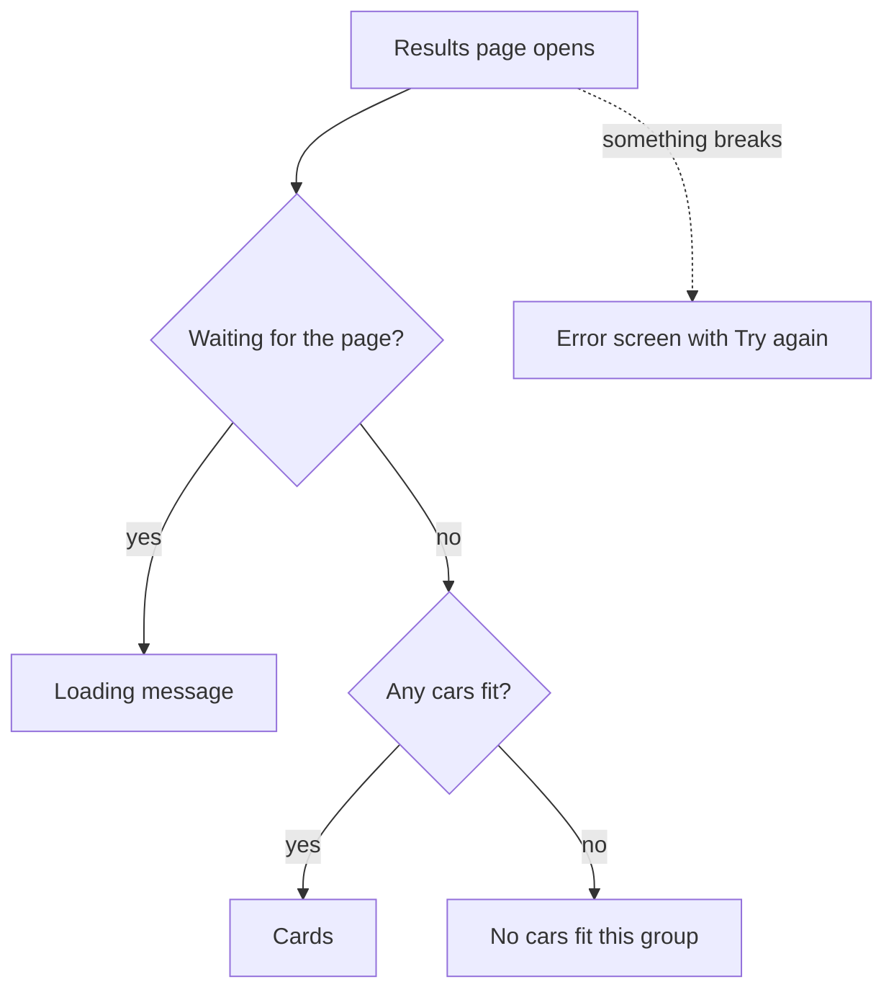

# Day 12: Result cards, and what to show when things go wrong (3h)

**Goal:** show the cars as clear cards, and make sure every outcome has a visible screen: cars, no cars, loading, and an unexpected error.
**New today (max 2):** a reusable card component; the `loading.tsx` and `error.tsx` files.
**Reused:** props, `.map()`, the results page, Tailwind.
**Branch:** `day-12`, from `develop`.
**Time:** recall 10 min; sketch 20; build 60; try every state 30; PR and notes 25; design 10; optional DSA 20 = 175 min.

**Prerequisite:** [Day 11](./day-11.md). Run commands inside `shubh-yatra-cabs`.

## Recall (10 min)
1. What does `readSearchFromUrl` give back?
2. What does `pickOptions` return when no car fits?
3. What does `key` do when you `.map()` a list in React?

<details><summary>Answers</summary>

1. A search object: `{ from, to, date, passengers }`, with `passengers` as a number.
2. An empty list, `[]`.
3. It helps React tell the list items apart. Use a stable unique value, such as `option.id`.
</details>

## Picture: three outcomes, not one



Two things that are easy to mix up:
- **No cars:** the page worked, there are just no matches. That is not an error.
- **Error:** something broke unexpectedly. Never show this as "no cars", because that hides the problem.

## Step 1: Branch and sketch (20 min)

```bash
git switch develop
git pull --ff-only
git switch -c day-12
```

On paper, draw four small screens: cards, no cars, loading, error. Under each, write **what the user can do next**. For example: "Edit search", "Try again". The loading screen is the only one that needs no action.

## Step 2: A card for one car (20 min)

**What:** create `src/components/OptionCard.tsx`.
**Why:** the page decides *which* cars to show. The card only knows how to draw *one* car.
**How:** first, the idea in the smallest form. A component is a function that receives props and returns what to draw:

```tsx
function Hello({ name }: { name: string }) {
  return <p>Hello {name}</p>;
}
// <Hello name="Asha" />   draws: Hello Asha
```

Our card does the same, with a car as the prop:

```tsx
// WHAT: Draw one car option as a card.
// WHY: Keep drawing separate from choosing which cars to show.
// HOW: Receive one car as a prop and show its details.
import { formatPrice } from "@/lib/format";
import type { CarOption } from "@/lib/sampleOptions";

export default function OptionCard({ option }: { option: CarOption }) {
  return (
    <article className="rounded-xl border border-slate-200 bg-white p-5 shadow-sm">
      <h2 className="text-xl font-semibold">{option.name}</h2>
      <p className="mt-2">{option.seats} seats</p>
      <p className="mt-2 font-bold">{formatPrice(option.priceInr)}</p>
      <p className="mt-2 text-sm text-slate-600">Sample price, not a real booking.</p>
    </article>
  );
}
```

Do not add a button that does nothing. Day 13 adds a real link.

## Step 3: Use the card on the results page (15 min)

**What:** replace the old list in `src/app/results/page.tsx`.
**Why:** one `<OptionCard />` per car.
**How:** add the import, then use this where you list the cars:

```tsx
import OptionCard from "@/components/OptionCard";
```

```tsx
{options.length === 0 ? (
  <p>No sample cars fit this group. Try fewer passengers.</p>
) : (
  <ul className="grid gap-4 sm:grid-cols-2 lg:grid-cols-3">
    {options.map((option) => (
      <li key={option.id}>
        <OptionCard option={option} />
      </li>
    ))}
  </ul>
)}
```

Read it:
- `options.length === 0 ? A : B` means "if there are no cars show A, otherwise show B".
- `.map` turns each car into one `<li>` holding one card.
- `key={option.id}` goes on the outermost element inside the `.map`.

## Step 4: A loading message (10 min)

**What:** create `src/app/results/loading.tsx`.
**Why:** while Next.js is preparing the page, the user should see something rather than a blank screen.
**How:**

```tsx
// WHAT: A message shown while the results page is loading.
// WHY: A blank screen feels broken.
// HOW: Next.js shows this file automatically for the /results route.
export default function Loading() {
  return <p role="status" className="p-6">Loading cab options...</p>;
}
```

Keep the `Suspense` from Day 10 in the page too. Our data is in memory, so loading is instant and you will rarely see this message. Step 6 shows how to see it on purpose.

## Step 5: An error screen (15 min)

**What:** create `src/app/results/error.tsx`.
**Why:** if something unexpected throws, the user sees a helpful screen instead of a broken page.
**How:**

```tsx
// WHAT: The screen shown when the results page breaks unexpectedly.
// WHY: A crash must not look like "no cars found".
// HOW: Next.js passes us the error and a reset function that tries again.
"use client";

import Link from "next/link";

export default function ResultsError({ reset }: { reset: () => void }) {
  return (
    <section className="mx-auto max-w-5xl px-6 py-16">
      <h1 className="text-2xl font-bold">We couldn't load the results</h1>
      <p role="alert">Please try again. Nothing has been booked.</p>
      <button type="button" onClick={reset} className="mt-4 rounded border p-3">
        Try again
      </button>
      <Link href="/" className="ml-4 underline">Change search</Link>
    </section>
  );
}
```

- `"use client"` is required in `error.tsx`, because it has a button with a click handler.
- `reset` is a function Next.js gives us. Calling it tries to draw the page again.
- Never show the raw error text to customers. It can leak details.

## Step 6: Try every state (30 min)

```bash
npm run lint
npm run typecheck
npm run build
npm run dev
```

| State | How to see it | Expected |
|---|---|---|
| Cards | A valid future search for 2 passengers | One card per car, with seats and price |
| No cars | Temporarily change the page to `const options: CarOption[] = [];` | "No sample cars fit this group." |
| Error | Temporarily add `throw new Error("test");` at the top of `Results` | The error screen with **Try again** |
| Loading | Temporarily add `await new Promise((r) => setTimeout(r, 1500));` at the top of `Results` | "Loading cab options..." for 1.5 s, then the cards |

**After each drill, remove the temporary line.** Never commit a deliberate error, delay or empty list.

In dev mode a red error overlay may appear over the error screen. Close it with the X to see the real screen.

## Break it on purpose (5 min)
- Delete `"use client"` from `error.tsx`: Next.js complains about the click handler. Put it back.
- Delete `key={option.id}`: the console warns about a missing `key`. Put it back.
- Show "No cars" for the thrown error: explain to yourself why that would hide an outage.

## Common errors
- The card shows `NaN` or empty text: check the field names against your `sampleOptions.ts` (`seats`, `priceInr`).
- `Module not found` for `OptionCard`: check the import path and the file name.
- The error screen never appears: the throw must happen while the page draws, not inside a click handler.

## Finish (25 min)
- [ ] All four states were seen, and every temporary line was removed.
- [ ] Tab through the page with the keyboard. The links and buttons are reachable.
- [ ] Looks fine on a narrow window.
- [ ] Lint, typecheck and build pass.

```bash
git add src
git commit -m "Day 12: option cards, loading and error screens"
git push -u origin day-12
```

PR into `develop`, wait for CI, merge. Write `docs/day-12.md`: the difference between "no cars" and "error" in your own words, and which drill taught you the most.

## System design corner (10 min): Failing nicely
When one part of a page fails, the rest can still work. But be honest: never invent prices, cars or success messages to cover a failure. Show what you reliably know, say what is unavailable, and note the error so you can fix it.

## DSA (optional, 20 min): Merge Sorted Array
Write `mergeSorted(a: number[], b: number[]): number[]` using two pointers.
- `[1, 4, 7]` and `[2, 4, 8]` give `[1, 2, 4, 4, 7, 8]`.
- Try an empty side, both empty, duplicates and different lengths.
- O(n + m) time.

## Interview Q&A
1. **Empty result versus error?** Empty means the request worked and nothing matched. An error means the request failed.
2. **Why a separate card component?** The page chooses the cars, the card draws one. Each can change without touching the other.
3. **What does an error boundary do?** It catches unexpected failures while drawing and shows a fallback screen instead of a broken page.
4. **Behavioral:** Describe testing a failure on purpose and what you learned.

Next: [Day 13](./day-13.md).
