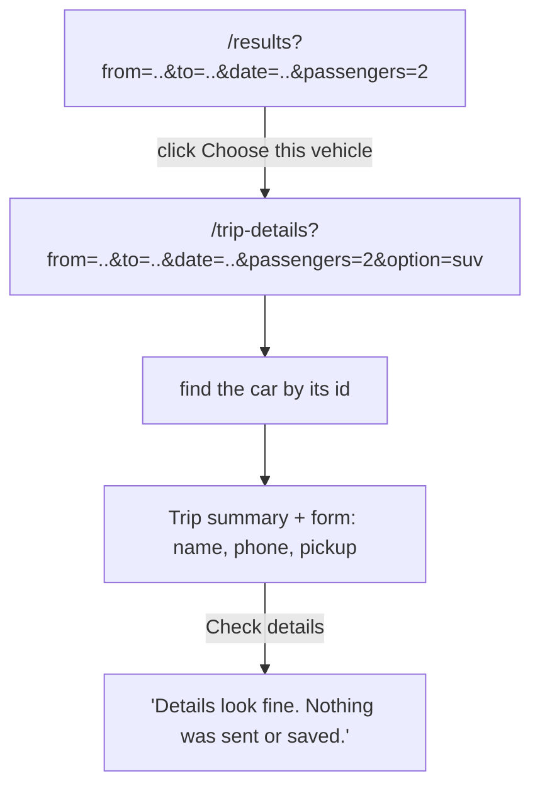

# Day 13: Trip details, the next step after choosing a car (3h)

**Goal:** choose a car on the results page, open a `/trip-details` page, and fill in a practice details form. Nothing is sent or saved.
**New today (max 2):** passing a choice to the next page in the URL; a form with several text fields.
**Reused:** `Link`, props, `useState` and controlled inputs (Day 9), `readSearchFromUrl`, `pickOptions`.
**Branch:** `day-13`, from `develop`.
**Time:** recall 10 min; sketch 15; build 80 min; checks 25; PR and notes 20; design 10; optional DSA 20 = 180 min.

**Prerequisite:** [Day 12](./day-12.md). Run commands inside `shubh-yatra-cabs`.

## Recall (10 min)
1. What is the difference between "no cars" and an error?
2. Why does `OptionCard` not look up its own price?
3. Which information must never go in a URL?

<details><summary>Answers</summary>

1. "No cars" is a normal result with zero matches. An error is something that broke.
2. The card only draws what it is given. The data and rules live elsewhere.
3. Names, phone numbers, addresses, passwords and secrets. URLs are saved in history and logs and can be shared.
</details>

## Picture: what travels in the URL, and what does not



- **In the URL:** the public search, plus which car was picked (`option=suv`).
- **Not in the URL:** the name, phone and address. They stay in the form, in the browser's memory.
- **Not in the URL:** the price. The page looks the price up again from the car list, so editing the URL cannot change it.

## Step 1: Branch and sketch (15 min)

```bash
git switch develop
git pull --ff-only
git switch -c day-13
```

Sketch the trip-details screen: a summary at the top, three fields, one button. Write down which values come from the URL and which the user types.

## Step 2: Give each card a link (15 min)

**What:** add a "Choose this vehicle" link to `OptionCard`.
**Why:** moving to another page is navigation, so use a link, not a button.
**How:** first the idea. A `Link` is a clickable address:

```tsx
import Link from "next/link";
<Link href="/trip-details?option=suv">Choose this vehicle</Link>
```

In `OptionCard.tsx`, take a new prop `href` and use it:

```tsx
import Link from "next/link";
// ...existing imports

export default function OptionCard({ option, href }: { option: CarOption; href: string }) {
  return (
    <article className="rounded-xl border border-slate-200 bg-white p-5 shadow-sm">
      {/* ...everything that was already inside the article... */}
      <Link href={href} className="mt-4 inline-block rounded bg-slate-900 px-4 py-2 text-white">
        Choose this vehicle
      </Link>
    </article>
  );
}
```

In `results/page.tsx`, build the address for each car. `searchToQuery(input)` already turns the search into URL text. We add the car's id:

```tsx
import { readSearchFromUrl, searchToQuery, type SearchQuery } from "@/lib/searchQuery";
```

```tsx
{options.map((option) => {
  const query = searchToQuery(input);          // from=..&to=..&date=..&passengers=..
  query.set("option", option.id);              // add option=suv
  return (
    <li key={option.id}>
      <OptionCard option={option} href={`/trip-details?${query.toString()}`} />
    </li>
  );
})}
```

Note the `{ ... return (...) }` block: when `.map` needs a few lines of work before it returns, use a block with `return`.

## Step 3: The trip-details page (30 min)

**What:** create `src/app/trip-details/page.tsx`.
**Why:** someone can open this address directly, so the page must find the car itself.
**How:** it reads the search, finds the car, and shows a summary. The `Suspense` part is the same wrapper as the results page. Copy that pattern.

```tsx
// WHAT: Show the chosen car and the details form.
// WHY: The URL can be edited, so the page looks the car up itself.
// HOW: Read the search -> find the car by id -> show summary and form.
import { Suspense } from "react";
import Link from "next/link";
import TripDetailsForm from "@/components/TripDetailsForm";
import { formatPrice } from "@/lib/format";
import { pickOptions, sampleOptions } from "@/lib/sampleOptions";
import { describeSearch } from "@/lib/search";
import { readSearchFromUrl, searchToQuery, type SearchQuery } from "@/lib/searchQuery";

type Props = { searchParams: Promise<SearchQuery> };

async function TripDetails({ searchParams }: Props) {
  const query = await searchParams;
  const input = readSearchFromUrl(query);

  // Cars that fit this group, then the one whose id is in the URL
  const options = pickOptions(sampleOptions, input.passengers);
  const optionId = typeof query.option === "string" ? query.option : "";
  const selected = options.find((option) => option.id === optionId);
  const backHref = `/results?${searchToQuery(input).toString()}`;

  if (!selected) {
    return (
      <p role="alert">
        Please choose a car that fits this group. <Link href={backHref}>Back to cars</Link>
      </p>
    );
  }

  return (
    <section>
      <h1 className="text-2xl font-bold">Trip details</h1>
      <p>{describeSearch(input)}</p>
      <p>{selected.name}, sample price {formatPrice(selected.priceInr)}</p>
      <p className="my-4">Practice only. This does not book a car.</p>
      <TripDetailsForm />
      <Link href={backHref} className="mt-6 inline-block underline">Back to cars</Link>
    </section>
  );
}

export default function TripDetailsPage(props: Props) {
  return (
    <main className="mx-auto max-w-3xl px-6 py-16">
      <Suspense fallback={<p role="status">Reading trip details...</p>}>
        <TripDetails {...props} />
      </Suspense>
    </main>
  );
}
```

Read the new line `options.find(...)`:
- `.find` returns the **first** car where the test is true, or `undefined` if there is none.
- We search the cars that **fit the group**, not the whole list. A made-up id, or a car that is too small, finds nothing, and the page asks the user to choose again.

If something throws unexpectedly, you can copy Day 12's `error.tsx` into `src/app/trip-details/`. Change the heading text.

## Step 4: The details form (35 min)

**What:** create `src/components/TripDetailsForm.tsx`.
**Why:** practice a form with several text fields, using the same controlled-input pattern as Day 9.
**How:** first, the pattern in one field:

```tsx
const [name, setName] = useState("");
<input value={name} onChange={(event) => setName(event.target.value)} />
```

The component keeps all three fields in **one object**, like the search form:

```tsx
// WHAT: A practice form for name, phone and pickup address. Nothing is sent or saved.
// WHY: Practice controlled text fields and simple checks.
// HOW: One state object for the values, one for the error messages, check on submit.
"use client";

import { useState } from "react";

type Details = { name: string; phone: string; pickup: string };
type DetailsErrors = Partial<Record<keyof Details, string>>;

const emptyDetails: Details = { name: "", phone: "", pickup: "" };

// true when every character is 0-9
function onlyDigits(text: string): boolean {
  for (const character of text) {
    if (character < "0" || character > "9") return false;
  }
  return true;
}

function checkDetails(details: Details): DetailsErrors {
  const errors: DetailsErrors = {};
  if (details.name.trim().length < 2) errors.name = "Please enter your name.";
  if (details.phone.length !== 10 || !onlyDigits(details.phone)) {
    errors.phone = "Enter a 10-digit mobile number.";
  }
  if (details.pickup.trim().length < 10) errors.pickup = "Please enter a fuller pickup address.";
  return errors;
}

export default function TripDetailsForm() {
  const [details, setDetails] = useState<Details>(emptyDetails);
  const [errors, setErrors] = useState<DetailsErrors>({});
  const [checked, setChecked] = useState(false);

  function change(field: keyof Details, value: string) {
    setDetails({ ...details, [field]: value });   // copy, then replace one field
    setErrors({});
    setChecked(false);
  }

  function handleSubmit(event: React.FormEvent<HTMLFormElement>) {
    event.preventDefault();                       // no page reload
    const found = checkDetails(details);
    setErrors(found);
    setChecked(Object.keys(found).length === 0);
  }

  return (
    <form onSubmit={handleSubmit} noValidate className="mt-6 space-y-4">
      <div>
        <label htmlFor="name">Name</label>
        <input id="name" value={details.name} onChange={(e) => change("name", e.target.value)}
          className="mt-1 block w-full rounded border p-3" />
        {errors.name && <p className="text-red-700">{errors.name}</p>}
      </div>
      <div>
        <label htmlFor="phone">Mobile number (10 digits)</label>
        <input id="phone" type="tel" value={details.phone} onChange={(e) => change("phone", e.target.value)}
          className="mt-1 block w-full rounded border p-3" />
        {errors.phone && <p className="text-red-700">{errors.phone}</p>}
      </div>
      <div>
        <label htmlFor="pickup">Pickup address</label>
        <textarea id="pickup" rows={3} value={details.pickup} onChange={(e) => change("pickup", e.target.value)}
          className="mt-1 block w-full rounded border p-3" />
        {errors.pickup && <p className="text-red-700">{errors.pickup}</p>}
      </div>
      <button type="submit" className="rounded bg-slate-900 px-4 py-3 text-white">
        Check details
      </button>
      {checked && <p role="status">Details look fine. Nothing was sent or saved.</p>}
    </form>
  );
}
```

Read the new pieces:
- `change("name", value)` is the same trick as Day 9: `{ ...details, [field]: value }` copies the object and replaces one key chosen by the variable `field`.
- `onlyDigits` goes through the text one character at a time. `"5" >= "0" && "5" <= "9"` is true. A letter fails.
- `.trim()` removes spaces at the ends, so `"   "` does not count as a name.
- A phone number is **text**, not a number. Use `type="tel"`, never `type="number"`, because numbers lose leading zeros and show spin arrows.
- This phone rule is only for practice. Real phone checks need to handle other countries and confirm the phone really works.

## Step 5: Check it (25 min)

```bash
npm run lint
npm run typecheck
npm run build
npm run dev
```

1. Choose a car. The address becomes `/trip-details?...&option=...`.
2. Refresh the page. The same car still shows.
3. Change `option=` in the URL to nonsense, or pick a car too small for the group: the page asks you to choose again.
4. Add `&price=1` to the address. The shown price does not change.
5. Submit the empty form: a message under each field.
6. Fill in made-up details in the right format: "Nothing was sent or saved."
7. Type in a field after a success: the success message disappears.
8. Look at the address bar and the Network tab: no name, phone or address anywhere.

Use made-up details only.

## Break it on purpose (5 min)
- Remove `event.preventDefault()`: the page reloads on submit. Put it back.
- Search the whole car list instead of `options`: a too-small car can be chosen. Put it back.
- Change `.length !== 10` to `=== 10`: the phone rule reverses. Put it back.

## Common errors
- `Cannot read properties of undefined`: `selected` was not found. Check you return early when `!selected`.
- Typing in a field does nothing: the input needs both `value` and `onChange`.
- After clicking a car you are asked to choose a car again: confirm the link includes the four search values and `option=`. Look at `searchToQuery`.

## Finish (20 min)
- [ ] The chosen car still works after a refresh or when the address is opened directly.
- [ ] Private details never appear in the address bar.
- [ ] Labels are connected to inputs, and the form can be submitted with the keyboard.
- [ ] No message says "booked" or "confirmed". Lint, typecheck and build pass.

```bash
git add src
git commit -m "Day 13: choose a car and fill a practice details form"
git push -u origin day-13
```

PR into `develop`, wait for CI, merge. Write `docs/day-13.md`: what travels in the URL versus what stays in the form, and what is lost when you refresh.

## System design corner (10 min): Where does each piece of data live?
- **In the URL:** public choices, easy to share and to refresh.
- **In browser memory (state):** a temporary private draft. It is lost on refresh.
- **On the server (a database):** the real booking. Later lessons add it, together with the questions of who may read it and how long you keep it.

## DSA (optional, 20 min): Climbing Stairs
You can climb 1 or 2 steps at a time. Write `climbStairs(n: number): number`, the number of ways to reach step `n`.
- `ways(0) = 1`, `ways(1) = 1`. After that, each value is the sum of the previous two.
- `n=2` gives 2, `n=3` gives 3, `n=5` gives 8.
- O(n) time with two running values.

## Interview Q&A
1. **Why use a `Link` rather than a button to go to the next page?** A link is real navigation: it works with the keyboard, can open in a new tab and can be shared.
2. **Why check the car again on the details page?** The address can be edited, so the page cannot trust it.
3. **Why not put the price in the URL?** Anyone can change it. The price is looked up from our own data.
4. **Behavioral:** Describe a time you left a feature deliberately simple, and how you made that clear to users.

Next: [Day 14](./day-14.md).
