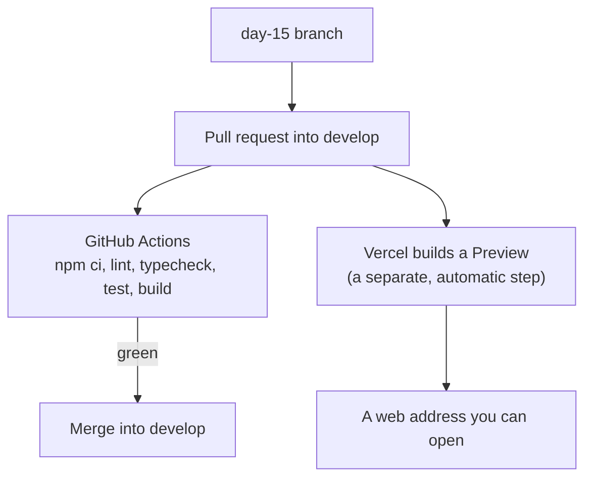

# Day 15: Review day: run the tests on every pull request, and put the app online (3h)

**Goal:** have GitHub run your checks automatically on every pull request, and see your app on a real web address (a Vercel "preview").
**New today (max 2):** CI running the tests; a preview deployment.
**Reused:** Git branches, GitHub Actions (Day 4), npm scripts, tests (Day 14).
**Branch:** `day-15`, from `develop`.
**Time:** recall 10 min; rebuild from memory 20; CI 30; Vercel 35; browser checks 25; checkpoint 20; notes and PR 15; design 10; optional DSA 15 = 180 min.

**Prerequisite:** [Day 14](./day-14.md). The app still uses sample data. There are no real bookings, payments or customer records.

## Recall (10 min)
1. Why does the pipeline use `npm ci` instead of `npm install`?
2. What is the difference between running tests and running a build?
3. Why might an app pass tests on your laptop and still break online?

<details><summary>Answers</summary>

1. `npm ci` installs exactly what the lockfile says, so every run is the same.
2. Tests check rules. A build checks that the app can be put together to run.
3. Your laptop and the server can differ: settings, folders, versions.
</details>

## Picture: checking is not the same as deploying



The two boxes after "Pull request" run **independently**. A preview address existing does **not** mean the tests passed. Always look at the green or red mark from GitHub.

## Step 1: Branch and rebuild from memory (20 min)

```bash
git switch develop
git pull --ff-only
git switch -c day-15
```

Without looking, write a test for "a car with exactly enough seats is included", then compare it to Day 14.

Then draw, from memory: form, URL, results page, chosen car, details form. For each part, mark whether it runs in the **browser** or on the **server**.

## Step 2: Run the tests in CI (30 min)

**What:** add the test and typecheck commands to your existing workflow file.
**Why:** tests nobody runs protect nothing. This makes GitHub run them for you.
**How:** open `.github/workflows/ci.yml`. Keep everything already there (checkout, Node setup, triggers). Make the commands list look like this:

```yaml
      - run: npm ci
      - run: npm run lint
      - run: npm run typecheck
      - run: npm test
      - run: npm run build
```

Each line is a step. If one fails, the steps after it do not run and the whole check goes red.

**Where the file lives.** Run `git rev-parse --show-toplevel`.
- If it prints your **app folder**, `.github/workflows/ci.yml` goes inside it. Nothing else to change.
- If it prints a **bigger folder** that holds the whole course (the app is in a subfolder called `shubh-yatra-cabs`), the workflow must live in `.github/workflows/` at that top folder. Add this under the `jobs:` entry for your job:
  ```yaml
      defaults:
        run:
          working-directory: shubh-yatra-cabs
  ```
  and add `cache-dependency-path: shubh-yatra-cabs/package-lock.json` under `with:` for the Node setup step.

Do not change the versions of the actions in this lesson. Only add the two lines.

### Prove the check really works
1. Push the branch and open a pull request into `develop`.
2. On the branch, change one expected value in a test to something wrong, commit and push.
3. On the pull request, look at the checks. The `npm test` step must go **red**.
4. Fix the test, commit and push. The check goes **green**.
5. Never merge while it is red.

**Optional, if your plan allows:** in the repository's Settings, add a rule for `develop` and `main` that requires this check to pass before merging. If the option is not available, just write that in your notes. Do not claim merges are blocked if they are not.

## Step 3: Put it online with a Vercel preview (35 min)

**What:** connect the repository to Vercel.
**Why:** the app runs on a real web address, outside your laptop.
**How:**
1. Sign in to Vercel and choose **Add New, Project**. Import the GitHub repository that holds the app.
2. The framework should be detected as **Next.js**.
3. **Root Directory:** leave it as is if the repository is only the app. If the repository is the whole course, choose the `shubh-yatra-cabs` folder.
4. Leave the build command at its default (`npm run build`).
5. Keep **`main`** as the production branch. Other branches, like `day-15` and `develop`, produce **Preview** addresses.
6. After the first deploy, push a change on your branch or open the pull request. Vercel adds a **Preview** link to it. Open that link.

The first deploy may be labeled Production. That is normal for the first import. What you need to test is the **Preview** for your branch.

No secrets and no database are used this week, so there is nothing to add under Environment Variables. **Never** put secret keys in code or in variables that start with `NEXT_PUBLIC_`; those are visible to everyone.

Vercel may ask you to sign in to see the preview. That is fine.

## Step 4: Check the preview (25 min)

Use made-up details only. Try it on a computer and on your phone.

| Try this | Expected |
|---|---|
| Open the home page | Header, form and routes show |
| Search with an empty form | A message under each field, no new page |
| A valid future search | The address becomes `/results?...` and cars show |
| Refresh the page, or open the address in a new tab | Same search, same cars |
| Choose a car | The details page shows it, with the same price |
| Edit the address to a nonsense car or city | A helpful message, no crash |
| Submit the empty details form | Messages under the fields |
| Submit made-up valid details | "Nothing was sent or saved." |
| Look at the address bar | No name, phone or address in it |

Open the browser console and look for red errors. Do not push the deliberate errors from Day 12 to a shared preview.

## Week 3 checkpoint (20 min, no notes first)
1. Why does one function check the search for both the form and the results page?
2. Why is the form's check not enough on its own?
3. What is the difference between an invalid search, "no cars" and an error?
4. Why is a sample price not a real price?
5. Why keep names and phone numbers out of the URL?
6. Why test the case "exactly enough seats"?
7. What does CI do for you?
8. Is a preview address proof that the tests passed?

<details><summary>Answers</summary>

1. So the two can never disagree, and a change is made once.
2. A browser can be changed or bypassed. The server must check again.
3. Invalid: the input is wrong. No cars: a normal result with zero matches. Error: something broke.
4. It is a placeholder, not a quote from a real price list.
5. URLs are saved in history and logs and can be shared.
6. It catches `>` versus `>=`.
7. It runs the checks the same way on every pull request, so nobody has to remember.
8. No. Vercel and GitHub run separately.
</details>

Update Week 3 in [the tracker](./learning-progress-and-interview-tracker.md). Add any question you missed twice to [review cards](./review-and-recall.md).

## Break it on purpose (5 min)
You already did the main one: a test that fails in CI. Optional extra: in a scratch branch, remove `npm ci` and use `npm install`, and read what changes.

## Common errors
- CI says `package.json not found`: the workflow is looking in the wrong folder. See "Where the file lives" in Step 2.
- `npm ci` complains about the lockfile: run `npm install` on your machine, commit the updated `package-lock.json`, push again.
- CI hangs on tests: it must call `npm test` (which runs once and stops), not the watch command.
- The check never appears on the pull request: confirm the workflow is in `.github/workflows/` at the top folder of the repository, and that it runs on `pull_request`.
- The preview shows a 404 on a page you open directly: read the Vercel build log. Check the page's folder and file names.
- Vercel is green but GitHub is red: this can happen because they run separately. Fix the red one before you merge.

## Finish (15 min)
- [ ] You saw a failing test turn the check red, and then fixed it.
- [ ] The latest commit on the pull request is green.
- [ ] A Preview address works, including opening a deep address directly, on your phone as well.
- [ ] No real customer data, secrets or deliberate errors anywhere.
- [ ] Week 3 checkpoint done.

```bash
git add .github/workflows/ci.yml
git commit -m "Day 15: run typecheck and tests in CI"
git push -u origin day-15
```

(If the workflow is at the top folder of a larger repository, add that file from there.)

Merge the green pull request into `develop`. Write `docs/day-15.md`: your Preview address, what you checked, what the CI failure drill showed, and one thing you want to revisit. Do not write secrets in notes.

## System design corner (10 min): Preview versus production
A **preview** is a copy of the app to look at and test. **Production** is the one real customers use. It needs careful settings, real data, monitoring and a way to roll back. Moving to production should be a decision you make on purpose, not "the preview looked fine once".

## DSA (optional, 15 min): Two Sum II
Write `twoSumSorted(values: number[], target: number): [number, number] | null`. It gets a **sorted** list and returns the positions (counting from 0) of two numbers that add up to `target`.
- Put one pointer at each end. If the sum is too small, move the left pointer right. If it is too big, move the right pointer left.
- `[2, 7, 11, 15]` with target `9` gives `[0, 1]`.
- `[1, 2, 3]` with target `20` gives `null`.
- O(n) time.

## Interview Q&A
1. **Why run tests in CI?** Everyone's changes are checked the same way, every time.
2. **Preview versus production?** A preview is for checking a change. Production is the live app for customers.
3. **Does a deployed preview prove the tests passed?** No. Look at the CI result separately.
4. **Behavioral:** Describe a problem you found after deploying, how you found the cause, and the fix.

## Next week
Day 16 starts databases and Supabase (SQL). Keep the app in demo mode until real prices, booking creation on the server and staff access are built. The rest of the plan is in [the roadmap](./reference-and-roadmap.md).
