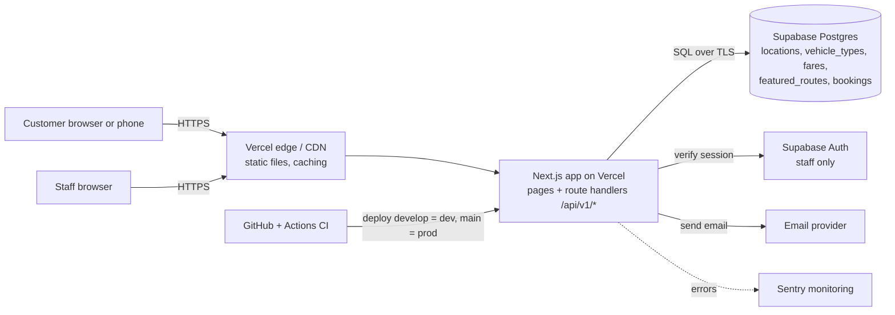
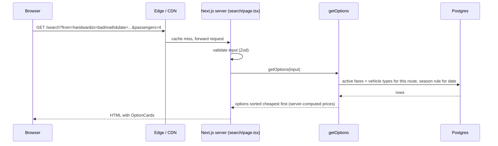
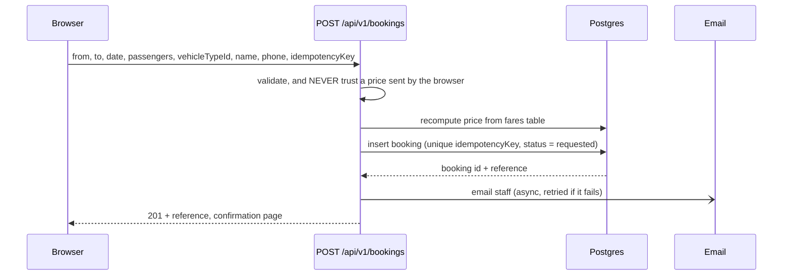
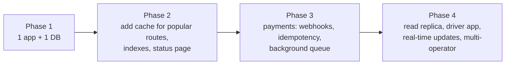

# System design, DSA and interview track

This runs alongside the build. Every day file ends with two short extra blocks:
- **System design corner (10 min, reading and talking, no new code):** one concept, tied to something you just built.
- **DSA of the day (15–20 min):** one interview question, solved in `sandbox/dsa/day-XX.js`, tied to the project where possible.

These blocks do not count toward the "max 2 new ideas per day" rule, because they reuse what you built that day. If a day runs over 3 hours, skip DSA first and keep the system design corner.

## 1. The system we are building (flow diagram)

### 1a. Big picture (Phase 1)

### 1b. One request, end to end (customer search)

### 1c. Booking request (write path, the part that must not be wrong)

### 1d. How it would grow (talk through this at Day 40)

## 2. Back-of-envelope numbers (so you can reason about scale)
Placeholder assumptions for one regional operator:
- 2,000 visitors/day, 10 searches each → 20,000 searches/day ≈ 0.25 searches/second on average. Peak (season morning) maybe 20x → about 5/second.
- 50 booking requests/day. Writes are tiny compared with reads.
- Fare table: ~30 locations × ~200 routes × ~5 vehicle types ≈ 1,000 rows. It fits in memory, so caching is easy and the database is not the bottleneck.
- Conclusion: one app and one Postgres are enough for a long time. The skill is knowing *what would break first* and when.

## 3. Day-by-day plan: system design concept + DSA question
"DSA" = data structures and algorithms. Each question links to the project so it sticks.

| Day | System design concept | DSA question (pattern) | Project link |
|---|---|---|---|
| 1 | Client–server model; environments (dev vs prod); what CI/CD does | Two Sum (hash map) | Look up a location by slug in O(1) |
| 2 | Rendering: server vs browser, static files and CDN | Valid Parentheses (stack) | Your `</main>` break-it exercise: tags must match |
| 3 | HTTP request/response; GET and the query string | Contains Duplicate (set) | Duplicate cities in the dropdown |
| 4 | Data modelling: money as integers, formatting at the edge | Group Anagrams (hash map grouping) | Group routes by starting city |
| 5 | Where logic lives (server vs browser); pure functions; Big-O | Top K Frequent Elements (count, then sort) | Most-searched routes |
| 6 | Types as contracts between parts of a system | Best Time to Buy and Sell Stock (one pass) | Cheapest fare vs date |
| 7 | Component tree, separation of concerns | Maximum Depth of Binary Tree (recursion) | Nested components |
| 8 | Client state vs server state | Min Stack | Undo in a form |
| 9 | Validate at the boundary | Implement Trie | Autocomplete for locations |
| 10 | URL as state; stateless HTTP | Binary Search | Find a location in a sorted list |
| 11 | Never trust the client | Valid Palindrome (normalise input) | Cleaning phone numbers |
| 12 | Failure states, graceful degradation | Merge Sorted Array | Merge results from two sources |
| 13 | Multi-step flows and session state | Climbing Stairs (intro to DP) | Counting step combinations |
| 14 | Testability; the test pyramid | Move Zeroes (two pointers) | Filtering in place |
| 15 | CI/CD, preview environments | Two Sum II (two pointers) | Pair of cars for a big group |
| 16 | Relational model, primary and foreign keys | SQL: Combine Two Tables | JOIN fares and locations |
| 17 | Normalisation, migrations, schema evolution | SQL: Second Highest Salary | Second-cheapest fare |
| 18 | Caching and read-heavy workloads | LRU Cache | Cache popular-route prices |
| 19 | REST design, status codes, versioning `/v1` | Logger Rate Limiter | Limit repeated searches |
| 20 | Environments, config and secrets (12-factor) | Insert Delete GetRandom O(1) | Fast lookup and removal |
| 21 | Idempotency, double-submit, unique IDs | Encode and Decode TinyURL | Booking reference generator |
| 22 | URL design, dynamic routes | Longest Substring Without Repeating Characters | Slug rules |
| 23 | Authentication: sessions vs tokens, cookies | Linked List Cycle (fast and slow pointers) | Detect a redirect loop |
| 24 | Authorization: roles, RLS | Binary Tree Level Order Traversal | Role hierarchy |
| 25 | Pagination, filtering, indexes | Sort Colors (in-place partition) | Group bookings by status |
| 26 | State machines, transactions, consistency | Course Schedule (graph, topological order) | Valid status transitions |
| 27 | CRUD, cache invalidation, audit log | Find All Duplicates in an Array | Detect duplicate fare rows |
| 28 | Async work, queues, retries, third-party failure | Task Scheduler | Email retry queue |
| 29 | Time zones, data-driven rules | Merge Intervals | Overlapping peak-season rules |
| 30 | Coupling and cohesion | Meeting Rooms II | Overlapping bookings per car |
| 31 | Rate limiting, defence in depth | Design Hit Counter (sliding window) | Rate-limit the booking endpoint |
| 32 | Observability: logs, metrics, traces | Subarray Sum Equals K (prefix sums) | Error spikes in a time window |
| 33 | CDN, Core Web Vitals, performance budgets | Container With Most Water (two pointers) | Optimising a scan |
| 34 | Testing the whole system (E2E) | Spiral Matrix | Systematic traversal |
| 35 | Capacity estimation (buffer day) | Re-solve your weakest earlier problem | Gaps first |
| 36 | Deployment strategies, safe migrations, rollback | Design Browser History | Version history and rollback |
| 37 | DNS, TLS, domains, cost | Longest Common Prefix | Domain and URL matching |
| 38 | Availability, backups, RPO and RTO | Kth Largest Element in a Stream | Slowest-request monitoring |
| 39 | Requirements, acceptance and trade-offs | Valid Sudoku | Checklist validation |
| 40 | Full design walkthrough and scaling by 100x | LRU Cache again, from memory | Mock interview day |

## 4. System design interview questions (answer aloud first)
Rotate through these. The first four are answerable by the end of Week 4. All of them by Day 40.

1. **Design this cab search and booking system.** Sketch the diagrams in section 1 from memory, then explain the read path, the write path and the data model.
   *Answer outline:* clients → CDN → app → Postgres. Read path: validate, fetch fares, filter by seats, apply season rule, sort. Write path: server recomputes price, inserts a booking with an idempotency key, emails staff asynchronously. State assumptions (traffic numbers) first.
2. **Why compute prices on the server?** The browser is controlled by the user, so anything it sends can be changed. The server is the only place you can trust.
3. **What happens if a user double-clicks "Submit"?** Without protection you get two bookings. Fix: disable the button for UX, plus a unique idempotency key in the database so a repeat returns the first result.
4. **How would you cache the popular-route prices?** Read-heavy, rarely changing data. Cache in the server or at the edge with a short time-to-live, and invalidate when staff edit fares. Trade-off: stale price for a short time vs load on the database.
5. **What breaks first at 100x traffic?** The database connection pool and slow queries (missing indexes), before CPU. Fixes in order: indexes, connection pooling, caching, read replica, queue for slow side-effects (email).
6. **How do you keep staff-only pages safe?** Authentication (who are you) in a session cookie, authorization (what can you do) by role, enforced on the server and in the database with row-level security. Hiding a button is not security.
7. **How do you add payments later?** A payment provider webhook, verified by signature, handled idempotently, updating the booking through a state machine (requested → confirmed → paid or cancelled).
8. **SQL or NoSQL here?** SQL. The data is relational (routes, fares, bookings), needs constraints and transactions, and the volume is small.
9. **How do you deploy without downtime and roll back?** Preview deploys, CI gates, backward-compatible migrations, promote the same build to production, and keep the previous deployment so you can switch back in minutes.
10. **How would you monitor it?** Error tracking (Sentry), uptime check, logs with a request ID, and alerts on error rate. Define what "healthy" means, such as 99.5% of searches under 1 second.

## 5. DSA problem approach (use every time)
1. Restate the problem and give one example in your own words.
2. Brute force first, say its time and space cost (Big-O).
3. Find the bottleneck, then name the pattern (hash map, two pointers, stack, sliding window, sort).
4. Code it with clear names, then test an empty input, one item, duplicates and a large input.
5. Say the final time and space complexity out loud.

## 6. Full-stack interview Q&A
Every day file keeps its own "Interview Q&A" with answers. From Day 6 on, each day has at least 6 questions with short answers, grouped as: language and framework, web and HTTP, data and SQL, system design, and one behavioural question about what you built that day.
